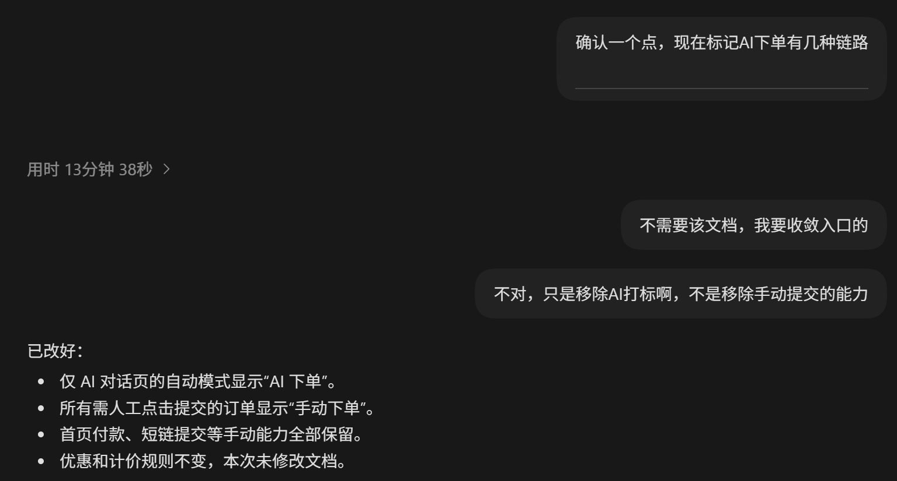
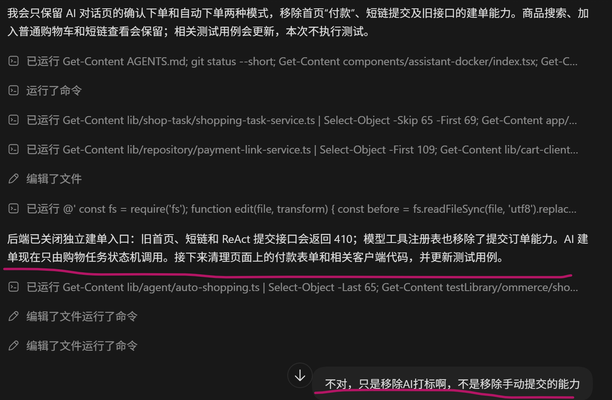

# AI 协作记录

> 说明：实际过程中调试了很多次才最终确定当前方案，以下只是其中很少一部分。

## 一、AI 把“收敛标记”误解为“删除入口”

我要求收敛“AI 下单”的标记范围，agent 却将首页付款、短链提交等能力一起移除。我发现后明确补充：只调整订单标记，手动提交能力必须保留。随后撤回了误改，并统一为“只有 AI 对话页自动模式算 AI 下单”。

这让我意识到，涉及业务入口的修改，需要明确区分“改变分类口径”和“删除功能”。

## 二、意图识别调试

### 1. 商品意图识别不能靠不断补关键词规则

我发现，输入“我想买大容量充电宝，支持快充的”时，系统无法识别到目录中的“輕量行動電源 10000mAh”。我继续追问：用户输入是无穷无尽的，难道只能逐个适配？这让讨论从修一个关键词，转向通用的意图识别方案：精确规则处理高确定性命令，对话上下文处理补充条件和指代，大模型兜底理解复杂请求。

这里还需要区分“明确条件”和“模糊偏好”：“支持快充”可以结合目录证据核实，“大容量”却不能直接等同于某个容量门槛。我的判断是，agent 可以负责抽取与核实，但缺少标准时应向用户澄清，不能替用户确定购买条件。

### 2. 模块写出来，不代表各个入口已经接上同一套流程

我检查代码时，指出 `light-router.ts` 应复用项目已有的全局 LLM 封装，不需要再写一套调用逻辑；随后又发现 `search-products-agent.ts` 的搜索入口没有接入前面讨论的三层识别，仍直接进入最后一层模型解析，因此要求统一入口。

之后，我继续检查 `measurement.ts`、`search-constraints.ts` 和旧 fallback 提词逻辑中的重复匹配，要求 agent 扩大检索范围再整理。这让我意识到，审核 AI 生成的架构不能只看新增模块是否齐全，还要沿真实调用链检查：入口是否统一、公共能力是否复用、旧路径是否仍在运行。

### 3. 拆分文件之后，还要检查迁移残留的字段和契约

`lib/intent/index.ts` 变长后，我要求按功能拆分，agent 将路由、模型调用、Schema、提示词和意图工具拆到独立文件。但拆分完成并不代表清理完成：我随后指出，`intent.specTerms` 在归一化后恒为空，后面却还保留着读取、合并和摘要逻辑，属于旧逻辑残留。

我要求继续审核并删除同类多余字段及相关测试。agent 随后清理了 `specTerms` 的整条链路、与 `routing` 重复的 `searchMode`、无独立合并行为的 `operation`，以及无人读取的会话字段和无调用方的兼容入口。这次经历让我把“按职责拆分”和“确认字段仍有实际用途”分成了两项检查；类型检查通过，也不能证明业务字段不是死逻辑。

## 三、核心功能核对

### 1. 发现购物车勾选结算功能缺失

我检查购物车时发现，原有 checkbox 勾选结算功能不见了。要求 agent 排查后，确认不仅页面缺少复选框，后端也按整车商品报价和下单。修复时要求前后端一起恢复，确保只结算勾选商品，未勾选商品保留。

这说明验收不能只看页面控件，还要检查实际提交的数据范围。

### 2. 优惠金额正确，不代表使用规则正确

我重新核对 A、B、C 优惠的消费方式，发现 A 虽然能计算满减，却没有“一次使用后失效”的限制；C 也按购物车来源判断，与最新 AI 下单口径不一致。随后要求补齐历史使用检查、下单核销和自动任务资格校验。

这让我认识到，优惠功能需要同时验证金额、适用资格和使用次数。

## 四、Agent 错误

### 1. 购物车数据存 localStorage，退出登录后仍可见

问题：购物车数据存在 localStorage，退出登录后依然存在，未登录用户也能看到购物车数据。

处理思路：先排查 AI 为什么这么实现，避免遗漏业务逻辑；确认删除不影响其他模块后，再去掉相关逻辑。

1. 排查原因

   > 现在购物车还会读 localStorage 吗，为什么这么设计？

2. 确认无影响后移除

   > 请彻底排查购物车用 localStorage 这部分逻辑，请全部去掉，不要两个共存，全部采用数据库读取。现在用户不登录都能看到购物车数据，不需要。

## 五、未交给 Agent 的部分

- 文件拆分
- 接口请求封装
- UI 调试
