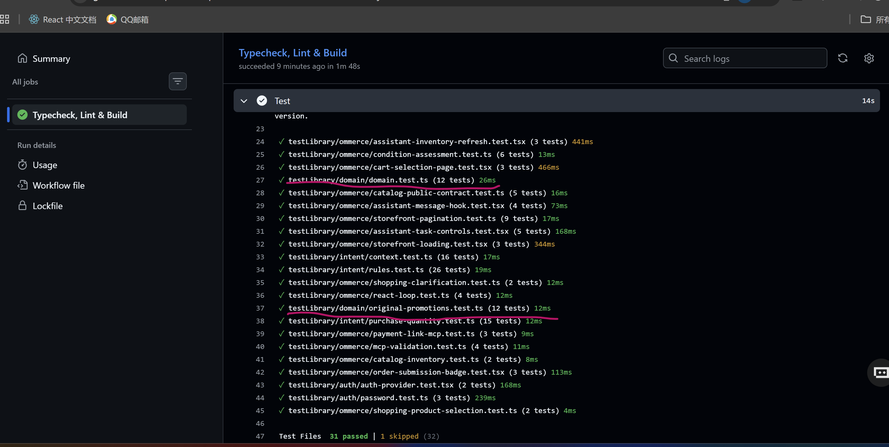
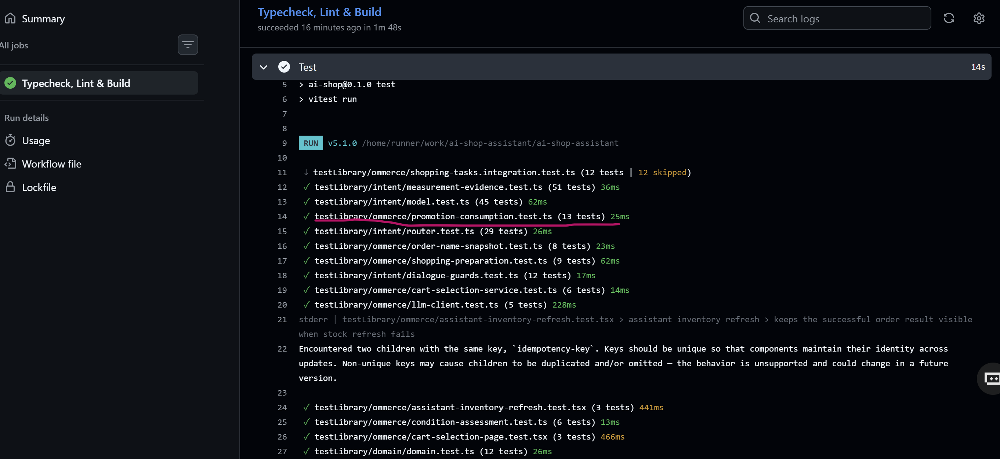

# GitHub Actions 与统一价格计算验证

本交付说明对应以下两项要求：自动化测试在 GitHub Actions 中执行；价格计算只有一份实现，网页与 Agent 接口共用同一套逻辑。

## 一、CI 执行配置

工作流文件：[`.github/workflows/ci.yml`](../.github/workflows/ci.yml)。

| 项目 | 当前配置 |
| --- | --- |
| 工作流名称 | `CI` |
| 运行环境 | `ubuntu-latest`，Node.js 22 |
| 触发方式 | 向 `main`、`dev` 分支推送代码，或创建/更新以这两个分支为目标的 Pull Request |
| 依赖安装 | `npm ci`，使用仓库中的 `package-lock.json` |
| 检查顺序 | Typecheck → Test → Lint → Build |
| 测试命令 | `npm test`，实际执行 `vitest run` |
| 任务超时 | 15 分钟 |

测试脚本定义在 [`package.json`](../package.json)，测试发现规则定义在 [`vitest.config.mts`](../vitest.config.mts)，会扫描 `*.test.ts` 和 `*.test.tsx`。虽然 GitHub 页面中的 Job 名称是 `Typecheck, Lint & Build`，其内部也包含独立的 `Test` 步骤。

## 二、价格计算只有一份实现

价格规则集中在 [`lib/pricing-domain.ts`](../lib/pricing-domain.ts) 的 `calculateBestQuote()`，统一计算满减、运费、AI 折扣及最终金额。`toMinor()` 和 `lineSubtotalMinor()` 负责统一金额单位转换与商品行小计，金额以整数“分”处理。

网页和 Agent 的入口负责认证、参数校验与来源区分，再调用同一报价服务，不各自维护一套优惠公式：

```text
网页报价接口 ─────────────────────────┐
                                    ├→ quoteCart() → calculateBestQuote()
Agent 报价接口 → commerce.quote_cart ─┘                     │
                                                           ▼
                                           商品小计 / 优惠 / 运费 / 总额
```

| 职责 | 实现位置 |
| --- | --- |
| 网页报价入口 | [`app/api/v1/carts/quote/route.ts`](../app/api/v1/carts/quote/route.ts) |
| Agent 报价入口 | [`app/api/v1/assistant/cart/quote/route.ts`](../app/api/v1/assistant/cart/quote/route.ts) |
| Agent 交易工具转发 | [`lib/mcp/commerce-server.ts`](../lib/mcp/commerce-server.ts) |
| 共用报价服务 | [`lib/repository/quote-service.ts`](../lib/repository/quote-service.ts) 的 `quoteCart()` |
| 唯一计价规则实现 | [`lib/pricing-domain.ts`](../lib/pricing-domain.ts) 的 `calculateBestQuote()` |
| 优惠资格查询 | [`lib/repository/promotion-eligibility.ts`](../lib/repository/promotion-eligibility.ts) |
| 下单前再次验证 | [`lib/repository/order-service.ts`](../lib/repository/order-service.ts) 的 `assertQuotePromotions()` |

下单时会再次调用同一个 `calculateBestQuote()`，校验报价版本、优惠资格和金额是否仍然一致。这是复用同一实现，不是复制另一套计价逻辑。前端和 Agent 消费服务端报价，不自行决定满减门槛、运费或折扣叠加顺序。

共用价格逻辑不代表网页订单与 Agent 订单的金额必须相同：来源、账号满减使用情况和服务端自动任务资格作为输入不同，结果可以不同，但计算规则来自同一个函数。

## 三、价格相关自动化测试

| 测试文件 | 覆盖内容 | 截图中的结果 |
| --- | --- | --- |
| [`testLibrary/domain/domain.test.ts`](../testLibrary/domain/domain.test.ts) | 金额单位转换、商品行小计、免运门槛、满减、AI 折扣、非法输入及规则版本；该文件同时包含库存领域用例 | 12 条通过，包含价格与库存用例 |
| [`testLibrary/domain/original-promotions.test.ts`](../testLibrary/domain/original-promotions.test.ts) | A/B/C 门槛和叠加、分单位金额、A 已使用后的处理、手动 AI 来源不享受 C、自动任务资格 | 12 条通过 |
| [`testLibrary/ommerce/promotion-consumption.test.ts`](../testLibrary/ommerce/promotion-consumption.test.ts) | WEB/AI 报价复用、账号优惠资格、仅报价不核销、下单时资格重校验、任务绑定、失败回滚、旧规则报价失效及同键重试 | 13 条通过，数据库依赖使用 mock |

以下为当前实现的代表性金额断言，单位为新台币：

| 场景 | 商品小计 | 优惠 | 运费 | 最终金额 |
| --- | ---: | ---: | ---: | ---: |
| 网页订单，未达免运门槛 | 989.99 | 0 | 100 | 1,089.99 |
| 网页订单，达到免运门槛 | 990 | 0 | 0 | 990 |
| 网页订单，账号仍可使用 A | 1,000 | 100 | 0 | 900 |
| AI 自动任务订单，账号仍可使用 A 且符合 C | 1,000 | 145 | 0 | 855 |
| AI 来源但手动提交，账号仍可使用 A | 1,000 | 100 | 0 | 900 |
| 网页订单，账号已经使用过 A | 1,000 | 0 | 0 | 1,000 |

这些断言验证当前代码口径。优惠使用次数、适用范围及叠加顺序的业务确认状态仍以 [DECISIONS.md](./DECISIONS.md) 为准；未确认规则标记为 `needs_human_review`，CI 通过不代表业务口径已经获得批准。

## 四、执行记录与验证范围

下方两张截图展示 GitHub Actions 中该次运行的 `Test` 日志：

- Job 状态为 `succeeded`，`Test` 步骤显示成功，执行命令为 `vitest run`。
- 测试文件汇总为 **31 passed / 1 skipped，共 32 个文件**。
- 三份价格相关测试文件均有通过记录，具体条数见上表；不能把包含库存用例的整个文件都计作价格用例。
- `shopping-tasks.integration.test.ts` 的 **12 条真实 MySQL 任务集成用例被跳过**。该测试文件需要显式设置 `SHOPPING_TASK_DB_TEST=1` 才会执行，当前工作流未开启，不能将其计入已执行通过的范围。

查看原始记录时，在仓库的 **Actions → CI → 对应运行 → Typecheck, Lint & Build → Test** 中展开日志，并在运行摘要核对对应 commit。截图记录的是该次运行的结果，后续代码修改需要对应新的 CI 结果。

当前证据支持“测试已在 GitHub Actions 执行”和“网页与 Agent 共用统一计价实现”。它不等同于真实数据库并发、真实模型或浏览器端到端测试已全部完成；本节也不涉及支付测试。

测试截图


