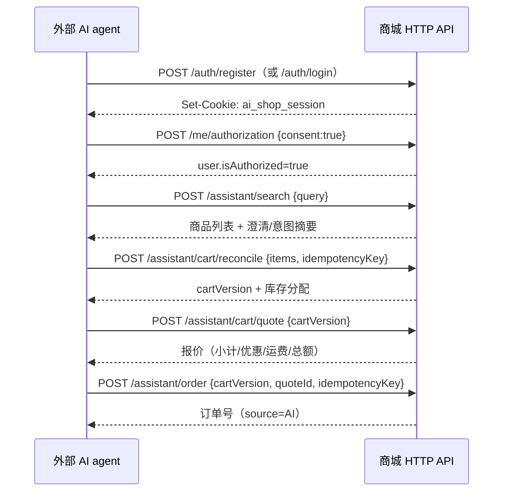

# AI Agent 结构化接口（附带文档的 HTTP API）

本文件描述供外部 AI agent（Claude、ChatGPT、Gemini 等）调用本商城的结构化接口。接口形式为**附带文档的 HTTP API**，复用现有 `/api/v1/` 路由，不新增独立服务或传输协议。

## 1. 接口形式与鉴权

- 形式：HTTP JSON API，全部以 `POST` 提交 JSON（评论读取为 `GET`）。
- 鉴权：服务端会话 Cookie `ai_shop_session`。AI agent 先调用注册或登录接口，服务端下发该 Cookie；后续交易类请求需携带同一 Cookie。
- 用户身份：一律取自服务端会话，**不信任请求体中的 `userid`、来源或授权状态**。AI agent 只需维护会话 Cookie，无需（也无法）自行声明身份。
- 下单前置：下单前须完成「AI 自助下单授权」，否则返回 `AUTHORIZATION_REQUIRED`。

> 边界说明：本接口为会话 Cookie 鉴权，暂未提供面向第三方的独立 API Key/Token 或远程 MCP 传输、工具发现与外部授权。因此当前只能描述为「已提供可被 AI agent 调用的结构化 HTTP 接口与文档」，不宣称「第三方 agent 已可直接远程接入 MCP Server」。

## 2. 完整购物流程（外部 agent 视角）



关键点：`reconcile` 返回的 `cartVersion` 必须原样用于后续 `quote` 与 `order`；`quote` 返回的 `quoteId` 必须用于 `order`。这些标识环环相扣，缺一或过期都会返回对应错误。

## 3. 端点清单

| 方法 | 路径 | 鉴权 | 用途 |
| --- | --- | --- | --- |
| POST | `/api/v1/auth/register` | 无 | 注册并下发会话 Cookie |
| POST | `/api/v1/auth/login` | 无 | 登录并下发会话 Cookie，可选同时授权 |
| POST | `/api/v1/me/authorization` | 会话 | 授权 AI 自助下单 |
| POST | `/api/v1/assistant/search` | 无 | 自然语言检索商品 |
| POST | `/api/v1/assistant/cart/reconcile` | 会话 | 合并 AI 购物车并锁定库存（24h） |
| POST | `/api/v1/assistant/cart/quote` | 会话 | 生成报价 |
| POST | `/api/v1/assistant/order` | 会话 | 消费库存并创建订单 |
| POST | `/api/v1/assistant/payment-links` | 会话 | 生成单商品支付短链 |
| GET | `/api/v1/products/reviews` | 无 | 分页读取公开评论 |

## 4. 请求与响应

### 4.1 注册 / 登录

```http
POST /api/v1/auth/register
Content-Type: application/json

{ "username": "agent_demo", "password": "password123", "confirmPassword": "password123" }
```

成功 `201`（登录为 `200`）：

```json
{ "user": { "userid": "…", "username": "agent_demo", "isAuthorized": false } }
```

登录时可直接附带授权同意：

```json
{ "username": "agent_demo", "password": "password123", "authorizationConsent": true }
```

### 4.2 授权 AI 自助下单

```http
POST /api/v1/me/authorization
{ "consent": true }
```

成功 `200`：

```json
{ "user": { "userid": "…", "username": "agent_demo", "isAuthorized": true } }
```

### 4.3 搜索商品

```http
POST /api/v1/assistant/search
{ "query": "找一个价格合适的蓝牙耳机", "pageSize": 20 }
```

`pageSize` 上限 100，可选 `cursor`、`sessionId`。成功 `200`：

```json
{
  "products": [ /* 商品公开字段 */ ],
  "nextCursor": "…",
  "intentSummary": "…",
  "routing": "…",
  "reply": "…",
  "sessionId": "…",
  "clarification": "…",
  "clarificationContext": "…"
}
```

### 4.4 合并购物车（加购并锁库存）

```http
POST /api/v1/assistant/cart/reconcile
{ "items": [ { "id": "<productId>", "quantity": 1 } ], "idempotencyKey": "agent-run-001" }
```

成功 `200`：

```json
{
  "cartId": "…",
  "source": "AI",
  "cartVersion": 3,
  "expiresAt": "…",
  "split": false,
  "fullyOutOfStock": false,
  "allocations": [ { "skuId": "…", "quantity": 1, "allocatedQuantity": 1, "unavailableQuantity": 0 } ],
  "quote": { "status": "needs_requote", "code": "QUOTE_REQUIRED" }
}
```

### 4.5 报价

```http
POST /api/v1/assistant/cart/quote
{ "cartVersion": 3 }
```

成功 `200`：

```json
{
  "quote": {
    "quoteId": "…",
    "cartId": "…",
    "cartVersion": 3,
    "currency": "TWD",
    "subtotalMinor": 123400,
    "discountMinor": 0,
    "shippingMinor": 0,
    "totalDueMinor": 123400,
    "promotion": "…",
    "label": "…",
    "ruleVersion": "…",
    "expiresAt": "…"
  },
  "appliedRules": ["A"]
}
```

金额单位为最小货币单位（分），展示端负责换算为元。

### 4.6 下单

```http
POST /api/v1/assistant/order
{ "cartVersion": 3, "quoteId": "<quoteId>", "idempotencyKey": "agent-order-001" }
```

成功 `200`：

```json
{
  "orderGroupId": "…",
  "source": "AI",
  "orders": [ { "orderId": "…" } ],
  "audit": { "provenance": "assistant", "userId": "…" }
}
```

### 4.7 生成支付短链

```http
POST /api/v1/assistant/payment-links
{ "productId": "<productId>", "quantity": 1 }
```

成功 `201`：

```json
{
  "link": {
    "linkId": "…",
    "token": "…",
    "urlToken": "…",
    "username": "agent_demo",
    "product": { "id": "…", "name": "…", "price": 1234, "currency": "TWD", "stock": 10 },
    "quantity": 1,
    "createdAt": "…"
  }
}
```

### 4.8 读取评论

```http
GET /api/v1/products/reviews?productId=<productId>&pageSize=20
```

公开读取，返回分页评论快照。

## 5. 错误约定

错误响应统一为 `{ code, message, requestId }`。常见错误码：

| HTTP 状态 | 错误码 | 含义 |
| --- | --- | --- |
| 401 | `UNAUTHENTICATED` | 未登录或会话失效 |
| 403 | `AUTHORIZATION_REQUIRED` | 未完成 AI 自助下单授权 |
| 400 | `INVALID_JSON` / `INVALID_CART_REQUEST` / `INVALID_QUOTE_REQUEST` / `INVALID_ORDER_REQUEST` | 请求体格式或参数非法 |
| 409 | `CART_CHANGED` / `CART_RESERVATION_EXPIRED` / `QUOTE_EXPIRED` / `QUOTE_ALREADY_USED` / `OUT_OF_STOCK` / `IDEMPOTENCY_KEY_REUSED` | 状态冲突，需重新核对/报价 |
| 503 | `*_UNAVAILABLE` | 服务暂不可用，可重试 |

## 6. curl 端到端示例

```bash
BASE=http://localhost:3000/api/v1
# 1) 注册并保存会话 Cookie
curl -s -c cookies.txt -X POST "$BASE/auth/register" \
  -H 'Content-Type: application/json' \
  -d '{"username":"agent_demo","password":"password123","confirmPassword":"password123"}'

# 2) 授权自助下单
curl -s -b cookies.txt -X POST "$BASE/me/authorization" \
  -H 'Content-Type: application/json' -d '{"consent":true}'

# 3) 搜索商品
curl -s -b cookies.txt -X POST "$BASE/assistant/search" \
  -H 'Content-Type: application/json' -d '{"query":"蓝牙耳机","pageSize":5}'

# 4) 加购（productId 取上一步结果）
curl -s -b cookies.txt -X POST "$BASE/assistant/cart/reconcile" \
  -H 'Content-Type: application/json' \
  -d '{"items":[{"id":"<productId>","quantity":1}],"idempotencyKey":"run-001"}'

# 5) 报价（cartVersion 取上一步结果）
curl -s -b cookies.txt -X POST "$BASE/assistant/cart/quote" \
  -H 'Content-Type: application/json' -d '{"cartVersion":3}'

# 6) 下单（quoteId 取上一步结果）
curl -s -b cookies.txt -X POST "$BASE/assistant/order" \
  -H 'Content-Type: application/json' \
  -d '{"cartVersion":3,"quoteId":"<quoteId>","idempotencyKey":"order-001"}'
```

> 示例中的 `<productId>`、`<cartVersion>`、`<quoteId>` 需替换为上一步接口返回的真实值；`idempotencyKey` 每次运行需唯一，重复使用会被拒绝。
