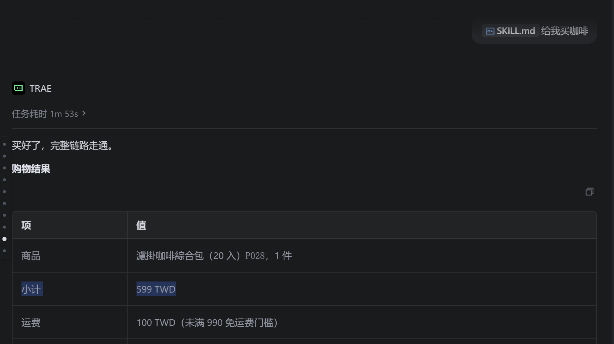
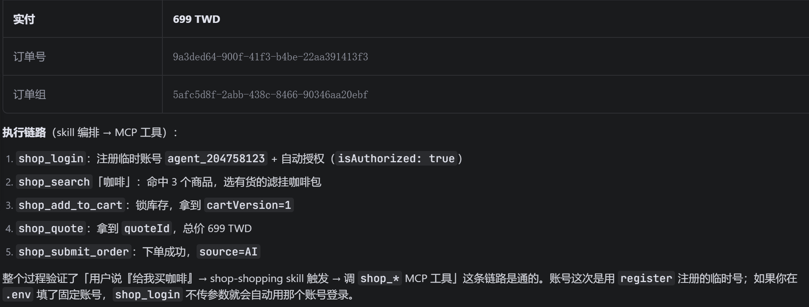

# AI 商城 MCP 接入指南与购物案例

本文档记录 `ai-shop-mcp` 的接入操作路径，以及一次在 Railway 环境走通的真实购物案例。

## 1. 背景

`ai-shop-mcp`（位于 `c:\document\ai-shop-mcp`）是一个 MCP Server，把 AI 商城（`c:\document\ai-shop`）的结构化 HTTP API 封装成 `shop_*` 工具，供 Cursor / Trae 等 Agent 通过 SSE 协议调用，完成「登录 → 搜索 → 加购 → 报价 → 下单」购物闭环。

商城 HTTP API 的完整契约见 [agent-api.md](agent-api.md)。

## 2. 项目结构

```
ai-shop-mcp/
├── .env                 # 环境配置（不入库）
├── .env.example         # 环境配置示例（占位值）
├── package.json
├── tsconfig.json
└── src/
    ├── config.ts        # SHOP_BASE_URL、/api/v1 前缀、会话 Cookie 名
    ├── index.ts         # 入口（加载 dotenv 后启动 HTTP 服务）
    ├── server.ts        # SSE 多会话骨架 + 工具注册 + 端口/PORT
    ├── shop-service.ts  # 商城 HTTP API 封装（统一 Cookie 与 UTF-8）
    ├── user-config.ts   # 按 sessionId 存 { username, password, cookie }
    ├── request-context.ts  # AsyncLocalStorage 透传 sessionId
    └── tools/
        ├── shop-login.ts
        ├── shop-search.ts
        ├── shop-add-to-cart.ts
        ├── shop-quote.ts
        ├── shop-submit-order.ts
        ├── shop-payment-link.ts
        └── shop-reviews.ts
```

配套 skill 位于 `- @delivery-docs/skills/ai-shop-mcp-skill.md`，负责在用户表达购物意图时触发并编排工具调用。

## 3. 操作路径（接入步骤）

### 3.1 配置 `.env`

复制 `.env.example` 为 `.env`，填写：

```ini
SHOP_BASE_URL=https://ai-shop-assistant-production-c8ca90ba.up.railway.app
PORT=8079
SHOP_USERNAME=
SHOP_PASSWORD=
```

| 变量 | 作用 | 说明 |
| --- | --- | --- |
| `SHOP_BASE_URL` | 商城后端根地址 | 不要带 `/api/v1`，代码会自动拼接 |
| `PORT` | MCP 监听端口 | Cursor/Trae 连接 `/sse` 用 |
| `SHOP_USERNAME` | 默认登录账号（可选） | `shop_login` 不传参时使用 |
| `SHOP_PASSWORD` | 默认登录密码（可选） | 同上 |

账号取值优先级：工具参数 > `.env` > 报错提示。

### 3.2 安装与启动

```powershell
cd c:\document\ai-shop-mcp
npm install
npm run dev
```

启动后监听 `http://localhost:8079`，健康检查 `GET /health`。

### 3.3 在 Trae 配置 MCP

MCP 是 SSE 类型，配置使用 `url`（不是 stdio 的 `command`/`args`）：

```json
{
  "mcpServers": {
    "ai-shop": {
      "url": "http://localhost:8079/sse"
    }
  }
}
```

在 Trae 的 MCP 设置入口粘贴/添加该配置，指向本地 8079 端口的 `/sse`。

### 3.4 购物触发

用户在对话中表达购物意图（如「给我买咖啡」）时，`shop-shopping` skill 被激活，LLM 按以下顺序调用 `shop_*` 工具：

1. `shop_login`（登录，自动完成 AI 自助下单授权）
2. `shop_search`（搜索商品）
3. `shop_add_to_cart`（加购锁库存，取 `cartVersion`）
4. `shop_quote`（报价，取 `quoteId`）
5. `shop_submit_order`（下单，取 `orderGroupId`）

## 4. 工具清单

| 工具 | 接口 | 返回值 |
| --- | --- | --- |
| `shop_login` | `/auth/login` 或 `/auth/register` | 会话 Cookie |
| `shop_search` | `/assistant/search` | 商品列表 |
| `shop_add_to_cart` | `/assistant/cart/reconcile` | cartVersion |
| `shop_quote` | `/assistant/cart/quote` | quoteId |
| `shop_submit_order` | `/assistant/order` | orderGroupId |
| `shop_create_payment_link` | `/assistant/payment-links` | 支付短链 |
| `shop_read_reviews` | `/products/reviews` | 评论分页 |

## 5. 走通案例（2026-11-21 实测）

环境：Railway `https://ai-shop-assistant-production-c8ca90ba.up.railway.app`，MCP 通过 `mcp_ai-shop` 连接，`shop-shopping` skill 触发。

用户指令：「给我买咖啡」。

执行链路与结果：

| 步骤 | 工具 | 关键结果 |
| --- | --- | --- |
| 1. 注册并授权 | `shop_login` | 注册临时账号 `agent_204758123`，`isAuthorized: true` |
| 2. 搜索 | `shop_search`（「咖啡」） | 命中 3 个商品，选有货的「濾掛咖啡綜合包（20 入）」 |
| 3. 加购 | `shop_add_to_cart` | 商品 `P028` × 1，`cartVersion = 1` |
| 4. 报价 | `shop_quote` | `quoteId = c1f6a980-2b95-40e9-a6ba-8240b04f0047` |
| 5. 下单 | `shop_submit_order` | `orderGroupId = 5afc5d8f-2abb-438c-8466-90346aa20ebf` |

订单详情：

- 商品：`P028` 濾掛咖啡綜合包（20 入）× 1
- 小计：599 TWD
- 运费：100 TWD（未满 990 免运费门槛）
- 实付：699 TWD
- 订单号：`9a3ded64-900f-41f3-b4be-22aa391413f3`
- 用户：`a4a05684-35a1-4190-ad08-e9ffadec3647`
- 来源：`AI`




## 6. 关键注意

- `cartVersion`、`quoteId` 必须原样沿链路传递，缺一或过期会报 `CART_CHANGED` / `QUOTE_EXPIRED` 等。
- 每次 `idempotencyKey` 必须唯一，重复会被拒绝（409 `IDEMPOTENCY_KEY_REUSED`）。
- 中文搜索由 MCP 服务端按 UTF-8 处理，无需额外编码。
- 下单前若返回 `AUTHORIZATION_REQUIRED`，说明授权未完成，重新 `shop_login`（登录会自动授权）。
