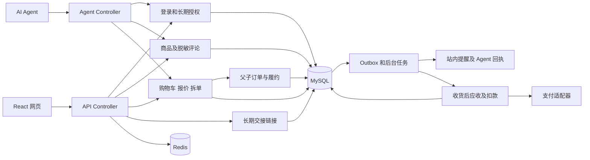
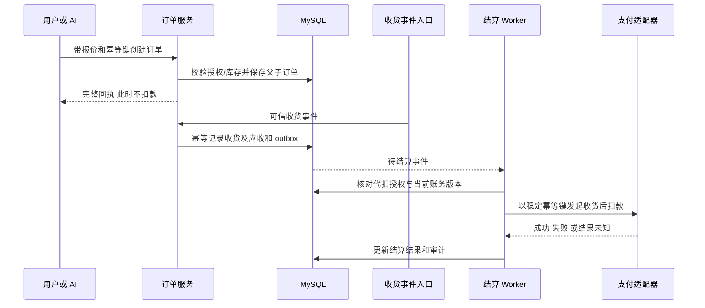

# Node.js + MySQL 后端技术文档

## 1. 版本、技术栈与边界

- 版本：`v0.3-assistant-comparison`，更新时间：2026-11-15（Asia/Shanghai）；补充网页 AI 助手搜索及 TOP3 商品比较数据契约。
- 依据：[需求功能清单](requirements-analysis.md) D-01～D-08；与 [前端文档](frontend-technical-design.md) 共用 `/api/v1` 契约。
- Node.js 当前受支持 LTS（建议 24）+ TypeScript + NestJS，MySQL 8 / InnoDB；建议 Prisma 负责常规 CRUD，库存使用参数化事务及行锁。
- Redis 用于缓存、限流和短期会话；授权、库存预留、幂等结果、报价、订单和应收以 MySQL 为准，不依赖 Redis TTL 保证账务正确。
- 本期 MySQL 商品查询、索引和必要的 FULLTEXT 即可；默认且最多返回 10 条，不引入 OpenSearch 或全量商品导出方案。中文搜索效果按实际数据验证。
- 采用单体模块化部署及后台 worker，先保证功能；支付/代扣、物流、通知通过适配器连接。支付供应商未选定，收货后扣款尚需确认可信收货来源及渠道能力。

## 2. 模块与数据流

`Auth` 管身份，`Consent` 管长期授权，`Pricing` 管报价，`Inventory` 管分配，`Orders` 管父子单，`Settlement` 管应收，`Returns` 管退货调整。模块共享 MySQL 事务边界，暂不拆微服务。

## 3. 核心表与关键约束

| 表 | 主要字段/用途 | 关键约束 |
| --- | --- | --- |
| `users`、`user_sessions`、`agents` | 用户、登录态、Agent 客户端身份 | session 可撤销；客户端身份不替代用户授权 |
| `agent_authorizations` | user_id、agent_id、scope、status、version、consent_version、granted_at、revoked_at | 对 user + agent + scope 串行更新；长期记录持久化，可审计 |
| `authorization_requests` | 用户、Agent、cart_id、下单意图、状态、过期时间、回跳目标 | 只能本人完成；回跳仅允许站内或白名单 |
| `payment_mandates` | user_id、渠道代扣引用、scope、status | 独立于代下单授权；不保存银行卡敏感明文 |
| `products`、`skus` | 商品信息、规格、售价、发布状态 | 商品 ID/SKU 唯一，公开字段白名单 |
| `product_attributes` 或等价 JSON 结构 | 品类、属性 key/value/标准单位/可比标记 | 仅公开可比字段；同品类且单位可归一后才生成比较结论 |
| `inventory` | sku_id、on_hand、reserved、version | on_hand >= reserved >= 0；available 查询时计算 |
| `inventory_reservations` | cart_id、sku_id、qty、expires_at、status | 状态 ACTIVE/COMMITTED/RELEASED；按过期时间索引 |
| `carts`、`cart_items`、`cart_allocations` | 来源、版本、原需求、锁定数量、缺货数量 | 需求量 = 本次分配量 + 缺货量；来源由后端判定 |
| `quotes` | cart_version、rule_version、金额、拆分方案、expires_at | 不可被客户端金额覆盖；建单校验版本 |
| `order_groups`、`orders`、`order_items` | 原始购物意图、子单、商品/价格快照、授权快照 | 同一下单意图只能成功一次；子单来源继承父单 |
| `shipments`、`shipment_events` | 子单/包裹、承运商、脱敏运单号、物流节点和预计送达 | 物流事件按 provider + event_id 幂等；只向订单所有者返回 |
| `pending_order_items` | 缺货 SKU、数量、处理状态、关联父单 | 不作为已发货/已计费订单；补货策略待确认 |
| `receipts` | 子单/包裹、来源、业务 event_id、收货时间 | 来源 + event_id 唯一；不可由 Agent 自称收货 |
| `receivables`、`payment_attempts` | 子单应收、账务版本、扣款状态、渠道引用 | 渠道幂等键唯一；账务调整追加记录，不覆盖历史 |
| `return_requests`、`settlement_adjustments` | 退货数量、核验、退款/运费及优惠调整 | 退货量不超过可退量，调整关联规则版本 |
| `refunds` | 退款申请、审核状态、退款状态、金额和支付渠道引用 | 退款状态变更追加审计事件；金额关联结算调整 |
| `reviews`、`review_public_views` | 原始受限数据与脱敏文本/媒体 | 公开接口只读已发布且脱敏完成的视图 |
| `handoff_links` | token_hash、绑定资源、revoked_at | token 哈希唯一；无自动过期不等于资源无生命周期 |
| `promotion_rules`、`pricing_allocations` | 组合、门槛、舍入、规则版本及逐项分摊 | 总分摊 = 订单优惠；规则变更不改历史订单 |
| `idempotency_records`、`outbox_events`、`audit_events` | 请求去重、可靠通知、审计 | 主体 + 操作 + key 唯一，保存 payload hash |

金额采用最小货币单位整数，数据库可用 BIGINT；禁止 JavaScript 浮点直接计算优惠，使用整数比例和明确舍入。具体 TWD 计费精度及舍入点待 Q-03 确认。序列化时限制安全整数范围或使用字符串金额，不丢精度。

## 4. 登录与长期授权

### 4.1 身份与同意分离

- `POST /api/v1/auth/login` 建立 HttpOnly、Secure 的网页 session。授权选项为独立明确同意；跳过不影响登录。
- 登录成功后，由 `POST /api/v1/me/agent-authorizations` 为明确的 Agent 和 scope 建立长期授权；若失败保留登录结果，告知授权未完成。
- grant 可长期有效，访问 token 仍短期签发、按规则刷新。通过 OAuth 授权码 + PKCE 等流程绑定用户与注册 Agent；Agent API key 只能证明客户端身份，不能证明用户同意。
- 服务端每次 AI 下单重新读取用户 grant、Agent 绑定和版本；不信任前端布尔值、token 中过时的授权声明。
- 撤销 grant 与创建订单通过同一 grant 行锁/版本检查确定先后：撤销提交后禁止新的自动建单；已完成订单不因撤销自动取消。
- 长期 AI 代下单授权不自动创建支付代扣授权。收货后自动扣款还需有效 `payment_mandate`；未完成时保留明确应收状态和处理入口。

### 4.2 无授权的再次提醒

1. AI 尝试下单时无有效 grant，返回 403、`AUTHORIZATION_REQUIRED`、用户授权链接和 requestId，不创建订单。
2. 链接包含短期授权请求 ID；用户未登录先登录，再展示 Agent、权限和关联购物摘要。
3. 用户主动同意后写 grant；拒绝则关闭请求，允许手动交接结账，不循环强制授权。
4. Agent 查询请求结果或用户返回原流程后重新请求报价/下单。授权确认本身不建单，不直接重放已过期请求。

营销弹窗是纯展示：10 秒自动关闭或手动关闭均不会调用授权写接口。建议登录态接口附授权摘要供首页显示；授权写操作使用 CSRF 防护和本人身份验证。

## 5. 库存分配与拆单

### 5.1 购物车创建即分配

1. 校验 SKU、请求数量和幂等键，在 MySQL 事务内按 SKU ID 排序 `SELECT ... FOR UPDATE`。
2. 对每个 SKU 计算 `available = on_hand - reserved`，分配可用数量，其余写缺货项。允许同一 SKU 的部分数量分配，作为技术建议，整件/整包限制遵循商品配置。
3. 只对实际可用分配量增加 reserved，写 `inventory_reservations`，有效期为创建时间后 24 小时；记录 cart version 与完整拆分结果。
4. 有货部分可继续，部分缺货返回 `split=true`、可履约/缺货数量和 notice；全部缺货保留购物意图并返回 `OUT_OF_STOCK`，不建可扣款订单。
5. 库存事务提交后通过 outbox 持久化拆分提醒。网页持久 Alert、Agent 响应、订单回执都展示相同明细；提醒投递失败可重试，不能静默丢失。
6. Redis 只缓存查询结果；到期任务以 MySQL ACTIVE 预留为依据，通过状态条件更新保证只释放一次。

### 5.2 建单和父子单

- 报价、拆单和实际建单要使用同一购物车版本。建单事务重新锁定 grant（AI 路径）、cart、quote、reservation 和 inventory，并检查有效期、数量和报价规则。
- 通过后创建父订单组及有库存子单，记录缺货待处理项。补货后是否自动创建子单未获确认，不自动收款或承诺发货时间。
- ACTIVE 预留转 COMMITTED，同时 `on_hand -= qty`、`reserved -= qty`，按“on_hand 表示尚未分配给已下订单的库存”的定义扣除一次；发货不再二次减库存。
- 取消已建单但未履约的商品时按明确取消/返库流程补回库存；退货需验收入库，不能仅凭申请返库。
- 建单与到期释放竞争时对同一预留行串行处理，只有一个状态迁移成功。下单后的 COMMITTED 记录不再被 24 小时回收任务释放。
- 优惠分摊与运费计算放在父级报价体系内；拆单后按整单还是子单判断门槛由 Q-04 决定，不能因为技术拆分自动重复收运费。

## 6. 最优惠报价引擎

`PricingService` 输入：商品和数量快照、真实 WEB/AI 来源、配送信息、库存拆分方案及规则版本。输出 `quoteId`、`cartVersion`、小计、逐项优惠、运费、总应付、规则明细和有效期。

1. 读取规则：A 满 1000 减 100；B 满 990 免运，否则 100；C AI 订单额外 95 折。
2. 读取明确配置的适用范围、门槛口径、允许叠加关系及先后顺序，枚举合法候选；必要时允许不参加某项优惠作为候选，但不能绕过已确认的适用条件。
3. 比较每个候选的最终应付总额（含运费），取最低者；同价用稳定规则优先级，避免界面抖动。
4. 保存规则版本、候选摘要、选中方案、行级分摊和拆单费用归属。总分摊必须与总优惠一致，舍入余量采用确定性的分摊策略。
5. 商品数量、来源资格、地址、拆分结果、规则版本改变后重新报价；建单绑定有效报价，历史单不动态改价。

### 6.1 算例说明（不是最终计价口径）

AI 商品小计新台币 1000 元：若 A/B 门槛都按商品原小计判断，C 仅打折商品，先 A 再 C，可得 `(1000 - 100) × 0.95 = 855`，免运；若 B 按折后商品金额判断，则运费可能增加 100，得到 955。

上述差异说明：动态选最优惠可以解决合法方案之间的比较，不能替代门槛定义。Q-03 确认前，不把 855 或 955 中任一个写成固定验收结果。边界测试将覆盖 989、990、999、1000，以及优惠前后跨门槛、WEB/AI、拆单和退货。

## 7. 先下单、收货后扣款

- 履约状态与结算状态分离，详见需求第 5 节。建单不要求先付款成功，也不会立即发起扣款。
- 收货来源必须可信：用户本人收货确认、经签名验证的物流事件等作为候选，采用哪些需 Q-02 确认。AI 无权自行发送收货事件以触发扣款。
- MySQL 事务记录 receipt、对应应收、outbox；外部扣款在事务外执行。子单/包裹收货粒度和扣款聚合时点待定，表结构保留对应引用。
- 实际执行须有渠道能力和有效代扣授权。授权缺失或费用超出范围时转待处理应收，不将 AI 代下单授权当作支付凭据。
- 扣款请求使用稳定的渠道幂等键，数据库唯一约束记录逻辑扣款。网络超时先查询渠道，结果未知维持 CHARGING，不换 key 盲目重扣。
- 重复收货回调、worker 重试和重复支付回调均不会重复收款。失败保存原因、通知用户并支持受控重试/人工处理。
- Q-02 确认前不设置自动确认收货时间，不把发货、物流发出或下单成功当作收货。

## 8. 退货、优惠和运费结算

1. 退货预览读取原订单商品/价格/规则快照、已退数量及当前应收/实扣情况，不使用后来上涨或下调的新价格改历史账。
2. 根据保留商品重新判断原免运资格；由免运变为不满足时产生运费调整，原规则运费为新台币 100 元。是否按父单/子单及特殊退货例外以 Q-04/Q-05 为准。
3. 总运费与已计收运费对账，只计算差额，避免每次部分退货或重复回调重复收 100 元；新收退货寄送费不在本次确认范围内。
4. 优惠追回/分摊策略需配置明确。展示 `refundMinor`、`shippingAdjustmentMinor`、`additionalReceivableMinor`、调整说明与规则版本，不能仅给出一个无法解释的负退款数。
5. 未扣款时先调整应收；已扣款时办理退款与费用抵扣，超过可抵扣金额的费用单独形成应收。是否自动补扣需另有有效支付授权及明确规则。
6. 预览不等于已退货。实际退货核验后以新的账务版本幂等结算；退货变更和扣款任务锁定同一应收记录。已在途扣款不能简单覆盖金额，应待渠道结果后追加退款/调整。

验收场景：部分退货跨 990 门槛、仍满足免运、原已收运费、全退待定、分多次退货、未扣款先退、扣款成功后退、扣款处理中退、可退金额不足运费。

## 9. API 契约与访问控制

### 9.1 网页/交接接口

与前端文档接口表一致；报价接口返回 `quote` 和 `splitSummary`，建单返回 `orderGroupId`、子单、缺货项、购买快照及 `settlementStatus=NOT_DUE`。

- 身份：`POST /api/v1/auth/login`、`GET /api/v1/auth/session`。
- 授权：`GET/POST /api/v1/me/agent-authorizations`、`DELETE /api/v1/me/agent-authorizations/:grantId`、`GET /api/v1/authorization-requests/:id`。
- 商品：`GET /api/v1/products`、`GET /api/v1/products/:id`、`GET /api/v1/products/:id/reviews`。
- 网页助手：`POST /api/v1/assistant/search`，输入自然语言查询，返回最多 10 件命中商品和按当前结果前 3 件生成的比较数据；与网页目录搜索共享商品、推荐和脱敏评论查询能力。
- 购物车：`POST /api/v1/carts`、`PATCH /api/v1/carts/:id/items`、`POST /api/v1/carts/:id/quotes`、`POST /api/v1/carts/:id/orders`。
- 交接：`POST /api/v1/carts/:id/handoff-links`、`POST /api/v1/handoff/exchange`。
- 订单：`GET /api/v1/order-groups/:id`、`POST /api/v1/order-groups/:id/receipt-confirmations`（是否启用由 Q-02 决定）。
- 我的：`GET /api/v1/me/overview`、`GET /api/v1/me/orders`、`GET /api/v1/me/logistics`、`GET /api/v1/me/refunds`。
- 物流详情：`GET /api/v1/order-groups/:id/logistics`，返回当前用户可见的子单、包裹和物流事件。
- 退货：`POST /api/v1/order-groups/:id/return-quotes`、`POST /api/v1/order-groups/:id/returns`。

所有操作校验资源所有权或绑定资源的受限凭证。无登录交接可手动建单，不因此获得账户其他订单或长期授权权限；代扣资料/收货敏感信息按实际需要额外验证。

### 9.2 Agent 接口

- `GET /api/v1/agent/products`：关键词、筛选、cursor，每次默认且最多 10 条；超限统一截断到 10 并返回实际 `pageSize`。
- `GET /api/v1/agent/products/:id`、`GET /api/v1/agent/products/:id/reviews`：公开详情和脱敏评论分页。
- `POST /api/v1/agent/carts`：幂等创建、24 小时锁库及拆分结果。
- `POST /api/v1/agent/carts/:id/quotes`：最优报价及缺货明细。
- `POST /api/v1/agent/carts/:id/orders`：需要用户绑定及 `order:create` grant；返回回执、不扣款。
- `POST /api/v1/agent/carts/:id/handoff-links`：需要对应购物车访问范围，不要求用户已经同意 AI 自动下单。
- `GET /api/v1/agent/authorization-requests/:id`：仅匹配的 Agent 读取授权请求状态，不向其他 Agent 暴露用户信息。

Agent 端无收货确认/代扣权限。网页 session 与 Agent token 分开；来源 AI 由服务端可信身份和购物车 provenance 确定，用户修改 `source` 不可骗取 95 折。交接后仍保留 AI 创建购物车的来源；修改范围导致的资格变化应在计价规则中明确。

网页内嵌助手只是用户界面，不等于外部 Agent 身份，也不自动获得下单权限。`POST /api/v1/assistant/search` 只负责搜索和生成比较建议；加入购物车、授权、报价、库存锁定和下单继续使用既有接口与校验。

### 9.3 一致响应与幂等

- 错误：`{code, message, requestId, fieldErrors?, details?}`；无授权返回 403 `AUTHORIZATION_REQUIRED`，旧报价 409 `QUOTE_CHANGED`，库存变化 409 `INVENTORY_CHANGED`，资源/链接撤销 410。
- 部分缺货为成功业务响应并带拆分明细；全部缺货不生成可履约订单。
- 幂等键按操作者、操作和 key 隔离，保存请求 payload hash；同 key 不同参数返回冲突。唯一业务约束防止短期幂等记录过期后重复建单。

## 10. 长期交接、评论脱敏与搜索

### 10.1 交接链接

- 生成至少 256 bit 随机 token，仅存哈希。无自动过期，但可撤销；首次进入页面调用交换接口获得短期受限会话，随后移除 URL token。
- 短期会话只绑定购物车/订单组；不等于用户登录，不授予长期 AI 下单权限。
- 购物车库存锁、报价和订单按生命周期独立处理；每次结账重校验；已建单链接展示回执，不能再次建单。
- token 不进入访问日志、埋点、错误跟踪或第三方 Referer；接口限流并按公开文案返回不可用状态。

### 10.2 评论脱敏

- 建议标准：昵称别名化，联系方式和地址脱敏，不暴露真实用户 ID、订单编号、精确地域；评论正文同样处理，不能只改昵称。
- 图片、头像和视频在处理完成前不向网页或 AI 输出；媒体元信息移除，疑似包含个人信息的内容转审核。原始记录仅受限内部访问。
- 公开视图含脱敏版本和发布状态，审核下架或删除后同时失效缓存。网页和 Agent 共用服务，AI 可通过分页遍历所有公开评论。

### 10.3 搜索

- 网页与 AI 共用查询服务，每次最多 10 条，返回 `items`、`pageSize=10`、`hasMore`、`nextCursor`；最后一页可少于 10 条。
- 按稳定排序键（推荐分数、商品 ID）分页，不向接口泄漏排序分数本身。商品发布状态、分类等常用条件建索引。
- 高毛利乘以 1.5 的内部规则留在服务端配置，不进入公开 API、提示词或前端包；披露策略待 Q-06 确认。
- 本期不评估全量 10 万条返回、OpenSearch 和数据导出。

### 10.4 助手搜索与 TOP3 比较

- 助手搜索请求包含 `query`、可选 `cursor`、筛选条件和 `comparisonContext`；服务端强制 `pageSize <= 10`，不接受客户端指定推荐分数或优劣结论。
- 响应建议包含 `items`、`pageSize`、`hasMore`、`nextCursor`、`topComparisons` 和 `comparisonVersion`。`topComparisons` 最多 3 项，按本次搜索结果排序前 3 个商品生成；少于 3 个只返回实际数量。
- 每个比较项只输出公开或允许展示的字段：当前价/可验证报价摘要、优惠说明、品类可比规格、库存状态、可信配送窗口、评分/评论量，以及由这些字段生成的结构化 `strengths` 与 `tradeoffs`。字段缺失返回 `null` 或明确的 `NOT_AVAILABLE`，不能降级成猜测。
- 比较结论在生成时保存 `basisFields` 和数据时间戳，便于前端显示依据和排查旧库存/价格；不输出毛利、内部推荐分数、权重、提示词或未脱敏评论。
- 比较排序沿用服务端推荐排序；对外不得宣称 TOP3 是客观质量排名。价格/库存和配送信息在进入购物车、报价和下单时重新校验，助手搜索响应不是承诺。
- 查询结果可以缓存，但缓存键必须包含查询、筛选、排序版本和数据版本；价格、库存、配送缓存设置短 TTL，并在结账前强制刷新。

## 11. 可靠性、观测与验证计划

- MySQL 事务保障库存、订单、授权和应收的一致性；outbox 保证提交后提醒和结算事件可重试。
- 权限审计记录授权/撤销版本、Agent 身份、建单依据与来源；不记录敏感 token 或银行卡明文。
- 指标：唯一 AI 购物车数、授权转化、授权缺失率、拆单比例、缺货数量、锁库回收延迟、收货后应收、扣款失败/未知结果、物流事件延迟、退款处理时长、退款和运费调整。
- 业务验证：对应 AC-01～AC-18；金额覆盖优惠门槛和退款分摊，权限覆盖撤销/建单竞态及“我的”资源隔离，库存覆盖并发抢最后一件和过期/建单竞争，物流覆盖重复/乱序事件，账务覆盖重复收货与支付未知结果，助手搜索覆盖最多 10 条、TOP3 比较字段、脱敏和缓存一致性。
- 备份恢复以 MySQL 为核心；Redis 可重建。通知失败不能丢失拆单结果，支付渠道不可用不能把订单标为已扣款。
- 部署 SLA、吞吐量、备份保留、支付渠道及 Q-01～Q-06 留待实施前明确；本次未新增业务代码、迁移或测试程序。
