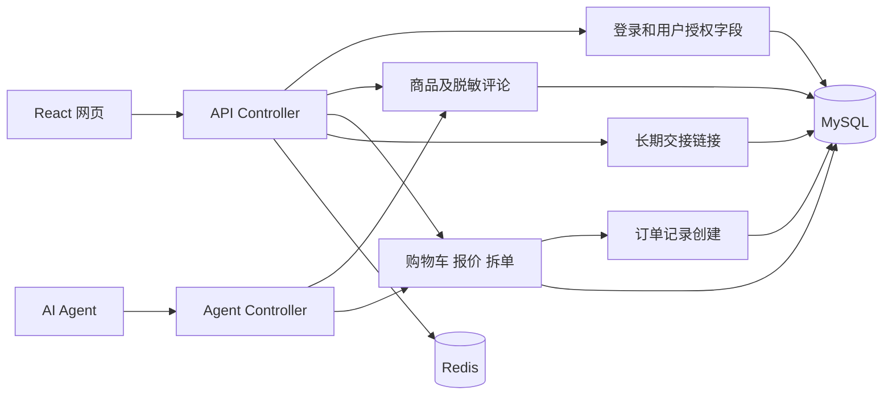

# Node.js + MySQL 后端技术文档

## 1. 版本、技术栈与边界

- 版本：`v1.0-assistant-product-agent`，更新时间：2026-11-16（Asia/Shanghai）；将网页 AI 助手定义为服务端编排的只读商品推荐 Agent（意图识别 + 工具调用 + 相关商品返回）。
- 依据：[需求功能清单](requirements-analysis.md) D-01～D-08；与 [前端文档](frontend-technical-design.md) 共用 `/api/v1` 契约。
- Node.js 当前受支持 LTS（建议 24）+ TypeScript + NestJS，MySQL 8 / InnoDB；建议 Prisma 负责常规 CRUD，库存使用参数化事务及行锁。
- Redis 用于缓存、限流和可选的短期会话辅助；用户授权字段、库存预留、幂等结果、报价和订单记录以 MySQL 为准，不依赖 Redis TTL 保证账务正确。用户已提供本地 MySQL 连接，实施阶段从环境变量读取连接信息，不把连接串或密码写入仓库。
- 本期 MySQL 商品查询、索引和必要的 FULLTEXT 即可；商品查询由后端 cursor 分页，`pageSize` 默认 20、最大 100，不引入 OpenSearch 或全量商品导出方案。中文搜索效果按实际数据验证。
- 采用单体模块化部署，先保证功能；本期不接入支付渠道、不执行扣款，不实现物流、发货、收货、退货、退款或其他订单履约流程。

## 2. 模块与数据流

`Auth` 管身份、网页 session 和用户授权字段；M1 不建立独立 Consent/Agent grant 流程。`Pricing` 管报价，`Inventory` 管分配，`Orders` 管订单记录创建。`Settlement`、`Returns`、物流、收货和扣款本期不实现。模块共享 MySQL 事务边界，暂不拆微服务。

## 3. 核心表与关键约束

| 表                                                         | 主要字段/用途                                                                      | 关键约束                                                                                                                                       |
| ---------------------------------------------------------- | ---------------------------------------------------------------------------------- | ---------------------------------------------------------------------------------------------------------------------------------------------- |
| `users`                                                    | `userid`、`username`、`password_hash`、`is_authorized`、`created_at`、`updated_at` | 新增 MySQL/InnoDB 用户表；`userid` 主键且唯一；`username` 唯一；密码只存强哈希；`is_authorized` `BOOLEAN NOT NULL DEFAULT FALSE`，由服务端维护 |
| `user_sessions`                                            | session token 哈希、`userid`、创建/过期/撤销时间                                   | session 可撤销；Cookie 使用 HttpOnly、Secure、SameSite                                                                                         |
| `agents`、`agent_authorizations`、`authorization_requests` | M1 不创建、不依赖                                                                  | 未来是否保留由后续需求评审，当前 `needs_human_review`                                                                                          |
| 支付代扣凭证/mandates                                      | M1 不创建、不接入                                                                  | 是否需要及其和用户授权字段关系为 `needs_human_review`；不保存银行卡敏感明文                                                                    |
| `products`、`skus`                                         | 商品信息、规格、售价、发布状态                                                     | 商品 ID/SKU 唯一，公开字段白名单                                                                                                               |
| `product_attributes` 或等价 JSON 结构                      | 品类、属性 key/value/标准单位                                                     | 仅返回公开规格字段；缺失字段不得由 Agent 推断                                                                                                  |
| `inventory`                                                | sku_id、on_hand、reserved、version                                                 | on_hand >= reserved >= 0；available 查询时计算                                                                                                 |
| `inventory_reservations`                                   | cart_id、sku_id、qty、expires_at、status                                           | 状态 ACTIVE/COMMITTED/RELEASED；按过期时间索引                                                                                                 |
| `carts`、`cart_items`、`cart_allocations`                  | 来源、版本、原需求、锁定数量、缺货数量                                             | 需求量 = 本次分配量 + 缺货量；来源由后端判定                                                                                                   |
| `quotes`                                                   | cart_version、rule_version、金额、拆分方案、expires_at                             | 不可被客户端金额覆盖；建单校验版本                                                                                                             |
| `order_groups`、`orders`、`order_items`                    | 原始购物意图、子单、商品/价格快照、授权快照                                        | 同一下单意图只能成功一次；子单来源继承父单；仅作为订单记录落库，不进入履约/结算状态                                     |
| `reviews`、`review_public_views`                           | 原始受限数据与脱敏文本/媒体                                                        | 公开接口只读已发布且脱敏完成的视图                                                                                                             |
| `handoff_links`                                            | token_hash、绑定资源、revoked_at                                                   | token 哈希唯一；无自动过期不等于资源无生命周期                                                                                                 |
| `promotion_rules`、`pricing_allocations`                   | 组合、门槛、舍入、规则版本及逐项分摊                                               | 总分摊 = 订单优惠；规则变更不改历史订单                                                                                                        |
| `idempotency_records`、`outbox_events`、`audit_events`     | 请求去重、可靠通知、审计                                                           | 主体 + 操作 + key 唯一，保存 payload hash                                                                                                      |

本阶段新增数据库对象为 MySQL 的 `users` 表，最小字段为：`userid`（主键）、`username`（唯一且非空）、`password_hash`（非空）、`is_authorized`（非空，默认 `false`）、`created_at`、`updated_at`。现有本地 MySQL 连接仅作为后续实施前提；本轮不执行建表、不创建迁移文件，也不保存本地连接凭据。

金额采用最小货币单位整数，数据库可用 BIGINT；禁止 JavaScript 浮点直接计算优惠，使用整数比例和明确舍入。当前 M3 的 C 规则按折扣金额 `Math.round(aiSubtotalMinor * 0.05)` 取整，前台按 NT$ 整数显示；后续若调整舍入方式必须新增规则版本。序列化时限制安全整数范围或使用字符串金额，不丢精度。

## 4. 登录与用户授权字段

### 4.1 登录接口与字段写入

- `POST /api/v1/auth/login` 输入 `{ username, password, authorizationConsent }`。`authorizationConsent` 对应首页登录弹窗中“同意AI自助下单，收货后自动扣款”的 checkbox，默认值为 `false`；已授权用户前端不显示该 checkbox，服务端仍以数据库字段为准。
- 服务端先校验用户名和密码；认证成功后建立网页 session。仅当 `authorizationConsent=true` 且当前 `is_authorized=false` 时，才将 `users.is_authorized` 更新为 `true`。未勾选仍可登录；本期不实现 `true -> false`。
- 登录成功返回 `{ user: { userid, username, isAuthorized }, session: { expiresAt } }`；返回的授权状态必须来自数据库。登录失败不创建 session、不修改授权字段。
- 密码使用经审查的自适应密码哈希算法和每用户唯一 salt；明文密码不得入库、日志、审计事件或分析事件。认证错误避免泄露用户名是否存在。
- 当前阶段不接入 OAuth、Agent 身份绑定、第三方授权，也不创建 grant/token 或授权请求记录。

### 4.2 “我的”授权入口

- `POST /api/v1/me/authorization` 仅接受已登录 session，输入 `{ consent: true }`。服务端从 session 解析 `userid`，锁定并读取用户行；只有明确为 `true` 时才将 `is_authorized` 从 `false` 更新为 `true`。
- 未登录返回 401；`consent` 缺失或为 `false` 返回 400 `AUTHORIZATION_CONSENT_REQUIRED`；已授权用户重复提交返回当前授权状态，接口保持幂等，不提供撤销能力。
- 授权成功返回 `{ user: { userid, username, isAuthorized: true } }`。写入与审计事件在同一 MySQL 事务中完成。

### 4.3 下单授权检查

- 所有来源和入口的建单请求都必须有有效登录 session，并由服务端解析 `userid`、读取 `users.is_authorized`；不得信任客户端 body、query 或缓存中的授权布尔值。交接凭证只允许查看绑定内容，不能创建匿名订单或绕过此检查。
- 缺少或无效 session 返回 401；已登录但 `is_authorized=false` 返回 403 `AUTHORIZATION_REQUIRED`。两种情况均不得创建订单记录。字段为 `true` 时才可继续订单校验和创建。
- 当前授权字段是“同意AI自助下单，收货后自动扣款”的产品同意状态，不保存支付代扣凭证；本期不提供撤销/更新入口，也不处理撤销对存量订单的影响。不得仅凭该字段实现具体支付渠道的代扣接入。
- 审计记录登录成功/失败及 `is_authorized` 字段变更的主体、时间、来源请求 ID 和变更前后值；不得记录密码、session 原文或敏感凭据。
- 登录 session Cookie 配置 HttpOnly、Secure、SameSite，并落实 CSRF 防护、登录限流和 session 撤销；会话存储方案按项目实际部署确认。

## 5. 库存分配与拆单

### 5.1 购物车创建即分配

1. 校验 SKU、请求数量和幂等键，在 MySQL 事务内按 SKU ID 排序 `SELECT ... FOR UPDATE`。
2. 对每个 SKU 计算 `available = on_hand - reserved`，分配可用数量，其余写缺货项。允许同一 SKU 的部分数量分配，作为技术建议，整件/整包限制遵循商品配置。
3. 只对实际可用分配量增加 reserved，写 `inventory_reservations`，有效期为创建时间后 24 小时；记录 cart version 与完整拆分结果。
4. 有货部分可继续，部分缺货返回 `split=true`、可下单/缺货数量和 notice；全部缺货保留购物意图并返回 `OUT_OF_STOCK`，不建订单记录。
5. 库存事务提交后通过 outbox 持久化拆分提醒。网页持久 Alert、Agent 响应、订单回执都展示相同明细；提醒投递失败可重试，不能静默丢失。
6. Redis 只缓存查询结果；到期任务以 MySQL ACTIVE 预留为依据，通过状态条件更新保证只释放一次。

### 5.2 建单和父子单

- 报价、拆单和实际建单要使用同一购物车版本。所有建单事务都必须验证登录用户的 `is_authorized=true`，并校验 cart、quote、reservation 和 inventory 的有效期、数量及报价规则；该检查覆盖网页、AI 和交接来源。

### M3 已实现接口契约

- `POST /api/v1/carts/reconcile` 接收 `{ cartToken, items, idempotencyKey }`。服务端合并重复 SKU、按 SKU 稳定顺序锁库存、保存 `cart_version`，返回 `allocations`、`split`、`fullyOutOfStock` 和 24 小时 `expiresAt`。同一购物车和幂等键重复提交相同内容返回原响应；复用不同内容返回 `409 IDEMPOTENCY_KEY_REUSED`。
- `POST /api/v1/carts/quote` 接收 `{ cartToken, cartVersion }`，只读取服务端已锁定数量和可信商品价格，自动返回 `quoteId`、商品小计、总折扣、运费、总应付、`appliedRules`、规则版本和有效期。前端不提交优惠选择；购物车版本变化、锁定过期、全部缺货分别返回 `CART_CHANGED`、`CART_RESERVATION_EXPIRED`、`OUT_OF_STOCK`。
- `POST /api/internal/inventory/expire` 由带 `Bearer INVENTORY_CRON_SECRET` 的定时任务调用，批量把到期 ACTIVE 预留改为 `EXPIRED`、归还 `inventory_skus.reserved` 并写入事件审计；接口不对前台开放。
- 当前 WEB reconcile 固定来源为 `WEB`；M5 AI 购物车来源和 C 优惠由 M5 可信下单入口接入。A 与 B 自动叠加，AI 下单来源在此基础上再叠加 C；门槛使用折前商品小计，C 只折 AI 商品，免运按整购物车计算；前台按 NT$ 整数显示。
- 通过后创建父订单组及有库存子单，并持久化为订单记录。本期不接入支付渠道、不执行扣款，不自动收款或承诺发货时间。
- ACTIVE 预留转 COMMITTED，同时 `on_hand -= qty`、`reserved -= qty`，按“on_hand 表示尚未分配给已下订单的库存”的定义扣除一次。
- 建单与到期释放竞争时对同一预留行串行处理，只有一个状态迁移成功。下单后的 COMMITTED 记录不再被 24 小时回收任务释放。
- 优惠分摊与运费计算放在父级报价体系内；A/B 门槛和免运按整车折前商品小计判断，拆单不得改变优惠资格或重复收取运费。费用归属需显式记录。

## 6. 自动报价引擎

`PricingService` 是价格计算的唯一实现，网页、M5 AI 购物车与交接来源均通过该服务获取报价，不得在各自入口重复实现优惠、运费或折扣。输入：商品和数量快照、真实 WEB/AI 来源、配送信息、库存拆分方案及规则版本。输出 `quoteId`、`cartVersion`、小计、逐项优惠、运费、总应付、规则明细和有效期。

1. 读取规则：A 按折前整车商品小计满 NT$1,000 减 NT$100；B 按折前整车商品小计满 NT$990 免运，否则收 NT$100；满足条件的 A/B 自动叠加。普通 WEB 购物车不应用 C。
2. 可信 M5 AI 下单来源在满足的 A/B 规则基础上，对 AI 商品金额额外应用 C（95 折），不折运费；来源资格由服务端确认。报价按固定规则自动计算，不枚举促销候选，也不接收用户优惠选择。
3. 计算最终应付总额（含整车运费）；金额接口使用最小货币单位整数，C 折扣结果按 `Math.round` 取整，页面按 NT$ 整数显示。
4. 保存规则版本、实际应用的规则、行级优惠分摊和拆单费用归属。总分摊必须与总优惠一致，舍入余量采用确定性的分摊策略。
5. 商品数量、来源资格、地址、拆分结果、规则版本改变后重新报价；建单绑定有效报价，历史单不动态改价。

### 6.1 M3 已确认算例

门槛统一按折前商品小计判断。WEB 商品小计 NT$1,000 时，A/B 同时命中：商品折扣 NT$100、运费 NT$0，应付 NT$900。AI 自动建单来源在此基础上对 AI 商品金额额外应用 C；C 不折运费，折扣结果按最小货币单位 `Math.round` 取整。边界测试覆盖 NT$989、990、999、1000，以及 WEB/AI 和拆单。

## 7. 订单记录创建（本期不实现履约与扣款）

- 用户点击结账页“付款”后，服务端创建并持久化一条订单记录；不接入支付渠道、不执行扣款，不实现物流、发货、收货、退货、退款或其他订单履约流程。
- 订单记录创建必须验证登录用户和 `users.is_authorized=true`，校验报价与库存快照，并以幂等键保证同一下单意图只成功一次。

## 9. API 契约与访问控制

### 9.1 网页/交接接口

与前端文档接口表一致；报价接口返回 `quote` 和 `splitSummary`，建单返回 `orderGroupId`、子单、缺货项和购买快照。

- 身份：`POST /api/v1/auth/login`、`POST /api/v1/auth/register`、`GET /api/v1/auth/session`。
- 注册：请求 `{ username, password, confirmPassword }`；服务端 trim 用户名、校验用户名非空和密码至少 8 个字符，使用 `scrypt` 哈希后写入 `users`，服务端生成 UUID `userid`，`is_authorized` 固定为 `false`，成功后建立网页 session 并返回用户摘要。唯一用户名约束处理并发重复注册，冲突返回 HTTP 409 `USERNAME_ALREADY_EXISTS`；格式或校验失败返回 400；数据库不可用返回 503，不暴露 SQL 细节。
- 授权状态由 `POST /api/v1/auth/login` 的 checkbox 或 `POST /api/v1/me/authorization` 写入，并通过登录响应及 `GET /api/v1/auth/session` 读取；M1 不提供撤销/更新接口。
- 商品：`GET /api/v1/products`、`GET /api/v1/products/:id`、`GET /api/v1/products/:id/reviews`。
- 网页助手（服务端编排 Agent）：`POST /api/v1/assistant/search` 接收自然语言查询，服务端先做意图识别，再编排只读工具（商品目录、规格/库存、本人历史订单、脱敏评论、报价摘要、授权读取）；按内部符合度分流返回：符合度 > 80% 返回单一最优商品及可追溯理由，否则返回相关商品列表（cursor 分页，pageSize 默认 20、最大 100）。与网页目录搜索共享商品、推荐和脱敏评论查询能力。
- 购物车：`POST /api/v1/carts`、`PATCH /api/v1/carts/:id/items`、`POST /api/v1/carts/:id/quotes`、`POST /api/v1/carts/:id/orders`。
- 交接：`POST /api/v1/carts/:id/handoff-links`、`POST /api/v1/handoff/exchange`。
- 订单：`GET /api/v1/order-groups/:id`。
- 我的：`GET /api/v1/me/overview`、`GET /api/v1/me/orders`。
- 我的授权：`POST /api/v1/me/authorization`，仅支持 `false -> true`，不提供撤销。

所有操作校验资源所有权或绑定资源的受限凭证。无登录交接只可查看绑定内容；提交建单时必须有登录用户且通过 `users.is_authorized` 检查，不能以交接凭证代替身份或授权。

### 9.2 外部 Agent 接口（非 M1 范围）

- 下列 Agent API 是历史方案占位，不属于 M1 交付：`GET /api/v1/agent/products`、`GET /api/v1/agent/products/:id`、`GET /api/v1/agent/products/:id/reviews`、`POST /api/v1/agent/carts`、`POST /api/v1/agent/carts/:id/quotes`。
- 是否引入外部 Agent API 及其身份接入方式需重新评审，标记为 `needs_human_review`。若未来提供建单能力，仍必须关联已登录用户并通过 `users.is_authorized` 检查，不得引入绕开该用户字段的建单路径。
- M1 不交付 Agent grant、OAuth 或第三方授权，也不交付外部 Agent API。本版网页助手是服务端编排的只读 Agent，身份是网页 session 用户，不是独立外部 Agent，不授予下单或授权写入能力。

注册事务边界：先生成密码哈希，再在单条 `INSERT` 中写入用户和默认授权字段；依赖 `users.username` 唯一索引处理并发，冲突时不创建第二条记录。密码明文只存在于请求处理内存，日志不得记录用户名以外的认证输入、密码或 session 原文。注册成功与登录成功共用 `setSession`，但注册绝不写入 `is_authorized=true`。

Agent 端无收货确认/代扣权限。若未来提供外部 Agent API，其客户端身份与网页 session 分开；订单仍需关联登录用户，AI 来源由服务端可信身份和购物车 provenance 确定，用户修改 `source` 不可骗取 95 折。交接后仍保留 AI 创建购物车的来源；修改范围导致的资格变化应在计价规则中明确。

网页助手由服务端编排意图识别与只读工具，但仍是网页 session 用户身份，不等于外部 Agent，也不自动获得下单或授权写入权限。`POST /api/v1/assistant/search` 只负责意图识别、检索和生成推荐/比较；加入购物车、授权写入、报价、库存锁定和下单继续使用既有接口与校验。Agent 不得写入授权字段、不得自行计算优惠/运费、不得创建订单。

### 9.3 一致响应与幂等

- 错误：`{code, message, requestId, fieldErrors?, details?}`；无效登录返回通用认证错误；未登录或 session 无效返回 401；已登录但授权字段为 `false` 返回 403 `AUTHORIZATION_REQUIRED` 且不建单；旧报价 409 `QUOTE_CHANGED`，库存变化 409 `INVENTORY_CHANGED`，资源/链接撤销 410。
- 部分缺货为成功业务响应并带拆分明细；全部缺货不生成订单记录。
- 幂等键按操作者、操作和 key 隔离，保存请求 payload hash；同 key 不同参数返回冲突。唯一业务约束防止短期幂等记录过期后重复建单。

## 10. 长期交接、评论脱敏与搜索

### 10.1 交接链接

- 生成至少 256 bit 随机 token，仅存哈希。无自动过期，但可撤销；首次进入页面调用交换接口获得短期受限会话，随后移除 URL token。
- 短期交接会话只绑定购物车/订单组；不等于用户登录，不授予账户授权状态，也不能绕过所有建单请求都必须通过的登录及授权字段检查。
- 购物车库存锁、报价和订单按生命周期独立处理；每次结账重校验；已建单链接展示回执，不能再次建单。
- token 不进入访问日志、埋点、错误跟踪或第三方 Referer；接口限流并按公开文案返回不可用状态。

### 10.2 评论脱敏

- 建议标准：昵称别名化，联系方式和地址脱敏，不暴露真实用户 ID、订单编号、精确地域；评论正文同样处理，不能只改昵称。
- 图片、头像和视频在处理完成前不向网页或 AI 输出；媒体元信息移除，疑似包含个人信息的内容转审核。原始记录仅受限内部访问。
- 公开视图含脱敏版本和发布状态，审核下架或删除后同时失效缓存。网页和 Agent 共用服务，AI 可通过分页遍历所有公开评论。

### 10.3 搜索

- 网页与 AI 共用查询服务，cursor 分页，`pageSize` 默认 20、最大 100，返回 `items`、`pageSize`、`hasMore`、`nextCursor`；最后一页可少于 `pageSize`。
- 按稳定排序键（推荐分数、商品 ID）分页，不向接口泄漏排序分数本身。商品发布状态、分类等常用条件建索引。
- 高毛利乘以 1.5 的内部规则留在服务端配置，不进入公开 API、提示词或前端包；披露策略待 Q-06 确认。
- 本期不评估全量 10 万条返回、OpenSearch 和数据导出。

### 10.4 助手搜索：服务端编排 Agent 与推荐返回

- 网页助手是服务端编排的只读 Agent。`POST /api/v1/assistant/search` 接收自然语言 `query` 后，服务端先做意图识别，输出结构化意图（品类、规格约束、预算、配送偏好、数量、是否复购），再编排只读工具：商品目录检索、规格/库存、本人历史订单、脱敏评论、报价摘要（走 `PricingService`）、授权状态读取（只读 `is_authorized`）。
- 上述工具是服务端内部对既有契约的封装，不新增对前端开放的 MCP 接口；工具只返回公开/允许展示字段与可追溯依据，不输出毛利、内部推荐分数、权重、提示词或未脱敏评论。历史订单与评论必须做资源级鉴权，只能读取当前登录用户自己的数据。
- 返回口径按内部「符合度」分流：符合度 > 80% 返回 `matchLevel=SINGLE`，含单一最优商品与可追溯理由（优势/权衡 + `basisFields`）；符合度 ≤ 80% 返回 `matchLevel=LIST`，含相关商品列表（cursor 分页，pageSize 默认 20、最大 100，返回 `items`、`pageSize`、`hasMore`、`nextCursor`）。符合度分数不出接口、不向前端返回。
- 搜索请求包含 `query`、可选 `cursor`、筛选条件和 `comparisonContext`；服务端将 `pageSize` 夹在默认 20、最大 100，不接受客户端指定推荐分数或优劣结论。
- 列表形态下仍返回 `topComparisons`（最多 3 项，按本次搜索结果排序前 3 个商品生成；少于 3 个只返回实际数量），供前端在左侧浮动抽屉展示；单一最优形态不返回 TOP3 比较。
- 每个比较项只输出公开或允许展示的字段：当前价/可验证报价摘要、优惠说明、品类可比规格、库存状态、可信配送窗口、评分/评论量，以及由这些字段生成的结构化 `strengths` 与 `tradeoffs`。字段缺失返回 `null` 或明确的 `NOT_AVAILABLE`，不能降级成猜测。
- 比较结论在生成时保存 `basisFields` 和数据时间戳，便于前端显示依据和排查旧库存/价格；不输出毛利、内部推荐分数、权重、提示词或未脱敏评论。
- 比较排序沿用服务端推荐排序；对外不得宣称结果为客观质量排名。价格/库存和配送信息在进入购物车、报价和下单时重新校验，助手搜索响应不是承诺。
- 查询结果可以缓存，但缓存键必须包含查询、筛选、排序版本和数据版本；价格、库存、配送缓存设置短 TTL，并在结账前强制刷新。

## 11. 可靠性、观测与验证计划

- MySQL 事务保障库存、订单记录和授权的一致性；outbox 保证提交后提醒可重试。
- 权限审计记录登录成功/失败、授权字段变更及建单授权检查结果；M1 不记录 Agent grant/撤销或第三方授权。不得记录密码、session 原文或银行卡明文。
- 指标：唯一 AI 购物车数、登录成功/失败、授权字段变更、授权缺失率、拆单比例、缺货数量、锁库回收延迟、订单记录创建数。
- 业务验证：对应 AC-01～AC-18；金额覆盖优惠门槛，权限覆盖建单竞态及“我的”资源隔离，库存覆盖并发抢最后一件和过期/建单竞争，助手搜索覆盖 pageSize 分页、脱敏和缓存一致性。
- 备份恢复以 MySQL 为核心；Redis 可重建。通知失败不能丢失拆单结果。
- 部署 SLA、吞吐量、备份保留及 Q-01～Q-06 留待实施前明确；本次未新增业务代码、迁移或测试程序。
