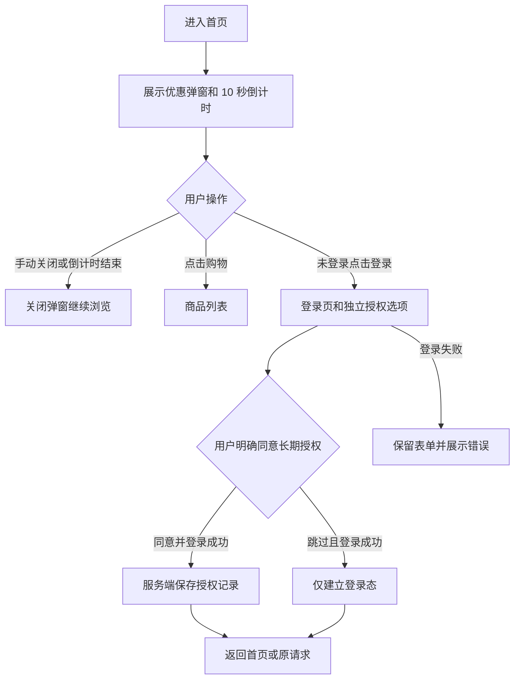
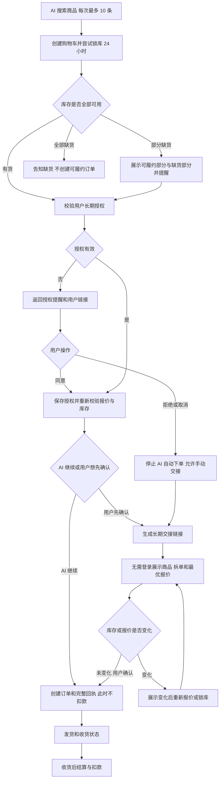
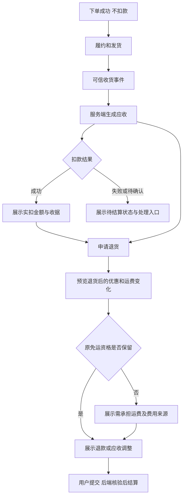

# React 前端交互与技术文档

## 1. 版本、技术栈与职责

- 版本：`v0.7-next-app-skeleton`，更新时间：2026-11-15（Asia/Shanghai）；补充“我的”账户中心、订单/物流/退款入口及网页 AI 助手布局，并落地 Next.js App Router 页面骨架。
- 对齐 [需求功能清单](requirements-analysis.md) 的 D-01～D-08；业务方向已确认，Q-01～Q-07 的细则仍待确定。
- Next.js 15 + React 19 + TypeScript，使用 App Router 管理页面路由、布局和动态参数；本项目以 Next.js 全栈应用骨架起步，后续 API Route/Server Action 可在同一仓库内按已确认后端契约实现。
- TanStack Query 管理商品、登录用户、授权、购物车、报价、拆单、订单及退货的服务端状态。
- Zustand 只管理营销弹窗和临时界面状态；React Hook Form + Zod 管理表单。授权、库存、支付结果不由本地状态裁决。
- 样式建议使用 CSS Modules + 统一主题变量，优先复用可访问的 Dialog、Checkbox、Alert、Table 等组件，保证功能可用。
- AI 助手作为 `AssistantDock` 独立于全站顶部导航；右侧展开宽度建议固定为 360px，收起后显示右下角卡通入口。面板使用 CSS transform/opacity 过渡，不依赖顶部搜索框。
- Vitest + Testing Library 验证交互；Playwright 覆盖登录授权、交接、拆单、收货及退货流程。本阶段仅设计，未实施这些测试。

## 2. 页面、路由与主要组件

| 路由 | 页面和组件 | 访问规则 |
| --- | --- | --- |
| `/` | 首页、`PromotionDialog`、登录引导 | 公开 |
| `/login` | 登录表单、`AiConsentSection`、授权说明 | 未登录；拒绝授权不影响登录 |
| `/account` | “我的”账户中心，订单概览、物流、退款/售后、授权管理入口 | 登录用户 |
| `/account/orders` | 我的订单列表，按订单状态筛选 | 登录用户 |
| `/account/logistics` | 我的物流列表，按包裹/子单展示最新物流状态 | 登录用户 |
| `/account/refunds` | 退款/售后订单列表，展示退款状态和金额 | 登录用户 |
| `/account/authorizations` | 当前 Agent 长期授权和撤销操作 | 登录用户 |
| `/authorize?requestId=...` | 下单触发的补充授权、订单摘要 | 未登录先登录；返回到原请求 |
| `/products` | 搜索、筛选、每页 10 条、分页 | 公开 |
| `/products/:productId` | 规格库存、脱敏评论分页 | 公开 |
| `/cart` | 锁库倒计时、`SplitNotice`、商品数量 | session 或受限购物车凭证 |
| `/checkout` | 最优报价、收货信息、拆单明细、收货后扣款说明 | 购物车访问权限 |
| `/handoff/:token` | 长期交接入口 | 无需登录；只获得绑定资源的权限 |
| `/orders/:orderGroupId/result` | 完整购买回执、子订单和缺货项 | 所有者 session 或受限订单凭证 |
| `/orders/:orderGroupId` | 履约、收货、扣款、退货状态 | 同上 |
| `/orders/:orderGroupId/logistics` | 当前订单的子单、包裹和物流轨迹 | 订单所有者或受限订单凭证 |
| `/orders/:orderGroupId/returns` | 退货选择、退款/应收和运费预览 | 资源级权限，敏感操作可要求额外验证 |
| 全站浮层 | `AssistantDock`、`AssistantLauncher`、`ComparisonTop3`、`SearchResultList`、`AssistantComposer` | 商品搜索公开；AI 下单仍要求有效长期授权 |

建议目录：`app/`（layout、page、loading、error、动态路由）、`features/{auth,promotion,catalog,cart,checkout,orders,returns}/`、`shared/{api,ui,types}/`。不在组件中重复实现优惠和库存算法。

### 2.1 布局基线与视觉方向

以下为可直接用于后续 UI 设计和 React 组件拆分的低保真布局方案；尺寸、配色为设计建议，不新增业务规则。交互流程见第 3～5 节，布局线框中的数据和状态均为占位示意，不代表实际报价或履约结果。

- 风格：简洁的商品卡片与明确的交易信息层级；白色内容面板、浅灰背景、深色正文，单一品牌主色用于主要操作。优惠、待处理和失败使用图标加文字表达，不只依赖颜色。
- 桌面浏览器：内容最大宽度 1200px，居中，左右至少 24px 留白；12 列栅格，24px 间距。导航高度建议 64px，卡片圆角 12px，间距采用 8/16/24/32px。浏览器窗口缩放或较窄窗口下按内容需要切换单列布局。
- 正文建议 16px，辅助文字不小于 14px；主要操作和图标按钮点击区域至少 44×44px。浏览器缩放或大字号时按内容需要提前切换单列。
- 金额统一显示币种与金额，明确区分“预计扣款”“已扣款”“应退”“额外应收”；下单按钮固定使用“确认下单，收货后扣款”。

共用页面骨架如下；简化交易页保留品牌、返回和必要账户入口，减少导航干扰。

```text
桌面浏览页
┌─────────────────────────────────────────────────────┐
│ 品牌 │ 搜索框                         │ 登录/账户 │ 购物车 │
├─────────────────────────────────────────────────────┤
│ 面包屑/页面标题                                       │
│ 页面主内容：筛选与商品 / 图文详情 / 账户内容               │
│ 分页或下一页                                          │
├─────────────────────────────────────────────────────┤
│ 服务说明与帮助入口                                    │
└─────────────────────────────────────────────────────┘
```

建议新增 `BrowseLayout`、`TransactionLayout`、`AccountLayout`、`PageContainer`、`OrderSummaryPanel`、`StickyActionBar` 作为组合组件。布局只负责排列，授权、报价、库存和扣款状态仍由业务模块提供。

### 2.2 页面布局覆盖表

| 页面/路由 | 桌面布局与信息顺序 | 主要操作 |
| --- | --- | --- |
| 首页 `/` | 全宽导航；顶部主视觉和购物入口；优惠说明条；推荐商品网格；优惠弹窗覆盖于页面中心 | “去逛商品” |
| 登录 `/login` | 居中约 480px 登录卡；标题、登录字段、独立 AI 授权区、登录按钮、帮助提示 | “登录” |
| 授权管理 `/account/authorizations` | 左侧约 220px 账户导航；右侧授权卡列表，按 Agent 显示状态、范围、授权时间和撤销入口 | “撤销授权”位于对应卡片 |
| 我的 `/account` | 左侧账户导航；右侧先展示订单状态概览，再展示待收货物流、退款/售后和授权摘要；每块都有进入列表或详情的入口 | “查看全部订单”“查看物流”“查看退款/售后”“管理 AI 授权” |
| 我的订单 `/account/orders` | 顶部按履约状态、结算状态和退款状态分组筛选；下方按时间倒序展示订单组、商品摘要、履约状态、结算状态、物流状态和可用操作 | “查看订单”“查看物流”“申请退货”（按状态显示） |
| 我的物流 `/account/logistics` | 按包裹/子单展示承运商、运单号脱敏值、最新节点、预计送达和轨迹入口；缺少物流信息时显示原因 | “查看物流详情”“查看订单” |
| 我的退款 `/account/refunds` | 按申请时间展示退款/售后订单、商品、申请原因、审核/退款状态、预计退款和额外应收 | “查看退款详情”“查看原订单” |
| 补充授权 `/authorize` | 简化导航；主区约 7/12 展示 Agent、权限与独立同意操作；右区约 5/12 展示本次购物摘要 | “同意长期授权”“暂不授权” |
| 商品列表 `/products` | 搜索和筛选摘要在上；左侧约 240px 筛选；右侧商品 4 列，每次最多 10 条，底部分页 | 商品卡进入详情 |
| 商品详情 `/products/:productId` | 上部左右各半：图片画廊 / 名称、价格、规格、库存、数量、加入购物车；下部商品说明及脱敏评论 | “加入购物车” |
| 购物车 `/cart` | 标题后为锁库信息和拆单提醒；左区约 8/12 商品列表，右区约 4/12 费用和结账入口；缺货部分独立分组 | “去结账” |
| 结账 `/checkout` | 顶部拆单/变价提醒；左区约 8/12 依次收货信息、商品、配送分组；右区约 4/12 最优报价及扣款说明 | “确认下单，收货后扣款” |
| 交接 `/handoff/:token` | 复用结账骨架，顶部增加“AI 已准备购物内容”及校验状态；已存在的非敏感信息可按权限展示 | 不要求登录 |
| 下单回执 `/orders/:orderGroupId/result` | 顶部结果及“本次未扣款”；中部完整购买清单、子单、缺货去向；底部金额与下一步 | “查看订单详情”“继续购物” |
| 订单详情 `/orders/:orderGroupId` | 顶部订单编号及两类状态；左区约 8/12 子单履约进度、商品、配送信息；右区约 4/12 金额及扣款记录 | 按实际状态显示退货或处理入口 |
| 退货 `/orders/:orderGroupId/returns` | 左区约 8/12 选择商品、数量和原因；右区约 4/12 费用变化、退款/应收预览和提交 | “提交退货申请” |

### 2.3 首页、登录与授权线框

```text
首页 /                         首页优惠弹窗（覆盖层）
┌──────────────────────────┐   ┌─────────────────────────┐
│ 导航与搜索                │   │ 优惠说明        10s  [×] │
├──────────────────────────┤   │ 满减 / 免运 / AI 优惠    │
│ 用 AI 助理购物            │   │ 以结算时适用规则为准      │
│ 简短说明      [去逛商品]   │   │ [登录查看 AI 授权]*      │
├──────────────────────────┤   │ 手动关闭或倒计时关闭      │
│ 优惠说明条                │   └─────────────────────────┘
│ 推荐商品：图/名称/价格     │   *按钮按实际登录和授权状态变化
│ [商品] [商品] [商品] [商品]│
└──────────────────────────┘

登录 /login                   补充授权 /authorize
┌──────────────────────────┐  ┌───────────────────────────────┐
│ 登录                     │  │ 品牌 / 返回                    │
│ 登录字段（方式待实现确定） │  ├────────────────┬──────────────┤
│ 字段错误原位显示          │  │ Agent 身份     │ 本次商品摘要 │
│ ── AI 长期代下单授权 ──  │  │ 授权范围与撤销 │ 商品/规格/量 │
│ □ 同意授权（可跳过）      │  │ □ 明确同意     │ 拆单及金额   │
│ 范围说明 / 撤销入口说明   │  │ [同意长期授权] │ 当前状态     │
│ [登录]                   │  │ [暂不授权]     │              │
│ 未同意也可正常登录        │  └────────────────┴──────────────┘
└──────────────────────────┘

授权管理 /account/authorizations
┌────────────┬───────────────────────────────────────┐
│ 账户导航   │ AI 长期授权                           │
│ 当前：授权 │ [Agent 名称 / 生效或已撤销]            │
│            │ 范围 / 授权时间 / 说明     [撤销授权] │
└────────────┴───────────────────────────────────────┘
```

“我的”账户中心 /account
```text
┌──────────────┬──────────────────────────────────────────────┐
│ 我的          │ 账户摘要 / 最近订单                           │
│ 订单          │ [待付款/待发货/配送中/已完成]                  │
│ 物流          ├──────────────────────────────────────────────┤
│ 退款/售后     │ 待收货物流：包裹、最新节点、预计送达 [查看物流] │
│ AI 授权       ├──────────────────────────────────────────────┤
│               │ 退款/售后：处理中、已退款、应收调整 [查看全部]  │
│               ├──────────────────────────────────────────────┤
│               │ AI 长期授权摘要                       [管理]  │
└──────────────┴──────────────────────────────────────────────┘
```

订单列表进入“订单详情”查看商品、履约、收货、扣款和退货；物流入口进入包裹轨迹；退款/售后入口进入退款状态和金额明细。账户中心只展示当前登录用户有权限访问的资源。

首页不承诺额外营销内容或新业务入口；推荐区复用商品卡片。弹窗关闭按钮固定在右上角且立即可用；内容超长时仅内容区滚动，关闭入口保持可见。登录失败在字段及卡片顶部反馈；授权写入失败显示“已登录，授权未完成”，将重试入口放在授权区。撤销操作通过确认对话框说明影响，提交中只禁用该授权卡的操作，成功后保留“已撤销”状态反馈。

### 2.4 商品列表与详情线框

```text
商品列表 /products
┌────────────────────────────────────────────────────┐
│ 搜索关键词 [搜索]          已选条件 / 清除条件        │
├────────────┬───────────────────────────────────────┤
│ 筛选条件   │ 商品结果（本次最多 10 条）              │
│ 分类等*    │ [图/名称/价格] [商品] [商品] [商品]    │
│            │ [商品]         [商品] ...              │
│            │ [上一页：有历史时] [下一页：hasMore]    │
└────────────┴───────────────────────────────────────┘
*仅展示后端实际支持的筛选字段；不额外承诺分类或排序接口。

商品详情 /products/:productId
┌──────────────────────┬─────────────────────────────┐
│ 主图                 │ 商品名称 / 价格与币种        │
│                      │ 规格选择 / 对应库存          │
│ 缩略图               │ 数量 [-] [n] [+]             │
│                      │ [加入购物车] / 操作反馈      │
├──────────────────────┴─────────────────────────────┤
│ 商品说明与规格                                      │
│ 评论：脱敏昵称 / 正文 / 已处理媒体 / 分页             │
└────────────────────────────────────────────────────┘
```

商品卡只展示对购买有用的公开信息，不展示毛利、内部推荐分数或权重。首次加载用与卡片等高的骨架；无结果在结果区展示“调整关键词/清除筛选”，保留搜索条件；请求失败在相同区域显示重试。分页使用服务端 cursor，不伪造总页数或全量商品数。详情页无库存时保留规格、数量与缺货文字，禁用加入操作并说明原因；加入成功在购买区反馈并更新购物车入口数量。

### 2.5 购物车、结账与交接线框

```text
购物车 /cart
┌────────────────────────────────────────────────────┐
│ 购物车 / 库存锁定截止时间                            │
│ 拆单提醒：哪些能下单、哪些缺货、数量和配送影响         │
├────────────────────────────────┬───────────────────┤
│ 可履约商品                     │ 本次费用摘要       │
│ 图片 名称 规格 数量 小计 [移除] │ 商品/优惠/运费     │
│ 缺货部分：原始数量/可履约/缺货  │ 预计扣款金额       │
│ 待处理说明，不计入本次应收     │ [去结账]           │
└────────────────────────────────┴───────────────────┘

结账 /checkout 和交接 /handoff/:token
┌────────────────────────────────────────────────────┐
│ 结账 / AI 购物交接说明（仅交接页）                   │
│ 库存/报价变化、拆单提醒                              │
├────────────────────────────────┬───────────────────┤
│ 1 收货信息（字段错误就近展示） │ 最优惠方案         │
│ 2 本次购买清单：图/名称/规格/量 │ 商品金额           │
│ 3 子单或配送分组、缺货去向     │ 优惠逐项列出       │
│                                │ 运费 / 预计扣款    │
│                                │ 收货后扣款说明     │
│                                │ [确认下单，        │
│                                │  收货后扣款]       │
└────────────────────────────────┴───────────────────┘
```

桌面摘要可在视口内吸顶，但内容超高时回到正常文档流。关键购买内容和拆单提醒始终在页面主内容或费用摘要中可见。锁库过期在原提醒区域显示“需要重新校验”，不清空用户已填表单；报价更新时原地展示变化前后值，并在手动路径重新确认前禁用下单。报价加载及提交中展示明确文案，避免金额更新时仍可提交旧报价。

交接首次进入先显示校验骨架，校验通过再显示购买内容；已下单展示既有回执入口，链接撤销或资源关闭展示原因和返回商品入口。长期链接不承诺库存持续保留；无需登录的交接页不插入强制登录或营销弹窗。代扣授权入口和具体文案仅在渠道及方案确定后加入费用说明附近，和 AI 代下单授权分开。

### 2.6 回执、订单与退货线框

```text
下单回执 /orders/:orderGroupId/result
┌────────────────────────────────────────────────────┐
│ 下单成功 / 本次未扣款 / 订单组编号                   │
│ 拆单提醒：已下单数量、缺货数量及去向                 │
│ 子单 A：完整购买清单与金额                           │
│ 子单 B（如有）：完整购买清单与金额                   │
│ 缺货待处理项：商品、规格、数量                       │
│ 商品金额 / 优惠 / 运费 / 预计扣款总额                │
│ [查看订单详情] [继续购物]                           │
└────────────────────────────────────────────────────┘

订单详情 /orders/:orderGroupId
┌────────────────────────────────────────────────────┐
│ 订单组编号    履约：服务端状态    结算：服务端状态     │
│ 拆单提醒 / 需要处理的事项                            │
├────────────────────────────────┬───────────────────┤
│ 子单 A：履约进度和时间          │ 商品/优惠/运费     │
│ 商品清单 / 脱敏配送信息         │ 预计扣款/已扣款    │
│ 子单 B：独立履约进度（如有）    │ 扣款及退款记录     │
│ 缺货待处理项                   │ [当前可用操作]     │
└────────────────────────────────┴───────────────────┘

退货 /orders/:orderGroupId/returns
┌────────────────────────────────────────────────────┐
│ 申请退货 / 原订单摘要                               │
├────────────────────────────────┬───────────────────┤
│ □ 商品/规格/可退数量/退货数量   │ 调整前 → 调整后    │
│ 退货原因与必要说明             │ 保留商品与优惠     │
│ 不能退的商品及原因             │ 免运资格变化       │
│ 预览失败提示与重试             │ 原配送费与应补差额 │
│                                │ 应退 / 额外应收    │
│                                │ [提交退货申请]     │
└────────────────────────────────┴───────────────────┘
```

我的订单 /account/orders、我的物流 /account/logistics、我的退款 /account/refunds 复用账户左侧导航。列表提供筛选、分页和空状态；订单卡片把“履约状态”“物流状态”“结算状态”“退款状态”分开显示，避免用一个综合状态掩盖扣款或退款进度。

订单页以“履约”和“结算”两组文字状态呈现，不把“已收货”画成“已扣款”。“确认收货”是否出现取决于 Q-02 最终决策；扣款未知时展示“处理中”和状态查询反馈，不展示可重复发起收费的按钮。无访问权限时仅展示通用提示，不先渲染订单详情。

退货页面在选择变化后刷新费用预览；未选商品、数量不合法或预览未完成时禁用提交并说明原因。配送费已收金额和应补差额分别列出；未明确规则的退货寄送费不填入估算数字。页面明确显示“预计应退”和“额外应收”（如有），不能用无标签的净额掩盖新增费用；提交成功展示申请状态及返回原订单入口。

### 2.7 共享状态与布局验收

| 状态 | 位置与反馈 | 操作规则 |
| --- | --- | --- |
| 初次加载 | 在主内容对应区域显示骨架，保留标题和导航 | 不展示默认零元报价或成功授权 |
| 空内容 | 列表/购物车/授权区使用原位空状态及一个相关入口 | 空购物车去浏览商品；无授权可解释授权触发方式 |
| 局部失败 | 失败卡片或字段旁显示原因与重试；保留其他已加载内容 | 不用覆盖整个页面的弹窗反复报错 |
| 资源失效/权限不足 | 主内容切换为状态面板，提供允许的登录、返回或重新校验入口 | 受限内容不短暂闪现，登录后回到原请求 |
| 金额/库存变化 | 商品区和费用区展示具体差异，顶部提醒可定位到变化项 | 重报价期间阻止使用旧数据下单 |
| 操作处理中 | 当前按钮显示进度，相关控件暂时禁用，操作结果原位反馈 | 后端幂等仍是最终保障；失败后保留表单 |

布局验收除第 8 节交互标准外，检查 1024/1280/1440px 代表桌面窗口宽度及 200% 浏览器缩放：无关键内容横向溢出，键盘可达全部操作，焦点不被吸顶区域挡住，商品/拆单/币种/费用始终可读。此处是设计验收计划，未生成高保真稿或执行浏览器验证。

### 2.8 全站 AI 助手停靠面板布局

助手是独立于站点导航的右侧停靠面板。顶部站点可以保留商品目录搜索，但 AI 对话入口不放在顶部搜索框。展开宽度建议 360px，面板高度为可视区高度。

```text
桌面：助手展开                          桌面：助手收起
┌─────────────────────────────┬──────────────┐
│ 页面导航/内容                │ 助手标题 [收起]│
│                             ├──────────────┤
│ 页面主内容                   │ TOP3 固定比较 │
│                             │ 价格/规格/取舍 │
│                             ├──────────────┤
│                             │ 搜索结果列表   │
│                             │ 仅此区域滚动   │
│                             ├──────────────┤
│                             │ [输入商品需求] │
│                             │ [发送]         │
└─────────────────────────────┴──────────────┘
                                                  ◉ 卡通入口

```

- 桌面默认展开，`AssistantDock` 固定在视口右侧，宽度恒定；主内容区预留该宽度，避免遮住商品操作。收起动画建议约 220ms，面板淡出并收拢为右下角 `AssistantLauncher`。
- 入口建议 56×56px，默认距右、下各 16px；可拖动，松手后吸附最近边缘并夹在视口内，位置保存为本地界面偏好；提供恢复默认位置。键盘焦点下 Enter/Space 打开，Escape 收起。
- 支持 `prefers-reduced-motion`；拖动使用 Pointer Events 和 pointer capture，不能仅以拖动作为唯一打开方式。
- 面板头部展示助手名/状态和收起按钮。TOP3 比较区固定在头部下方，显示商品、到手价/优惠、核心规格、库存/配送、评分/评论量以及“优势/需要权衡”。
- 中间结果区显示完整命中列表，每次 API 最多 10 件，独立 `overflow-y: auto`；前三项和 TOP3 通过商品 ID 对齐。卡片提供打开详情和加入比较入口。
- 底部 `AssistantComposer` 固定，多行输入有高度上限。发送、取消、重试状态原位反馈。

建议组件：`AssistantDock`、`AssistantHeader`、`ComparisonTop3`、`ComparisonProductCard`、`SearchResultList`、`AssistantComposer`、`AssistantLauncher`。面板展开、拖动坐标属于 Zustand 界面状态；搜索结果和比较数据由 TanStack Query 缓存。不要把授权、库存或订单状态放进拖动状态。

优劣字段建议（均需可追溯至服务器数据）：

| 对比项 | 展示内容 | 边界 |
| --- | --- | --- |
| 价格 | 当前标价；有报价上下文时显示到手价、优惠金额和规则说明 | 搜索阶段不虚构最终购物车报价，报价失效时标为估算 |
| 核心规格 | 按品类配置的 3～5 项可比属性，如尺寸、容量、材质、兼容性 | 缺失显示“暂无数据”，同义且单位可归一时才横向比较 |
| 库存与配送 | 可售/缺货；有可信数据时显示预计配送窗口 | 搜索结果不是库存承诺，不编造到货日期 |
| 评分与口碑 | 平均评分、评论数，可选脱敏评论摘要 | 标注样本量；摘要需能追溯，不把评论推断成事实 |
| 优势/权衡 | 每件 1～3 条结构化优势和待权衡点，标明依据字段 | 不使用毛利、隐藏排序权重或缺失字段推断 |

建议首期实现价格、规格、库存和评分/评论量；配送时效和评论摘要依赖可信数据源再启用。品类没有共同属性时保留共同字段，并在单品卡展示差异属性。

## 3. 登录、首页与授权交互



### 3.1 首页优惠弹窗

- 展示满 1000 减 100、满 990 免运、AI 订单额外 95 折，并提示“系统自动匹配适用优惠，以结算结果为准”。不把点击优惠当作授权。
- 显示“10 秒后自动关闭”，按打开时间 `deadline` 计算剩余秒数；10 秒后关闭，页面后台计时漂移恢复后也检查实际时间。
- 关闭按钮从展示的第一刻可用，Esc 可关闭。倒计时无需阻止手动关闭，也不执行自动跳转或自动同意。
- 未登录展示“登录查看 AI 授权”；已登录且未授权展示授权入口；已授权展示“去购物”。
- 交接结账、授权页不显示营销弹窗，避免打断任务。建议每个浏览器会话仅展示一次，用 `sessionStorage` 保存展示标记；频率是可调整设计建议。
- 对话框打开后管理焦点，关闭后恢复触发位置；倒计时不每秒向读屏重复播报。

### 3.2 登录区域长期授权

- 授权选项未预选，与登录提交分离；展示代下单范围、适用 Agent、撤销入口及“收货后扣款”的购物说明。
- 用户跳过授权仍可完成登录，服务端返回实际授权状态。不得通过登录按钮、促销接受或 10 秒计时隐式授予授权。
- 先完成身份校验，再基于本次明确同意写入授权；写授权失败时显示“已登录，授权未完成”，允许重试。
- 用户中心支持撤销，成功后使 Query 中的授权缓存失效。长期授权不意味着浏览器持有长期明文 Agent token。
- 代下单授权和支付代扣授权分别展示、分别记录；渠道及代扣文案待支付方案确定。

## 4. AI 下单、拆单与交接图



### 4.1 未授权时再次提醒

- 后端返回 `AUTHORIZATION_REQUIRED`、`authorizationUrl`、`authorizationRequestId`；AI 将用户引导到可见授权页面。没有用户页面时也能通过链接完成，不能只依赖首页登录态。
- 授权页显示 Agent 身份和本次购物摘要。确认后重新读取授权、库存及报价，不用旧报价直接重放订单请求。
- 同一个下单意图用关联 `requestId` 保持幂等；同意授权本身不创建订单，由 Agent 或用户明确恢复流程。
- 拒绝、关闭或链接失效保持未授权状态，不循环强制授权；可继续走无登录的交接手动下单。

### 4.2 购物车、拆单与结账

- 每行展示原始数量、锁定数量、缺货数量、锁定截止时间。按服务端 `expiresAt` 倒计时，到期重新拉取而非本地宣布扣库存成功。
- `SplitNotice` 持续展示拆分原因、已下单/待处理部分、费用和配送变化；AI 回执也返回同一提醒。
- 可履约项才进入本次订单；缺货项保留可追踪状态。补货后是否自动下单未确定，不生成隐藏应收。
- 提交按钮使用“确认下单，收货后扣款”；界面显示预计扣款总额、商品、规格、优惠及运费，移除“确认并支付”。
- 前端展示后端选出的最优惠方案和选用规则，修改数量、来源资格、拆分结果或地址后重新报价。
- 提交携带 `quoteId` 和购物车版本。价格或库存变化时明确展示差异，用户手动路径需重新确认；AI 路径仅在授权范围内重试。

### 4.3 长期交接链接

- 无需登录直接访问绑定的购物内容；不能借交接权限授予账户长期授权。
- 入口用 token 换受限的短期会话，随后移除地址栏原 token；页面不加载会泄漏 token 的第三方资源。
- 链接长期存在，库存锁和报价可以失效；过期后重新校验，明确显示价格/数量变化。
- 已下单链接进入既有回执；撤销或资源关闭显示对应状态，不把关闭的订单再次提交。

## 5. 收货、扣款与退货交互



- 订单页分开显示 `fulfillmentStatus` 和 `settlementStatus`，例如“已收货 / 扣款处理中”。扣款超时显示处理中，不引导重复支付。
- 允许用户确认收货的入口、物流签收作为扣款触发源的规则待 Q-02 确认；前端不得仅凭计时器触发扣款。
- 退货预览展示退货项、保留项、原优惠、调整后优惠、应退金额、运费和额外应收。
- 尚未扣款：调整应收；已扣款：显示退款及费用抵扣结果，超出可抵扣部分单独列为应收。原运费已收的，不重复显示一次新运费。
- 运费“原配送费”与退货寄送费分栏，后一项没有明确规则前不自动添加。

## 6. 前后端契约摘要

所有业务接口统一前缀 `/api/v1`；金额示例采用最小货币单位整数，TWD 舍入细节以 Q-03 最终配置为准。

```ts
type Authorization = {
  status: 'NOT_GRANTED' | 'ACTIVE' | 'REVOKED';
  grantId?: string;
  agentId?: string;
  scope: string[];
  version?: number;
};

type ProductSearchResponse = {
  items: ProductCard[]; // 最多 10 条
  pageSize: 10;
  nextCursor: string | null;
  hasMore: boolean;
};

type AssistantSearchResponse = ProductSearchResponse & {
  topComparisons: Array<{
    rank: 1 | 2 | 3;
    productId: string;
    price: { amountMinor: number; currency: 'TWD'; label: 'CURRENT' | 'ESTIMATE' } | null;
    discountSummary: string[];
    comparableAttributes: Array<{ key: string; label: string; value: string | null }>;
    inventoryStatus: 'AVAILABLE' | 'LOW_STOCK' | 'OUT_OF_STOCK' | 'NOT_AVAILABLE';
    deliveryWindow: { from: string; to: string } | null;
    rating: { value: number; count: number } | null;
    strengths: Array<{ text: string; basisFields: string[] }>;
    tradeoffs: Array<{ text: string; basisFields: string[] }>;
  }>;
  comparisonVersion: string;
};

type Quote = {
  quoteId: string;
  cartVersion: number;
  currency: 'TWD';
  subtotalMinor: number;
  discountMinor: number;
  shippingMinor: number;
  totalDueMinor: number;
  appliedRules: string[];
  ruleVersion: string;
  expiresAt: string;
};

type SplitSummary = {
  split: boolean;
  fulfillableItems: AllocationItem[];
  shortageItems: AllocationItem[];
  notice: string | null;
};

type OrderGroupView = {
  orderGroupId: string;
  splitSummary: SplitSummary;
  orders: Array<{
    orderId: string;
    fulfillmentStatus: 'PLACED' | 'FULFILLING' | 'SHIPPED' | 'RECEIVED' | 'COMPLETED';
    settlementStatus: 'NOT_DUE' | 'DUE' | 'CHARGING' | 'PAID' | 'FAILED';
  }>;
  quote: Quote;
};
```

`ProductCard`、`AllocationItem` 的字段及完整 API DTO 在实现阶段随 OpenAPI 明细化；上述类型是跨端契约摘要，不是独立可编译代码。

| 接口 | 用途 |
| --- | --- |
| `POST /api/v1/auth/login`、`GET /api/v1/auth/session` | 登录与 session；响应附实际授权状态 |
| `GET/POST /api/v1/me/agent-authorizations` | 读取/授予指定 Agent 长期授权 |
| `DELETE /api/v1/me/agent-authorizations/:grantId` | 撤销长期授权 |
| `GET /api/v1/authorization-requests/:id` | 展示下单补充授权请求，只允许匹配用户读取 |
| `GET /api/v1/products`、`GET /api/v1/products/:id` | 每次 10 条商品/商品详情 |
| `POST /api/v1/assistant/search` | AI 助手自然语言搜索，最多 10 条结果及最多 3 条可追溯比较数据 |
| `GET /api/v1/products/:id/reviews` | 脱敏评论分页 |
| `POST /api/v1/carts`、`PATCH /api/v1/carts/:id/items` | 创建及编辑购物车 |
| `POST /api/v1/carts/:id/quotes` | 重校验、拆分预览和最优报价 |
| `POST /api/v1/carts/:id/orders` | 幂等建单，返回父子单及缺货明细，不扣款 |
| `POST /api/v1/carts/:id/handoff-links` | 创建长期可撤销交接链接 |
| `POST /api/v1/handoff/exchange` | body 携带 token，交换受限会话 |
| `GET /api/v1/me/overview` | “我的”首页概览：订单状态计数、待收货物流摘要、退款/售后摘要、授权摘要 |
| `GET /api/v1/me/orders` | 当前用户订单列表，支持状态筛选和分页 |
| `GET /api/v1/me/logistics` | 当前用户包裹/子单物流列表，返回最新节点和轨迹摘要 |
| `GET /api/v1/me/refunds` | 当前用户退款/售后列表，返回审核、退款、应收调整状态和金额 |
| `GET /api/v1/order-groups/:id` | 查询回执及履约/结算状态 |
| `GET /api/v1/order-groups/:id/logistics` | 查询订单子单、包裹和物流轨迹 |
| `POST /api/v1/order-groups/:id/receipt-confirmations` | 用户确认收货；是否采用由 Q-02 决定 |
| `POST /api/v1/order-groups/:id/return-quotes`、`.../returns` | 退货预览、提交申请 |

## 7. 错误、脱敏与可访问性

- 错误统一 `code`、`message`、`requestId`、可选 `fieldErrors` 和 `details`；不把敏感 token 写入错误或埋点。
- 401 引导登录，`AUTHORIZATION_REQUIRED` 引导补充授权，409 处理报价/库存变化，410 处理撤销链接，429 退避重试。
- 拆单成功是携带明细的业务结果，不作为通用请求失败；全部缺货展示 `OUT_OF_STOCK`。
- 评论只渲染服务端脱敏字段；未经脱敏的图片和原始头像不能用前端 CSS 遮盖后继续加载。
- React Query 按用户/资源隔离缓存，退出登录清理授权、订单和个人信息缓存；不将代扣凭证保存在 localStorage。
- Dialog 支持键盘和焦点恢复，表单错误与输入关联，拆单和扣款失败用可读文字说明；下单按钮防重复提交仍依赖后端幂等保障。

## 8. 验证计划与待定边界

交互验收对应需求 AC-01～AC-18，重点验证：10 秒自动关闭与立即手动关闭、拒绝授权仍登录、补充授权后重报价、部分缺货提醒、下单不扣款、扣款失败不重复收费、退货运费明细、无登录交接和已下单链接重访，以及助手停靠/收起动画、拖动入口、TOP3 固定比较、列表独立滚动和“我的”中的订单/物流/退款入口隔离。

Q-01～Q-06 以需求文档为统一决策入口。弹窗频率、支付授权文案、分批收货、缺货后续处理、促销舍入未作为最终产品结论。

本次新增布局验收：桌面助手宽度稳定且不遮挡主内容；入口拖动后仍留在视口内并可通过键盘打开；桌面窗口调整后仍保持布局可用；长结果列表滚动不带动 TOP3 或底部输入框；比较字段缺失时如实标注且不显示隐藏权重。尚未执行浏览器视觉回归。
