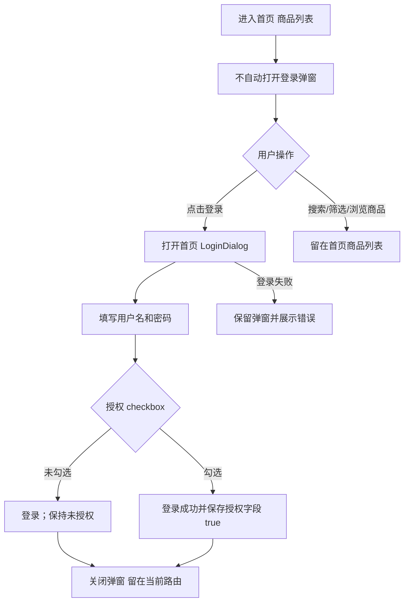
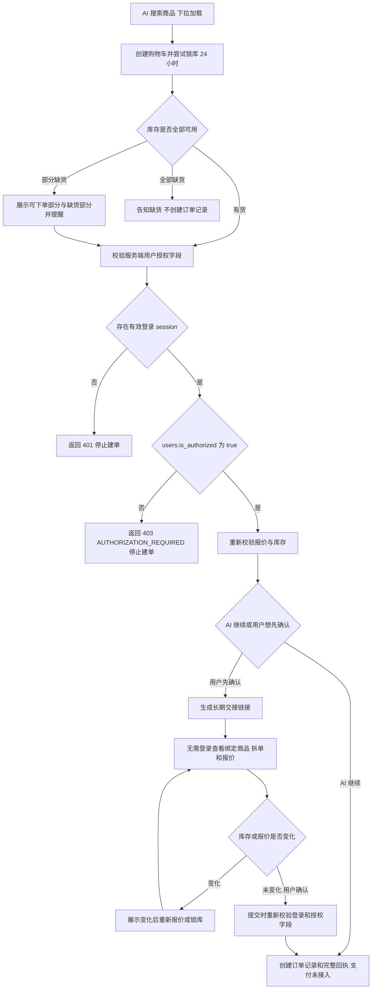

# React 前端交互与技术文档

## 1. 版本、技术栈与职责

- 版本：`v0.1.0`，更新时间：2026-11-16（Asia/Shanghai）；补充“我的”账户中心、订单记录入口及网页 AI 助手商品推荐 Agent 布局，落地 Next.js App Router 页面骨架。
- 对齐 [需求功能清单](requirements-analysis.md) 的 D-01～D-09；业务方向已确认，Q-01～Q-08 的细则仍待确定。
- Next.js 15 + React 19 + TypeScript，使用 App Router 管理页面路由、布局和动态参数；本项目以 Next.js 全栈应用骨架起步，后续 API Route/Server Action 可在同一仓库内按已确认后端契约实现。
- TanStack Query 管理商品、登录用户、授权、购物车、报价、拆单和订单记录的服务端状态。
- Zustand 只管理助手面板和临时界面状态；React Hook Form + Zod 管理表单。授权、库存、订单创建结果不由本地状态裁决。
- 样式建议使用 CSS Modules + 统一主题变量，优先复用可访问的 Dialog、Checkbox、Alert、Table 等组件，保证功能可用。
- AI 助手作为 `AssistantDock` 独立于全站顶部导航；右侧展开宽度建议固定为 360px。首页 `/` 上助手占据页面位置（不浮动遮罩）且默认展开，收起后显示右下角可拖动卡通小精灵入口。面板使用 CSS transform/opacity 过渡，不依赖顶部搜索框。
- Vitest + Testing Library 验证交互；Playwright 覆盖登录授权、交接、订单记录创建及“我的”查看流程。

## 2. 页面、路由与主要组件

| 路由                              | 页面和组件                                                                                                     | 访问规则                                             |
| --------------------------------- | -------------------------------------------------------------------------------------------------------------- | ---------------------------------------------------- |
| `/`                               | 商品列表（搜索、筛选、下拉加载，pageSize 默认 20）、非阻塞优惠提示条、`LoginDialog` 登录/注册弹窗              | 公开；进入首页不自动打开登录或优惠弹窗               |
| `/account`                        | “我的”账户中心，订单记录概览、AI 自助下单授权入口                                                               | 登录用户                                             |
| `/account/orders`                 | 我的订单记录列表，按创建时间查看                                                                                | 登录用户                                             |
| `/products/:productId`            | 规格库存、脱敏评论分页                                                                                         | 公开                                                 |
| `/cart`                           | 购物车商品数量和报价状态                                                                                       | session 或受限购物车凭证                             |
| `/checkout`                       | 商品与报价摘要、订单记录创建说明                                                                              | 购物车访问权限                                       |
| `/handoff/:token`                 | 长期交接入口                                                                                                   | 无需登录查看绑定内容；建单必须登录并通过授权字段检查 |
| `/orders/:orderGroupId/result`    | 单条订单记录创建回执、订单编号和时间                                                                            | 当前用户 session                                     |
| `/orders/:orderGroupId`           | 单条订单记录详情、商品摘要和创建时间                                                                            | 当前用户 session                                     |
| 全站停靠组件                      | `AssistantDock`、`AssistantLauncher`、`SearchResultList`、`ProductResultCard`、`AssistantComposer`、`LoginDialog` | 商品搜索公开；AI 下单由 M5/M6 服务端契约负责         |

建议目录：`app/`（layout、page、loading、error、动态路由）、`features/{auth,promotion,catalog,cart,checkout,orders}/`、`shared/{api,ui,types}/`。不在组件中重复实现优惠和库存算法。

### 2.1 布局基线与视觉方向

以下为可直接用于后续 UI 设计和 React 组件拆分的低保真布局方案；尺寸、配色为设计建议，不新增业务规则。交互流程见第 3～5 节，布局线框中的数据和状态均为占位示意，不代表实际报价或订单创建结果。

- 风格：简洁的商品卡片与明确的交易信息层级；白色内容面板、浅灰背景、深色正文，单一品牌主色用于主要操作。优惠、待处理和失败使用图标加文字表达，不只依赖颜色。
- 桌面浏览器：内容最大宽度 1200px，居中，左右至少 24px 留白；12 列栅格，24px 间距。导航高度建议 64px，卡片圆角 12px，间距采用 8/16/24/32px。浏览器窗口缩放或较窄窗口下按内容需要切换单列布局。
- 正文建议 16px，辅助文字不小于 14px；主要操作和图标按钮点击区域至少 44×44px。浏览器缩放或大字号时按内容需要提前切换单列。
- 金额如有报价则统一显示币种与金额；未确认的金额快照规则标记为 `needs_human_review`。按钮固定使用“付款”，其语义是创建订单记录。

共用页面骨架如下；简化交易页保留品牌、返回和必要账户入口，减少导航干扰。

```text
桌面浏览页
┌─────────────────────────────────────────────────────┐
│ 品牌 │ 搜索框                         │ 登录/账户 │ 购物车 │
├─────────────────────────────────────────────────────┤
│ 面包屑/页面标题                                       │
│ 页面主内容：筛选与商品 / 图文详情 / 账户内容               │
│ 分页或下一页                                          │
├─────────────────────────────────────────────────────┤
│ 服务说明与帮助入口                                    │
└─────────────────────────────────────────────────────┘
```

建议新增 `BrowseLayout`、`TransactionLayout`、`AccountLayout`、`PageContainer`、`OrderSummaryPanel`、`StickyActionBar` 作为组合组件。布局只负责排列，授权、报价、库存和订单创建状态仍由业务模块提供。

### 2.2 页面布局覆盖表

| 页面/路由                               | 桌面布局与信息顺序                                                                                                                                                                                                            | 主要操作                                                                         |
| --------------------------------------- | ----------------------------------------------------------------------------------------------------------------------------------------------------------------------------------------------------------------------------- | -------------------------------------------------------------------------------- |
| 首页 `/`（商品列表）                    | 全宽导航；顶部非阻塞优惠提示条；搜索与筛选摘要；左侧约 240px 筛选、中间商品网格（下拉加载，pageSize 默认 20、最大 100）；右侧为 AI 助手预留固定宽度侧栏（默认展开、占据页面位置），商品网格随助手占位收窄；不自动打开任何弹窗 | 用户点击导航“登录”后打开 `LoginDialog`；点击助手“收起”变为小精灵；商品卡进入详情 |
| 首页登录弹窗                            | 居中约 480px modal；标题、用户名、密码、未授权时显示默认未勾选 checkbox（文案为“同意 AI 助手代为创建订单记录”）、登录按钮、错误提示                                                                                     | “登录”；关闭按钮保持可见；已授权用户不显示 checkbox                              |
| 我的 `/account`                         | 左侧账户导航；右侧先展示订单记录概览，再展示 AI 自助下单授权入口；每块都有进入列表或详情的入口                                                                                                                               | “查看全部订单”“AI自助下单授权”                                                  |
| 我的订单 `/account/orders`              | 按时间倒序展示订单记录、订单编号、商品摘要与创建结果；支持分页和空状态                                                                                                        | “查看订单”                                     |
| 商品详情 `/products/:productId`         | 上部左右各半：图片画廊 / 名称、价格、规格、库存、数量、加入购物车；下部商品说明及脱敏评论                                                                                                                                     | “加入购物车”                                                                     |
| 购物车 `/cart`                          | 标题后为库存和报价提醒；左区约 8/12 商品列表，右区约 4/12 费用和结账入口                                                                                                                                | “去结账”                                                                         |
| 结账 `/checkout`                        | 顶部变价提醒；左区约 8/12 商品清单；右区约 4/12 报价摘要及订单记录创建说明                                                                                                                             | “付款”                                                                         |
| 交接 `/handoff/:token`                  | 复用结账骨架，顶部增加“AI 已准备购物内容”及校验状态；仅展示链接绑定的内容，提交建单时要求登录和授权                                                                                                                           | 查看不要求登录；建单按统一门禁校验                                               |
| 下单回执 `/orders/:orderGroupId/result` | 展示“订单已创建，支付未接入”、一条订单编号及创建时间                                                                                                                                                                         | “查看订单详情”“继续购物”                                                         |
| 订单详情 `/orders/:orderGroupId`        | 顶部订单编号及创建时间；左区约 8/12 商品、规格、数量；右区约 4/12 已保存的金额摘要                                                                                                                                          | “返回商品列表”                                                                 |

### 2.3 首页（商品列表）、登录与授权线框

```text
首页 /（即商品列表；进入时不自动弹窗；右侧 AI 助手默认展开、占据页面位置）
┌────────────────────────────────────┬────────────────┐
│ 导航与搜索             [登录][购物车] │ AI 助手  [收起]  │
├────────────────────────────────────┼────────────────┤
│ 非阻塞优惠提示条（如展示，不遮挡）   │ Agent 商品结果   │
│ 搜索关键词 [搜索]    已选条件/清除   │ (左抽屉看对比)  │
├────────────┬───────────────────────┼────────────────┤
│ 筛选条件   │ 商品结果（下拉加载）    │ 搜索结果列表      │
│ 分类等*    │ [商品] [商品] [商品]   │ 仅此区域滚动      │
│            │ [商品] [商品] ...      ├────────────────┤
│            │ 滚动到底部自动加载更多  │ [输入商品需求]    │
│            │                       │ [发送]            │
└────────────┴───────────────────────┴────────────────┘
*仅展示后端实际支持的筛选字段；不额外承诺分类或排序接口。

首页登录弹窗（点击登录后打开，不改变路由）
┌───────────────────────────────┐
│ 登录                       [×] │
│ 用户名 [                    ]  │
│ 密码   [                    ]  │
│ □ 同意 AI 助手代为创建订单记录    │
│ （未授权时显示，默认未勾选）     │
│ [登录]                         │
│ 登录失败在字段或顶部原位提示   │
└───────────────────────────────┘
```

“我的”账户中心 /account

```text
┌──────────────┬──────────────────────────────────────────────┐
│ 我的          │ 账户摘要 / 最近订单记录                       │
│ 订单          │ [订单记录列表]                                │
│              ├──────────────────────────────────────────────┤
│              │ AI自助下单授权：                                │
│              │ □ 同意 AI 助手代为创建订单记录 [保存]            │
│              │ 已授权用户隐藏 checkbox，显示“已授权”           │
└──────────────┴──────────────────────────────────────────────┘
```

订单列表进入“订单记录详情”查看订单编号、商品和创建时间；授权入口只允许未授权用户明确勾选并保存。账户中心只展示当前登录用户有权限访问的资源。授权 checkbox 文案为“同意 AI 助手代为创建订单记录”；该授权仅用于 AI 建单，不代表支付或扣款授权。已授权用户隐藏 checkbox 并展示“已授权”。本期不提供支付、物流、收货、扣款、退货或退款入口。

首页即商品列表页，商品卡只展示对购买有用的公开信息，不展示毛利、内部推荐分数或权重。首次加载用与卡片等高的骨架；无结果在结果区展示“调整关键词/清除筛选”，保留搜索条件；请求失败在相同区域显示重试；列表使用服务端 cursor 分页与下拉加载，`pageSize` 默认 20、最大 100，不伪造总页数或全量商品数。非阻塞优惠提示条不遮挡搜索、筛选和商品操作。首页右侧 AI 助手占据页面位置、默认展开，主内容区为其预留固定宽度且不被遮罩，商品网格随助手占位收窄，收起后收敛为右下角可拖动小精灵。登录弹窗只由用户主动点击登录入口打开，关闭按钮固定在右上角且立即可用；内容超长时仅内容区滚动，关闭入口保持可见。登录失败在字段及卡片顶部反馈，成功后由服务端返回登录状态；未授权用户可在登录弹窗或“我的”入口明确勾选后写入授权字段，已授权用户不显示 checkbox。

### 2.4 商品详情线框

```text
商品详情 /products/:productId
┌──────────────────────┬─────────────────────────────┐
│ 主图                 │ 商品名称 / 价格与币种        │
│                      │ 规格选择 / 对应库存          │
│ 缩略图               │ 数量 [-] [n] [+]             │
│                      │ [加入购物车] / 操作反馈      │
├──────────────────────┴─────────────────────────────┤
│ 商品说明与规格                                      │
│ 评论：脱敏昵称 / 正文 / 已处理媒体 / 分页             │
└────────────────────────────────────────────────────┘
```

详情页无库存时保留规格、数量与缺货文字，禁用加入操作并说明原因；加入成功在购买区反馈并更新购物车入口数量。

### 2.5 购物车、结账与交接线框

```text
购物车 /cart
┌────────────────────────────────────────────────────┐
│ 购物车 / 库存锁定截止时间                            │
│ 库存和报价有效性提醒                                │
├────────────────────────────────┬───────────────────┤
│ 可下单商品                     │ 本次费用摘要       │
│ 图片 名称 规格 数量 小计 [移除] │ 商品/优惠/运费     │
│ 图片 名称 规格 数量 小计 [移除] │ 订单金额           │
│                                │ [去结账]           │
└────────────────────────────────┴───────────────────┘

结账 /checkout 和交接 /handoff/:token
┌────────────────────────────────────────────────────┐
│ 结账 / AI 购物交接说明（仅交接页）                   │
│ 库存/报价变化提醒                                │
├────────────────────────────────┬───────────────────┤
│ 本次购买清单：图/名称/规格/数量 │ 报价摘要           │
│                                │ 商品金额           │
│                                │ 优惠逐项列出       │
│                                │ 运费 / 订单金额    │
│                                │ 订单金额           │
│                                │ [付款]             │
└────────────────────────────────┴───────────────────┘
```

桌面摘要可在视口内吸顶，但内容超高时回到正常文档流。关键购买内容和库存/报价提醒始终在页面主内容或费用摘要中可见。锁库过期在原提醒区域显示“需要重新校验”，不清空用户已填表单；报价更新时原地展示变化前后值，并在手动路径重新确认前禁用下单。报价加载及提交中展示明确文案，避免金额更新时仍可提交旧报价。

交接首次进入先显示校验骨架，校验通过再显示绑定内容；匿名状态只允许查看，建单仍须登录并由服务端检查授权字段。已下单展示既有回执入口，链接撤销或资源关闭展示原因和返回商品入口。长期链接不承诺库存持续保留；无需登录的交接页不插入强制登录或营销弹窗。支付代扣授权不在本期实现，且不得与用户授权字段混同。

### 2.6 回执与订单记录线框

```text
下单回执 /orders/:orderGroupId/result
┌────────────────────────────────────────────────────┐
│ 订单已创建 / 支付未接入 / 订单编号                  │
│ 创建时间                                            │
│ 商品、规格、数量及已保存的金额摘要                  │
│ 缺货待处理项：商品、规格、数量                       │
│ 商品金额 / 优惠 / 运费 / 订单总额                    │
│ [查看订单详情] [继续购物]                           │
└────────────────────────────────────────────────────┘

订单记录详情 /orders/:orderGroupId
┌────────────────────────────────────────────────────┐
│ 订单组编号 / 创建时间                                │
├────────────────────────────────┬───────────────────┤
│ 商品、规格、数量                │ 商品/优惠/运费     │
│                                │ 订单总额           │
│ 缺货待处理项                   │ [返回商品列表]     │
└────────────────────────────────┴───────────────────┘
```

我的订单 /account/orders 复用账户左侧导航。列表按时间倒序展示当前用户的订单编号、商品摘要、报价金额和创建时间，并提供加载、失败及空数据状态。订单记录详情和列表不展示支付、物流、收货、扣款、退货或退款状态。

### 2.7 共享状态与布局验收

| 状态              | 位置与反馈                                                                       | 操作规则                                                                                    |
| ----------------- | -------------------------------------------------------------------------------- | ------------------------------------------------------------------------------------------- |
| 初次加载          | 在主内容对应区域显示骨架，保留标题和导航                                         | 不展示默认零元报价或成功授权                                                                |
| 空内容            | 列表/购物车使用原位空状态及一个相关入口                                          | 空购物车去浏览商品                                                                          |
| 局部失败          | 失败卡片或字段旁显示原因与重试；保留其他已加载内容                               | 不用覆盖整个页面的弹窗反复报错                                                              |
| 资源失效/权限不足 | 主内容切换为状态面板；401 提供用户主动点击的登录入口，403 明确显示未授权且不建单 | 受限内容不短暂闪现；未登录后的恢复方式与已登录未授权后的再次授权方式为 `needs_human_review` |
| 金额/库存变化     | 商品区和费用区展示具体差异，顶部提醒可定位到变化项                               | 重报价期间阻止使用旧数据下单                                                                |
| 操作处理中        | 当前按钮显示进度，相关控件暂时禁用，操作结果原位反馈                             | 后端幂等仍是最终保障；失败后保留表单                                                        |

布局验收除第 8 节交互标准外，检查 1024/1280/1440px 代表桌面窗口宽度及 200% 浏览器缩放：无关键内容横向溢出，键盘可达全部操作，焦点不被吸顶区域挡住，商品/拆单/币种/费用始终可读。此处是设计验收计划，未生成高保真稿或执行浏览器验证。

### 2.8 全站 AI 助手商品推荐面板布局

助手是独立于站点导航的右侧停靠面板。顶部站点可以保留商品目录搜索，但 AI 对话入口不放在顶部搜索框。展开宽度建议 360px，面板高度为可视区高度。

首页 `/` 上助手占据页面位置：首页即商品列表页，布局为左侧筛选、中间商品网格、右侧助手，主内容区为助手预留固定宽度，助手不浮动、不遮罩内容，商品网格随助手占位收窄，进入首页默认展开；其他页面助手保持右侧停靠形态，是否占据页面位置随该页面布局而定，收起后统一收敛为右下角卡通小精灵入口。

```text
首页（商品列表）：助手默认展开（右侧占据页面位置）    收起后：右下角卡通小精灵
┌─────────────────────────────┬──────────────┐
│ 页面导航/内容                │ 助手标题 [收起]│
│ （为助手预留宽度，不遮罩）    ├──────────────┤
│ 页面主内容                   │ 相关商品结果     │
│                             ├──────────────┤
│                             │ 搜索结果列表   │
│                             │ 仅此区域滚动   │
│                             ├──────────────┤
│                             │ [输入商品需求] │
│                             │ [发送]         │
└─────────────────────────────┴──────────────┘
                                                ◉ 卡通小精灵

```

- 首页 `/` 默认展开，`AssistantDock` 占据视口右侧固定宽度，主内容区预留该宽度，避免遮住商品操作；其他页面助手以右侧停靠形态出现。收起动画建议约 220ms，面板淡出并收敛为右下角 `AssistantLauncher`（卡通小精灵）。
- 卡通小精灵入口建议 56×56px，默认距右、下各 16px。形象建议为圆润的卡通小精灵：大眼睛、柔和轮廓、品牌主色点缀，收起/悬停带轻微弹跳或眨眼动画，展开后隐藏。小精灵可拖动，松手后吸附最近边缘并夹在视口内，位置保存为本地界面偏好；提供恢复默认位置。键盘焦点下 Enter/Space 打开，Escape 收起。
- 支持 `prefers-reduced-motion`；拖动使用 Pointer Events 和 pointer capture，不能仅以拖动作为唯一打开方式。
- 面板头部展示助手名/状态和收起按钮。结果区统一展示服务端返回的相关商品列表，不提供比较按钮、比较抽屉或比较状态。
- 结果区独立 `overflow-y: auto` 并支持下拉加载（pageSize 默认 20、最大 100）；商品卡提供打开详情入口，并展示商品名称、公开价格/价格摘要、规格摘要、库存状态、脱敏评论摘要/评论入口和 Agent 相关理由。
- 底部 `AssistantComposer` 固定，当前实现使用单行输入框；发送、重试状态原位反馈，取消请求作为后续增强项。

设计组件：`AssistantDock`、`AssistantHeader`、`ProductResultCard`、`SearchResultList`、`AssistantComposer`、`AssistantLauncher`。当前实现以 React 本地 state 管理助手交互，尚未接入 Zustand 或 TanStack Query；后续引入状态库时仍不得把推荐分数、毛利、内部权重或订单状态放进前端状态。

商品卡只渲染服务端允许公开的字段。缺失信息显示“暂无数据”，不由前端推断质量、配送承诺、库存承诺或价格；用户可打开商品详情查看规格与全部可展示评论。

## 3. 登录、首页与授权交互



### 3.1 首页登录弹窗

- 首页进入时不自动打开登录弹窗；只有用户点击“登录”后打开。
- 未授权时弹窗包含用户名、密码、默认未勾选的 checkbox、提交和关闭操作；文案固定为“同意 AI 助手代为创建订单记录”；已授权时不渲染 checkbox。不接入 Agent、OAuth 或第三方授权流程。
- 未勾选仍可登录；勾选后由服务端在登录成功时保存用户授权字段。
- 成功后关闭弹窗并刷新登录态；失败时保留弹窗、输入内容和错误提示，不改变当前路由。
- 弹窗管理焦点，关闭后恢复触发位置；内容区可滚动且不能遮挡提交和关闭操作。

### 3.2 登录授权字段

- checkbox 的勾选值只作为本次登录请求的授权意图；服务端完成身份校验后写入用户表授权字段。已授权用户不显示 checkbox。
- “我的”页面提供同一授权入口。只有当前用户为未授权状态时才显示 checkbox 和保存操作；明确勾选后调用授权接口，将字段从 `false` 更新为 `true`，成功后隐藏 checkbox 并显示“已授权”。
- 客户端不得自行判定授权成功；后续下单始终以服务端返回并校验的授权字段为准。
- 本期不提供撤销/更新入口，不实现 `true -> false`，也不处理撤销对存量订单的影响。

## 4. AI 下单、拆单与交接图



### 4.1 未授权时的处理

- 所有建单入口由服务端检查登录和授权字段：未登录/session 无效返回 401；已登录但 `users.is_authorized=false` 返回 403 `AUTHORIZATION_REQUIRED`；均不创建订单。
- 401 在当前页面说明需要登录，由用户主动点击登录入口打开登录弹窗；不得在进入首页或页面加载时自动弹窗。403 在当前页面说明授权字段未满足并停止建单，不跳转到独立授权路由。
- 用户勾选登录弹窗中的授权 checkbox 后，服务端才可在登录成功时写入授权字段；登录本身不因未勾选而失败。已登录未授权用户可在“我的”页面再次勾选并提交。
- 登录弹窗和“我的”授权入口是 M1 的授权交互，不接入 Agent、OAuth 或第三方授权。已授权后不显示 checkbox；本期不提供撤销/更新入口。

### 4.2 购物车、拆单与结账

- 每行展示原始数量、锁定数量、缺货数量、锁定截止时间。按服务端 `expiresAt` 倒计时，到期重新拉取而非本地宣布扣库存成功。
- 购物车和结账页持续展示库存、报价有效期和变价提醒；AI 回执复用订单记录摘要。
- 可下单项才进入本次订单记录；缺货项保留可追踪状态。补货后是否自动下单未确定。
- 提交按钮使用“付款”；界面显示订单总额、商品、规格、优惠及运费，并明确“订单已创建，支付未接入”。
- 前端只展示后端自动应用的 A/B 规则和金额，不在本地计算优惠、运费或折扣，也不提供优惠选择器；数量、来源资格（由服务端判定）、拆分结果或地址变化后，调用后端重新报价。AI 选品后的购物车和独立下单由 M5 负责，M4 不获取报价或提交订单。
- 提交携带 `quoteId` 和购物车版本。价格或库存变化时明确展示差异，用户手动路径需重新确认；AI 路径仅在授权范围内重试。

### 4.3 长期交接链接

- 无需登录直接查看绑定的购物内容；匿名交接会话不允许创建订单。提交订单前必须由服务端检查有效登录 session 和 `users.is_authorized=true`，不能借交接权限代替身份或授权字段。
- 入口用 token 换受限的短期会话，随后移除地址栏原 token；页面不加载会泄漏 token 的第三方资源。
- 链接长期存在，库存锁和报价可以失效；过期后重新校验，明确显示价格/数量变化。
- 已下单链接进入既有回执；撤销或资源关闭显示对应状态，不把关闭的订单再次提交。

## 5. 订单记录创建交互（本期无资金扣款、收货与退货）

- 点击“付款”提交后，服务端校验报价与库存预留，并在同一事务消费预留、扣减库存、创建并持久化订单记录；回执明确显示“订单已创建，库存已扣减，支付未接入”。不展示履约、物流、收货、资金扣款、退货或退款状态。

## 6. 前后端契约摘要

所有业务接口统一前缀 `/api/v1`；M3 购物车页面通过 `/api/v1/carts/reconcile` 获取服务端库存分配和锁定期限，再通过 `/api/v1/carts/quote` 获取服务端报价。金额接口使用最小货币单位整数，页面按已确认口径显示 NT$ 整数；95 折结果按 `Math.round` 取整并由规则版本固定。

```ts
type LoginResponse = {
  user: { userid: string; username: string; isAuthorized: boolean };
  session: { expiresAt: string };
};

type AssistantSearchResponse = {
  products: ProductCard[];
  nextCursor: string | null;
  intentSummary: string;
};

type Quote = {
  quoteId: string;
  cartVersion: number;
  currency: "TWD";
  subtotalMinor: number;
  discountMinor: number;
  shippingMinor: number;
  totalDueMinor: number;
  appliedRules: string[];
  ruleVersion: string;
  expiresAt: string;
};

type OrderGroupView = {
  orderGroupId: string;
  source: "WEB" | "AI";
  createdAt: string;
  subtotalMinor: number;
  discountMinor: number;
  shippingMinor: number;
  totalMinor: number;
  items: Array<{ skuId: string; productName: string; quantity: number; unitPriceMinor: number }>;
};
```

`ProductCard`、`AllocationItem` 的字段及完整 API DTO 在实现阶段随 OpenAPI 明细化；上述类型是跨端契约摘要，不是独立可编译代码。搜索结果中的评论字段只包含评分和评论数，全部公开脱敏评论通过 `GET /api/v1/products/:id/reviews` 分页读取。

| 接口                                                         | 用途                                                                                                                            |
| ------------------------------------------------------------ | ------------------------------------------------------------------------------------------------------------------------------- |
| `POST /api/v1/auth/login`                                    | 首页弹窗登录；输入用户名、密码和 checkbox 授权意图，响应返回用户标识、实际授权状态和 session 信息                               |
| `POST /api/v1/auth/register`                                 | 首页弹窗注册；输入用户名、密码和确认密码，成功创建未授权用户并建立 session                                                      |
| `GET /api/v1/auth/session`                                   | 获取当前登录态和服务端授权字段，用于刷新首页登录状态                                                                            |
| `POST /api/v1/me/authorization`                              | “我的”授权入口；仅登录且未授权用户可提交 `{ consent: true }`，成功后将 `is_authorized` 更新为 `true`；已授权后前端隐藏 checkbox |
| `GET /api/v1/products`、`GET /api/v1/products/:id`           | 商品列表（pageSize 默认 20、最大 100，cursor 分页）与商品详情                                                                   |
| `POST /api/v1/assistant/search`                              | AI 助手自然语言需求解析与商品推荐，cursor 分页（pageSize 默认 20、最大 100）；返回相关商品及公开规格、库存和脱敏评论摘要，不返回推荐分数或内部排序字段 |
| `GET /api/v1/products/:id/reviews`                           | 商品全部已发布、已脱敏评论的 cursor 分页；前端只展示服务端允许公开的字段 |
| `POST /api/v1/carts`、`PATCH /api/v1/carts/:id/items`        | 创建及编辑购物车                                                                                                                |
| `POST /api/v1/carts/reconcile`                              | 合并购物车 SKU、锁定可用库存、返回缺货拆分和购物车版本                                                                             |
| `POST /api/v1/carts/quote`                                  | 按购物车版本读取服务端锁定快照，按来源自动应用符合条件且可叠加的优惠规则并返回报价；不接收用户优惠选择                         |
| `POST /api/v1/carts/order`                                  | 幂等创建一条订单记录，返回订单组编号和订单编号，支付未接入                                                                                   |
| `POST /api/v1/carts/:id/handoff-links`                       | 创建长期可撤销交接链接                                                                                                          |
| `POST /api/v1/handoff/exchange`                              | body 携带 token，交换受限会话                                                                                                   |
| `GET /api/v1/me/overview`                                    | “我的”首页概览：订单记录计数和摘要                                                                     |
| `GET /api/v1/me/orders`                                      | 当前用户订单记录列表，支持分页                                                                                            |
| `GET /api/v1/me/orders/:id`                                  | 查询当前用户自己的订单记录及摘要                                                                                           |

## 7. 错误、脱敏与可访问性

- 错误统一 `code`、`message`、`requestId`、可选 `fieldErrors` 和 `details`；不把敏感 token 写入错误或埋点。
- 401 在当前页面提示登录，用户主动点击登录入口后打开登录弹窗；不因页面加载自动弹窗。403 `AUTHORIZATION_REQUIRED` 表示已登录但用户授权字段未满足，显示拒绝原因且不建单；已登录未授权用户可进入“我的”重新勾选并提交授权。409 处理报价/库存变化，410 处理已撤销交接链接，429 退避重试。
- 报价或库存校验失败时不创建订单，并返回可重试的业务错误；没有可下单商品时展示 `OUT_OF_STOCK`。
- 评论只渲染服务端脱敏字段；未经脱敏的图片和原始头像不能用前端 CSS 遮盖后继续加载。
- React Query 按用户/资源隔离缓存，退出登录清理授权、订单和个人信息缓存；不将代扣凭证保存在 localStorage。
- Dialog 支持键盘和焦点恢复，表单错误与输入关联；下单按钮防重复提交仍依赖后端幂等保障。

## 8. 验证计划与待定边界

交互验收对应需求 AC-01～AC-20，重点验证：首页不自动弹窗、点击登录打开 modal、未授权用户 checkbox 默认未勾选且文案正确、未勾选仍可登录、勾选后服务端保存授权字段、已授权用户不显示 checkbox、“我的”授权入口可完成授权、登录失败保留弹窗、未登录建单返回 401、已登录未授权建单返回 `AUTHORIZATION_REQUIRED` 且不创建订单、匿名交接只读、部分缺货提醒、下单创建订单记录且支付未接入、已下单链接重访，以及首页助手占据页面位置（不浮动遮罩）且默认展开、收起动画、小精灵拖动入口、Agent 结果区独立滚动、商品规格/库存/评论展示和“我的”中的订单记录入口隔离。

Q-01～Q-08 以需求文档为统一决策入口。授权文案和“我的”再次授权方式已确认；授权撤销/更新及存量订单影响本期不考虑。支付渠道、分批收货、缺货后续处理、促销舍入仍按需求文档的待定边界处理。

### 8.1 注册模式补充

- 首页登录弹窗在登录与注册模式之间切换，不增加独立注册路由；注册模式按“用户名、密码、确认密码、注册按钮”的顺序展示，不显示授权 checkbox。
- 注册成功关闭弹窗、停留当前首页并刷新登录态；新用户的 `is_authorized` 固定为 `false`，授权需后续在登录或“我的”入口明确勾选。
- 用户名为空、密码少于 8 个字符、两次密码不一致时在弹窗内原位提示；用户名重复由服务端返回 409 `USERNAME_ALREADY_EXISTS`，保留弹窗和输入内容。
- 注册处理中禁用提交按钮；失败不跳转、不清空输入；桌面窗口变窄时弹窗保持视口内、表单单列且不产生横向溢出。

本次新增布局验收：首页助手占据页面位置、宽度稳定且不遮挡主内容；小精灵入口拖动后仍留在视口内并可通过键盘打开；桌面窗口调整后仍保持布局可用；长结果列表滚动不带动底部输入框；商品字段缺失时如实标注且不显示隐藏权重。尚未执行浏览器视觉回归。
