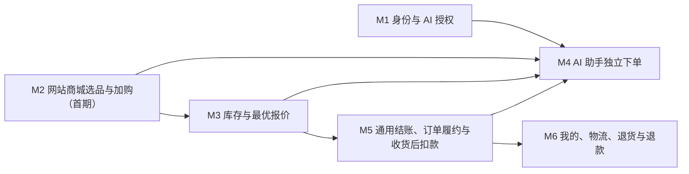

# 商城大模块端到端拆分与交付规范

## 1. 触发条件与目标

当用户说“拆分实现大模块”时，应根据业务边界、用户价值、风险和实现依赖，推导适合当前项目的模块数量，不预设固定数量。针对当前已知需求，建议拆为 **6 个候选模块**；该数量只是本次需求的分析结果，不是规范或未来项目的固定要求。网站商城选品加购和 AI 助手下单必须是两个独立模块。每个模块都是一条可以独立开发、运行、验收和审查的完整链路：

```text
页面交互 -> 前端状态/API -> 后端业务 -> 数据持久化 -> 测试用例 -> 可执行测试 -> code review
```

大模块不是按前端、后端、数据库或页面类型横向切分，也不是把公共组件单独算作一个模块。拆分目标是让每个模块都能形成可演示的用户价值，并让实现顺序、依赖关系和验收边界清晰。

本项目默认只生成桌面浏览器网页商城方案，移动端不作为模块范围，除非用户明确提出。

## 2. 固定产出

需求分析阶段新增或更新：

- `docs/<version>/module-delivery-splitting.md`：本规范和当前项目的模块拆分建议。
- `docs/<version>/requirements-analysis.md`：为功能点、验收标准和模块编号增加映射。
- `docs/<version>/frontend-technical-design.md`：为每个模块补页面、路由、布局、交互图和状态。
- `docs/<version>/backend-technical-design.md`：为每个模块补服务边界、接口、数据模型、事务和异步流程。

进入实现阶段后，每个模块都必须形成自己的交付记录，至少包含：

1. 模块目标、范围和不包含项。
2. 页面路由、桌面布局、关键交互和 Mermaid 流程图。
3. 前端组件、状态、接口消费和错误状态。
4. 后端服务、API、表/实体、权限、事务和幂等约束。
5. 正向、边界、失败、权限和数据一致性测试用例。
6. 可复制执行的测试命令及执行结果。
7. code review 记录、发现的问题、修复结果和剩余风险。

## 3. 模块划分规则

按业务闭环优先、风险隔离优先、依赖清晰和可独立验收进行拆分。模块数量由实际需求决定；避免为凑数量过度拆分，也避免把多个独立用户目标塞入同一模块。当前商城中 M2 是第一优先实现模块，先交付普通用户从商城浏览/搜索商品、进入详情并加购到购物车的完整网站链路。M4 的 AI 助手搜索和 AI 下单独立实现，不并入 M2。用户明确要求分开的链路必须保持独立验收；基础设施或共享服务可以复用稳定契约，不得借“复用”把两个用户流程合并交付。

| 编号 | 模块 | 完整链路 | 主要页面/接口范围 |
| --- | --- | --- | --- |
| M1 | 身份、登录与 AI 授权 | 登录 -> 长期授权同意/拒绝 -> 授权管理/撤销 -> 未授权 AI 下单补充授权 | `/login`、`/account/authorizations`、`/authorize`；认证与授权接口 |
| M2 | 网站商城选品与加购（优先实现） | 网站首页/商品列表 -> 搜索筛选 -> 商品详情/规格 -> 加入购物车 -> 购物车查看和编辑 | `/`、`/products`、`/products/:id`、`/cart`；商品与基础购物车接口 |
| M3 | 购物车库存与最优报价 | 购物车数量变更 -> 库存校验/锁定 -> 缺货拆分 -> 动态优惠运费计算 -> 有效报价 | `/cart`、报价和库存接口、拆单与优惠规则 |
| M4 | AI 助手搜索与独立下单 | 右侧 AI 助手搜索 -> TOP3 优劣对比 -> 选择商品/规格 -> 授权校验 -> 获取报价 -> 调用订单提交契约 -> AI 订单回执 | `AssistantDock`、`/authorize`、AI 订单回执；助手搜索、授权校验、报价消费和 AI 来源订单提交接口 |
| M5 | 通用结账、订单履约与收货后扣款 | 网站结账或接收 M4 的已确认下单请求 -> 创建父子订单 -> 订单详情 -> 物流/收货事件 -> 应收与扣款状态 | `/checkout`、`/orders/:id`、通用订单/收货/结算接口 |
| M6 | 我的、物流、退货与退款 | 账户概览 -> 订单状态 -> 包裹轨迹 -> 退货预览/申请 -> 退款或额外应收 | `/account`、`/account/orders`、`/account/logistics`、`/account/refunds`、退货页面和接口 |

首轮实现顺序为 **M2 -> M3 -> M1 -> M5 -> M4 -> M6**：先让网站商城选品加购端到端可用；随后补齐库存与报价、登录授权和通用结账/订单契约；再独立实现 AI 搜索、授权检查和 AI 来源订单提交。M4 复用 M2/M3 的商品、报价契约及 M5 的订单提交契约，但不修改网站购物车、不复制订单创建/履约逻辑；AI 搜索、AI 意图到商品的选择交互、授权检查与提交体验仍独立交付。模块依赖只表示契约先后，不允许把一个模块的未完成实现复制到另一个模块。



## 3.1 当前商城的可实现模块任务书

以下任务映射当前需求文档。代码实现时优先完成 M2，再按依赖实现后续模块。每个模块先完成一条可在浏览器演示的窄而完整链路，再扩展边界场景；不要为了“页面齐全”先铺空页面。

### M1 身份、登录与 AI 授权

- 需求映射：`F-01`、`F-03`、`F-04`；`AC-01`、`AC-03`、`AC-04`。
- 页面闭环：`/login` 登录且可选择独立授权 -> `/account/authorizations` 查看/撤销授权 -> 未授权 AI 下单进入 `/authorize` -> 同意后返回原请求并重新报价；拒绝时保留手动结账路径。
- 前端任务：登录表单与校验；明确未预选的授权控件；授权状态/写入失败反馈；授权管理及撤销确认；授权拦截返回原流程；会话失效后的回跳。
- 后端任务：网页 session；Agent 身份绑定；长期 grant 建立、查询、撤销；授权请求的一次性状态与用户绑定；建单时服务端重验 grant；撤销与建单竞态控制和审计。
- 首批测试：`M1-T01` 未勾授权仍可登录；`M1-T02` 明确同意后生成绑定用户/Agent/scope 的 grant；`M1-T03` 撤销后 AI 新建单返回 `AUTHORIZATION_REQUIRED` 且无订单；`M1-T04` 无授权用户拒绝补充授权后可走手动结账；`M1-T05` 另一用户不能读取或使用该授权请求。关联 `AC-01`～`AC-04`。
- Review 重点：营销弹窗不得授予授权；AI 授权不得被解释为支付代扣授权；拒绝授权不得阻止普通登录；授权 ID 不可跨用户使用。

### M2 网站商城选品与加购（首期实现）

- 需求映射：`F-05`、`F-06`，首页优惠弹窗 `F-02`；`AC-02`、`AC-11`、`AC-12`。
- 页面闭环：`/` 首页 -> `/products` 搜索/筛选/分页 -> `/products/:id` 查看商品并选择 SKU/数量 -> 加入购物车 -> `/cart` 查看已选商品并可编辑或移除。该模块只实现网站用户主动选品加购，不包含 AI 助手搜索、AI 加购或 AI 下单。
- 页面布局：商品列表页左侧筛选、右侧商品网格；详情页左侧图片、右侧名称/价格/规格/数量/加购；购物车显示商品、规格、数量、小计和继续购物/去结账入口。加载、无结果、不可售、加购失败/成功在对应内容区反馈。
- 前端任务：首页促销弹窗（10 秒自动关闭且可立即关闭）；商品列表与筛选分页；商品详情及规格选择；加购处理中/成功/失败状态；购物车列表、数量修改、移除和刷新恢复；桌面窗口变化时保持可读且无横向溢出。
- 后端任务：商品与 SKU 查询；购物车创建/读取/修改/移除；服务端校验商品和 SKU 可售状态、数量；购物车与登录用户或匿名会话绑定。此模块不锁库存、不计算促销报价、不建订单。
- 首批测试：`M2-T01` 从商品列表进入详情并把指定 SKU 加入购物车；`M2-T02` 加购后购物车显示正确商品、规格和数量；`M2-T03` 刷新页面后购物车内容保持；`M2-T04` 不可售商品或无效 SKU 加购失败且有明确反馈；`M2-T05` 修改/移除条目后数量和小计正确；`M2-T06` 商品列表默认且最多返回 10 条。关联 `AC-02`、`AC-12` 及商品/购物车验收项。
- Review 重点：商品、SKU、数量由服务端校验；加购不得误触发库存锁定、优惠报价、授权或下单；处理重复点击和请求重试；购物车不能跨用户泄漏。

### M3 购物车库存与最优报价

- 需求映射：`F-07`、`F-08`、`F-09`；`AC-05`～`AC-07`。
- 页面闭环：M2 购物车 -> 库存重校验/锁定 -> `/cart` 查看锁定期限和拆单提醒 -> 修改购物车或地址后重新报价 -> 查看最优优惠/运费明细。
- 前端任务：在 M2 购物车基础上增加库存锁定截止提示、有货/缺货分组、拆单影响、报价变化和优惠明细、重报价状态及失效恢复入口；本模块结束仍不建单。
- 后端任务：MySQL 库存行锁与预留记录；24 小时到期释放；SKU 稳定排序避免死锁；拆分快照；报价候选比较与规则版本；幂等及报价过期检查。
- 首批测试：`M3-T01` 并发抢最后一件仅一方成功预留；`M3-T02` 部分有货明确返回可履约与缺货数量；`M3-T03` 全部缺货不产生可下单订单；`M3-T04` 同一建购物车请求重试不重复占库存；`M3-T05` 购物车/规则变化后旧报价不能下单；`M3-T06` 仅在合法促销组合内选择含运费总价最低项。关联 `AC-05`～`AC-07`。
- Review 重点：同一库存不能重复预留或释放；拆单不能静默丢商品；前端金额只展示服务端报价；没有确认的门槛/舍入规则必须保留 `needs_human_review`。

### M4 AI 助手搜索与独立下单

- 需求映射：`F-01`、`F-03`、`F-04`、`F-10`、`F-17`、`F-18`；`AC-01`、`AC-04`、`AC-15`～`AC-17`。
- 页面闭环：用户打开右侧 `AssistantDock` -> 输入自然语言需求 -> 浏览最多 10 个搜索结果和固定 TOP3 优劣对比 -> 选择商品/规格/数量 -> 检查 AI 下单授权 -> 必要时进入补充授权 -> 确认 AI 下单 -> 展示订单回执。该模块与 M2 网站选品加购分离；AI 助手不能绕过授权、库存、报价及建单接口。
- 前端任务：实现助手展开/收起动画、可拖动卡通入口、固定 TOP3、独立滚动结果列表、固定底部输入框；实现搜索加载/空结果/失败、比较字段缺失、选品确认、授权补充、下单处理中/失败和订单回执状态。布局遵循现有桌面网页规则，不实现移动端。
- 后端任务：自然语言商品搜索与最多 10 条结果；按可验证字段生成前三项优劣对比；把选择形成独立的 AI purchase intent（不写入网站购物车）；检查长期 AI 下单 grant；复用 M2/M3 商品和报价查询契约；将用户明确确认的下单请求交给 M5 通用订单提交契约，并记录 AI 来源审计。订单创建、库存最终校验、订单幂等及履约归 M5。AI 授权不等于支付代扣授权。
- 首批测试：`M4-T01` 搜索结果不超过 10 条；`M4-T02` 少于 3 个命中时不补造比较项；`M4-T03` TOP3 结论能追溯有效商品字段且不含内部权重；`M4-T04` 无授权时不建单并可进入补充授权；`M4-T05` 用户拒绝授权时不下单且可继续手动购物；`M4-T06` 有效授权下从搜索到订单回执走通；`M4-T07` 重试不重复建单。关联 `AC-01`、`AC-04`、`AC-12`、`AC-15`～`AC-17`。
- Review 重点：AI 对话不能隐式同意授权或支付；不能把商品搜索建议自动当作明确购买确认（仅遵循已确认的 AI 授权范围）；不可由前端伪造授权、来源或报价；AI purchase intent 不得污染网站购物车；订单最终校验和创建只能由 M5 契约执行；AI 与网站订单来源需可区分审计。

### M5 通用结账、订单履约与收货后扣款

- 需求映射：`F-10`、`F-11`、`F-12`、`F-14`、`F-16`；`AC-08`、`AC-10`、`AC-13`、`AC-14`。
- 页面闭环：网站用户进入 `/checkout` 确认地址、商品拆分和报价，或 M4 将用户已确认的 AI 下单请求提交到本模块的通用订单接口 -> 创建父订单及子订单 -> `/orders/:id/result` 显示回执 -> `/orders/:id` 查看履约与结算状态 -> 可信收货事件后显示应收/扣款结果。本模块是唯一订单创建与履约所有者；M4 只负责 AI 入口、授权检查和来源标记。
- 前端任务：结账摘要和待收货后扣款说明；拆单确认提醒；重复提交保护；订单回执；订单详情分别显示履约、物流、结算状态；扣款未知结果显示处理中和查询反馈。
- 后端任务：网站结账与通用订单提交契约；订单组/子订单与购买快照；报价/库存最终校验（AI 来源请求另验证授权上下文）；建单幂等；收货事件验证及去重；outbox/worker；支付适配器幂等键；扣款失败和结果未知状态处理。AI 和网站请求走同一领域订单创建逻辑，并由服务端可信上下文记录来源。
- 首批测试：`M5-T01` 网站结账建单产生完整父子单且不发起扣款；`M5-T02` 有效 AI 来源请求通过同一领域服务建单并正确记录来源；`M5-T03` 重复提交返回同一订单；`M5-T04` 无效报价或库存变化阻止建单；`M5-T05` 未验证的收货事件不能触发应收；`M5-T06` 重复收货事件及 worker 重试不会重复扣款；`M5-T07` 链接重访已下单结果不再建单。关联 `AC-08`、`AC-10`、`AC-13`。
- Review 重点：订单状态不与结算状态混为一谈；M4 不得实现平行订单创建逻辑；事务与外部支付调用边界正确；支付未知结果不换幂等键盲目重试；未经确认的收货/代扣规则不得落成自动行为。

### M6 我的、物流、退货与退款

- 需求映射：`F-13`、`F-14`、`F-19`；`AC-09`、`AC-18`。
- 页面闭环：`/account` 进入订单、物流或退款列表 -> 订单详情查看履约/结算 -> 物流详情查看包裹轨迹 -> 符合条件时申请退货并预览费用 -> 查看审核、退款或额外应收状态。
- 前端任务：账户中心摘要；`/account/orders` 独立展示履约/物流/结算/退款状态；`/account/logistics` 展示包裹最新节点与脱敏运单号；`/account/refunds` 展示审核状态、预计/已退款和额外应收；退货选择、预览、提交和结果反馈；分页/筛选/空状态。
- 后端任务：仅当前用户可见的 overview/orders/shipments/refunds；物流事件幂等和顺序处理；退货可退数量校验；以原订单规则快照重算免运资格；退款/费用调整审计；退款与订单资源所有权校验。
- 首批测试：`M6-T01` “我的”各摘要能进入对应订单/物流/退款列表；`M6-T02` 订单列表分别显示履约、结算和退款状态；`M6-T03` 重复或乱序物流事件不重复生成轨迹且最新状态正确；`M6-T04` 非所有者不能查看订单、包裹或退款；`M6-T05` 退货不超过可退数量；`M6-T06` 退货导致免运失效时显示运费调整且不重复收已付运费；`M6-T07` 未扣款时调整应收，已扣款时清楚列出退款及额外应收。关联 `AC-09`、`AC-18`。
- Review 重点：不同状态和金额字段必须单独展示；运单及个人信息脱敏；物流/退款列表和详情必须做资源级鉴权；退款展示值须能追溯到结算调整记录。

测试编号在实现中扩展为至少一条可执行测试文件/用例；上列首批测试是最低场景，不代表测试覆盖上限。测试命令在工程脚手架存在后据实际 `package.json`、数据库服务和 Playwright 配置落定并执行。

## 4. 模块细粒度拆分模板

每个模块按以下顺序拆成可交付任务。任务粒度以半天到两天能完成、能单独验证为宜；超过两天必须继续拆分，低于半小时且没有独立验收价值的工作合并到相邻任务。

### 4.1 需求与契约

- 列出本模块覆盖的 `F-*`、`AC-*`、页面路由和 API。
- 写清用户触发、成功结果、失败结果、权限边界和数据变化。
- 标记 `needs_human_review`，不得在实现任务中悄悄决定支付、授权、订单、库存、隐私和费用规则。
- 定义输入、输出、状态枚举、错误码、幂等键和资源所有权。

### 4.2 页面与交互

- 每个页面给出目的、区域、信息顺序、组件位置、主要操作、状态/金额位置和桌面窗口规则。
- 关键页面必须有文本线框；关键流程必须有 Mermaid 图。
- 覆盖加载、空数据、失败、权限不足、资源失效和处理中状态。
- 交互必须可在页面中演示：按钮、表单、筛选、列表滚动、弹窗、状态反馈和返回路径均有明确行为。

### 4.3 实现任务

按“契约 -> 数据 -> 后端 -> 前端 -> 联调”顺序拆解：

1. 类型和 API DTO/错误码。
2. 数据表、索引、迁移和种子数据。
3. 后端领域服务、权限校验、事务、幂等和异步任务。
4. 前端路由、页面布局、组件、查询缓存和提交状态。
5. 端到端联调、演示数据和可复现的启动方式。

跨模块共享代码只在确认契约后抽取；禁止先建立无法由一个模块验收的“大而全”基础层。

### 4.4 测试用例

每个模块至少生成以下测试层级：

| 层级 | 必测内容 |
| --- | --- |
| 单元测试 | 状态转换、金额/数量规则、校验、错误码、纯函数和边界值 |
| API/集成测试 | 权限、事务、幂等、数据库约束、外部依赖失败和重复请求 |
| 页面测试 | 路由、表单、按钮、列表、加载/空/失败/处理中和关键反馈 |
| E2E 测试 | 从用户入口走完本模块的成功链路，以及至少一条失败/恢复链路 |

测试用例用唯一编号，例如 `M3-T01`，每条包括前置数据、操作步骤、预期结果、清理方式和关联 `AC-*`。不能只写“测试通过”，必须能由另一个开发者复现。

### 4.5 可执行验证

每个模块必须提供：

- 单元/API/页面/E2E 的明确命令，命令可在仓库根目录直接执行。
- 必要的环境变量、数据库准备、种子数据和测试账号说明。
- 最小验证命令和完整验证命令；测试失败时保留日志或报告路径。
- 页面交互验证方式：优先 Playwright；涉及纯后端时执行 API/集成测试并说明页面不适用原因。

模块只有在最小验证命令通过后，才能进入下一模块的联调；完整验证失败必须记录失败用例和阻塞原因。

### 4.6 Code review

每个模块提交前必须单独 review，检查：

- 需求/验收映射是否完整，是否出现未授权的业务决策。
- 页面操作是否都有可达入口，状态和金额是否准确，是否存在遮挡或横向溢出。
- API 是否执行资源权限校验，错误码和状态是否与前端一致。
- 事务、并发、幂等、重试和异步事件是否会产生重复订单、重复扣款、重复退款或库存错误。
- 敏感数据是否脱敏，日志、缓存和客户端存储是否越权。
- 测试是否覆盖关键成功、失败、边界和恢复路径。

Review 输出按严重性列出文件/行号、问题、影响、修复建议和验证结果。没有发现问题时仍要列出测试缺口和剩余风险。

## 5. 模块完成定义（DoD）

一个模块只有同时满足以下条件才算完成：

- 至少一条从页面入口到持久化结果的完整成功链路可演示。
- 关键失败、权限和处理中状态可演示，且不会泄露错误详情或敏感数据。
- 前端布局、交互图、API、数据模型和状态枚举互相一致。
- `M*-T*` 测试用例已落盘，最小测试命令通过；完整测试失败有明确记录。
- code review 已完成，高严重性问题为零；中低严重性问题有修复或明确延期理由。
- 模块输出可供下一个模块通过稳定契约接入，不依赖未提交的本地状态。

所有模块完成后，再执行跨模块回归：网站选品加购、购物车库存报价、AI 助手独立下单、履约收货扣款、我的订单物流退款主链路，以及跨模块权限、金额、库存和幂等场景。

## 6. 输出顺序

当触发“拆分实现大模块”时，按以下顺序输出并落盘：

1. 根据需求给出合适数量的模块边界、依赖图和每模块完成定义。
2. 为每个模块生成细粒度实现任务、页面交互说明和 API/数据契约。
3. 为每个模块生成测试用例清单和可执行命令。
4. 按依赖顺序实现并逐模块运行测试。
5. 每个模块独立 code review，修复后再进入下一模块。
6. 最后运行跨模块回归并输出交付报告。

不得只生成模块目录或任务标题就宣称完成；没有页面可查看、测试可执行和 review 证据的模块不算完成。
