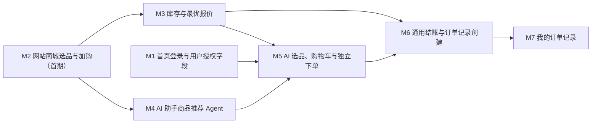

# 商城大模块端到端拆分与交付规范

## 1. 触发条件与目标

当用户说“拆分实现大模块”时，应根据业务边界、用户价值、风险和实现依赖，推导适合当前项目的模块数量，不预设固定数量。针对当前已知需求，建议拆为 **7 个候选模块**；该数量只是本次需求的分析结果，不是规范或未来项目的固定要求。AI 助手商品推荐与 AI 选品下单保持独立，分别由 M4 和 M5 交付。每个模块都是一条可以独立开发、运行、验收和审查的完整链路：

```text
页面交互 -> 前端状态/API -> 后端业务 -> 数据持久化 -> 测试用例 -> 可执行测试 -> code review
```

大模块不是按前端、后端、数据库或页面类型横向切分，也不是把公共组件单独算作一个模块。拆分目标是让每个模块都能形成可演示的用户价值，并让实现顺序、依赖关系和验收边界清晰。

本项目默认只生成桌面浏览器网页商城方案，移动端不作为模块范围，除非用户明确提出。

## 2. 固定产出

需求分析阶段新增或更新：

- `docs/<version>/module-delivery-splitting.md`：本规范和当前项目的模块拆分建议。
- `docs/<version>/requirements-analysis.md`：为功能点、验收标准和模块编号增加映射。
- `docs/<version>/frontend-technical-design.md`：为每个模块补页面、路由、布局、交互图和状态。
- `docs/<version>/backend-technical-design.md`：为每个模块补服务边界、接口、数据模型、事务和异步流程。

进入实现阶段后，每个模块都必须形成自己的交付记录，至少包含：

1. 模块目标、范围和不包含项。
2. 页面路由、桌面布局、关键交互和 Mermaid 流程图。
3. 前端组件、状态、接口消费和错误状态。
4. 后端服务、API、表/实体、权限、事务和幂等约束。
5. 正向、边界、失败、权限和数据一致性测试用例。
6. 可复制执行的测试命令及执行结果。
7. code review 记录、发现的问题、修复结果和剩余风险。

## 3. 模块划分规则

按业务闭环优先、风险隔离优先、依赖清晰和可独立验收进行拆分。模块数量由实际需求决定；避免为凑数量过度拆分，也避免把多个独立用户目标塞入同一模块。当前商城中 M2 是第一优先实现模块，先交付普通用户从商城浏览/搜索商品、进入详情并加购到购物车的完整网站链路。M4 的 AI 助手搜索和 AI 下单独立实现，不并入 M2。用户明确要求分开的链路必须保持独立验收；基础设施或共享服务可以复用稳定契约，不得借“复用”把两个用户流程合并交付。

| 编号 | 模块                           | 完整链路                                                                                                                                                                           | 主要页面/接口范围                                                                          |
| ---- | ------------------------------ | ---------------------------------------------------------------------------------------------------------------------------------------------------------------------------------- | ------------------------------------------------------------------------------------------ |
| M1   | 首页登录与用户授权字段         | 首页进入不自动弹窗 -> 点击登录 -> 首页登录弹窗 -> 用户名/密码/checkbox -> 登录成功关闭弹窗；已登录用户可从“我的”进入授权入口并完成勾选 -> 所有建单入口由 M5 最终校验登录和授权字段 | `/` 的 `LoginDialog`、`/account` 的授权入口；登录/session/授权接口和 `users.is_authorized` |
| M2   | 网站商城选品与加购（优先实现） | 首页商品列表 -> 搜索筛选 -> 商品详情/规格 -> 加入购物车 -> 购物车查看和编辑                                                                                                        | `/`（商品列表）、`/products/:id`、`/cart`；商品与基础购物车接口                            |
| M3   | 购物车库存与最优报价           | 购物车数量变更 -> 库存校验/锁定 -> 缺货拆分 -> 动态优惠运费计算 -> 有效报价                                                                                                        | `/cart`、报价和库存接口、拆单与优惠规则                                                    |
| M4   | AI 助手商品推荐 Agent          | 右侧 AI 助手输入自然语言 -> 服务端识别意图 -> 查询商品、规格、库存和全部已发布脱敏评论 -> 按内部推荐排序 -> 返回相关商品列表；不创建购物车、不报价、不授权、不下单 | `AssistantDock`、商品结果列表；助手搜索、意图识别和只读推荐接口                         |
| M5   | AI 选品、购物车与独立下单      | M4 选择商品/SKU/数量 -> 创建 AI 来源购物车或购买意图 -> 库存与报价 -> 登录/授权校验 -> 通用订单提交 -> AI 订单回执                         | `AssistantDock` 选品确认、AI 购物车/结账、订单提交和来源审计接口                         |
| M6   | 通用结账与订单记录创建 | 网站购物车或 M5 AI 购物车进入结账 -> 校验登录/授权 -> 点击“付款” -> 创建并持久化一条订单记录 -> 订单回执与详情查看                                      | `/checkout`、`/orders/:id`、通用订单创建与查询接口                                       |
| M7   | 我的订单记录         | 账户概览 -> 订单记录列表 -> 查看本人订单记录与摘要                         | `/account`、`/account/orders`、订单记录查询接口  |

首轮实现顺序为 **M2 -> M3 -> M1 -> M4 -> M5 -> M6 -> M7**：先让网站商城具备商品与购物车基础能力，再补齐库存报价、登录授权、AI 商品推荐、AI 购物车与下单、通用结账与订单记录创建及账户订单查看。M4 只复用商品目录、规格、库存和评论查询能力；M5 复用 M3 的库存/报价契约、M1 的登录授权契约和 M6 的通用订单提交契约。模块依赖只表示契约先后，不允许把一个模块的未完成实现复制到另一个模块。



## 3.1 当前商城的可实现模块任务书

以下任务映射当前需求文档。代码实现时优先完成 M2，再按依赖实现后续模块。每个模块先完成一条可在浏览器演示的窄而完整链路，再扩展边界场景；不要为了“页面齐全”先铺空页面。

### M1 首页登录与用户授权字段

- 需求映射：`F-01`、`F-03`、`F-04`、`F-19`、`F-21`；`AC-01`、`AC-03`、`AC-04`、`AC-20`、`AC-21`。
- 页面闭环：首页进入不自动弹窗 -> 用户点击“登录” -> 首页 `LoginDialog` 在登录/注册模式间切换；登录模式输入用户名、密码并选择 checkbox，注册模式输入用户名、密码和确认密码 -> 登录或注册成功关闭弹窗且路由不变；注册用户默认未授权；登录用户进入“我的”后打开授权入口，未授权时明确勾选并保存；已授权用户不再看到 checkbox；未授权的受保护下单由服务端拒绝。
- 前端任务：首页登录入口；modal 登录/注册模式切换；登录 checkbox 默认未勾选；注册确认密码和最小长度校验；未勾选仍允许登录；勾选状态提交；处理中、失败和关闭状态；成功刷新登录态且不改变当前路由；注册失败保留弹窗；“我的”页面增加授权入口，未授权时显示固定文案 checkbox 和保存操作，已授权时隐藏 checkbox 并展示已授权状态。
- 后端任务：建立 `users` 表（`userid`、`username`、`password_hash`、`is_authorized`、创建/更新时间）；密码哈希和网页 session；实现 `POST /api/v1/auth/login`、`POST /api/v1/auth/register`、`GET /api/v1/auth/session`、`POST /api/v1/me/authorization`；注册使用 UUID、唯一用户名和默认未授权，冲突返回 409；身份校验成功后按登录 checkbox 写入授权字段；“我的”授权接口只允许当前登录用户将 `is_authorized` 从 `false` 更新为 `true`；建单前由服务端读取字段。
- 首批测试：保留既有 `M1-T01`～`M1-T11`，新增 `M1-T12` 合法注册创建唯一用户并建立 session；`M1-T13` 密码少于 8 个字符被拒绝；`M1-T14` 用户名重复返回 409 且不创建重复记录；`M1-T15` 注册用户默认未授权且密码仅保存哈希；`M1-T16` 注册/登录模式切换及注册失败保留弹窗。关联 `AC-01`、`AC-03`、`AC-20`、`AC-21`。
- Review 重点：session 和用户标识不能由客户端伪造；勾选授权只在认证成功后或已认证的“我的”授权接口中写库；未勾选不得阻止登录；已授权用户不能通过前端状态伪造未授权或绕过服务端校验；建单权限以数据库字段为准；授权字段不得被解释为支付代扣授权；M1 不实现 Agent grant、OAuth 或第三方授权；“我的”入口不得提供撤销或更新操作。

### M2 网站商城选品与加购（首期实现）

- 需求映射：`F-02`、`F-05`、`F-06`；`AC-02`、`AC-11`、`AC-12`。
- 页面闭环：`/` 商品列表（搜索/筛选/下拉加载）-> `/products/:id` 查看商品并选择 SKU/数量 -> 加入购物车 -> `/cart` 查看已选商品并可编辑或移除。该模块只实现网站用户主动选品加购，不包含 AI 助手搜索、AI 加购或 AI 下单。
- 页面布局：首页 `/` 即商品列表页，顶部非阻塞优惠提示条；左侧筛选、中间商品网格（下拉加载，pageSize 默认 20、最大 100）、右侧为 AI 助手预留固定宽度侧栏（占据页面位置、不浮动遮罩，进入首页默认展开），商品网格随助手占位收窄；详情页左侧图片、右侧名称/价格/规格/数量/加购；购物车显示商品、规格、数量、小计和继续购物/去结账入口。加载、无结果、不可售、加购失败/成功在对应内容区反馈。
- 前端任务：首页商品列表页顶部非阻塞优惠提示条（不使用自动弹窗）；搜索、筛选与下拉加载；商品详情及规格选择；加购处理中/成功/失败状态；购物车列表、数量修改、移除和刷新恢复；桌面窗口变化时保持可读且无横向溢出。
- 后端任务：商品与 SKU 查询（cursor 分页，pageSize 默认 20、最大 100）；购物车创建/读取/修改/移除；服务端校验商品和 SKU 可售状态、数量；购物车与登录用户或匿名会话绑定。此模块不锁库存、不计算促销报价、不建订单。
- 首批测试：`M2-T01` 从商品列表进入详情并把指定 SKU 加入购物车；`M2-T02` 加购后购物车显示正确商品、规格和数量；`M2-T03` 刷新页面后购物车内容保持；`M2-T04` 不可售商品或无效 SKU 加购失败且有明确反馈；`M2-T05` 修改/移除条目后数量和小计正确；`M2-T06` 商品列表默认返回 20 条、pageSize 参数可调（最大 100），下拉加载能继续获取更多商品。关联 `AC-02`、`AC-12` 及商品/购物车验收项。
- Review 重点：商品、SKU、数量由服务端校验；加购不得误触发库存锁定、优惠报价、授权或下单；处理重复点击和请求重试；购物车不能跨用户泄漏。

### M3 购物车库存与最优报价

- 需求映射：`F-07`、`F-08`、`F-09`；`AC-05`～`AC-07`。
- 页面闭环：M2 购物车 -> 库存重校验/锁定 -> `/cart` 查看锁定期限和拆单提醒 -> 修改购物车或地址后重新报价 -> 查看最优优惠/运费明细。
- 前端任务：在 M2 购物车基础上增加库存锁定截止提示、有货/缺货分组、拆单影响、报价变化和优惠明细、重报价状态及失效恢复入口；本模块结束仍不建单。
- 后端任务：MySQL 库存行锁与预留记录；24 小时到期释放；SKU 稳定排序避免死锁；拆分快照；按订单来源及规则版本计算报价，A/B 对折前整车商品金额独立判定并自动叠加，运费按整车金额判定；M5 AI 来源订单仅对 AI 商品金额应用 C，不折运费；幂等及报价过期检查。优惠不提供用户选择，M3 普通 WEB 购物车不应用 C。
- 首批测试：`M3-T01` 并发抢最后一件仅一方成功预留；`M3-T02` 部分有货明确返回可履约与缺货数量；`M3-T03` 全部缺货不产生可下单订单；`M3-T04` 同一建购物车请求重试不重复占库存；`M3-T05` 购物车/规则变化后旧报价不能下单；`M3-T06` 验证 A 在折前整车商品金额 NT$1,000 门槛的边界、A/B 满足时自动叠加，且 B 按折前整车金额 NT$990 门槛计算免运；`M3-T07` 验证 WEB 报价不应用 C，可信 M4 AI 来源报价仅对 AI 商品金额应用 C、不折运费，C 折扣在最小货币单位按 `Math.round` 取整。关联 `AC-05`～`AC-07`。
- Review 重点：同一库存不能重复预留或释放；拆单不能静默丢商品；前端金额只展示服务端报价，按 NT$ 整数显示；A/B 门槛按折前整车商品金额判断并自动叠加，运费按整车计算；C 仅由 M5 可信 AI 下单来源触发且只作用于 AI 商品金额，折扣在最小货币单位按 `Math.round` 取整；规则变更需新增规则版本。


### M4 AI 助手商品推荐 Agent

- 需求映射：`F-18`、`F-15`；`AC-15`～`AC-17`。
- 非目标：不创建购物车或 purchase intent，不锁库存，不报价，不读取历史订单或授权状态，不写授权字段，不下单。
- 页面闭环：用户打开右侧 `AssistantDock` -> 输入自然语言需求 -> 服务端解析品类、规格约束、预算、数量等意图 -> 查询商品、规格、库存和全部已发布脱敏评论 -> 按服务端内部推荐分数稳定排序 -> 返回相关商品列表 -> 用户查看公开信息或进入商品详情。结果可 cursor 下拉加载，单次默认 20、最大 100。
- 前端任务：首页助手固定宽度并占据页面位置；提供输入、发送、取消、重试、加载、空结果、失败和下拉加载；商品卡展示公开字段、规格/库存、脱敏评论摘要或评论入口、相关理由；不展示推荐分数、毛利、排序权重或比较入口。
- 后端任务：实现结构化意图识别和只读工具编排；评论工具支持全部已发布脱敏评论的分页读取；推荐排序只在服务端完成，高毛利商品分数乘以 1.5 的规则仅存在服务端配置/审计上下文，不进入提示词、工具响应、公开 API、前端或普通业务日志。
- 首批测试：`M4-T01` 自然语言输入能解析并返回商品结果；`M4-T02` 商品结果包含公开规格、库存状态和已发布脱敏评论依据；`M4-T03` 结果按服务端推荐顺序稳定返回但响应不含分数、毛利或内部权重；`M4-T04` cursor 分页遵守默认 20、最大 100 且可继续加载；`M4-T05` 无结果、服务失败和评论分页失败分别在原位展示可恢复状态；`M4-T06` M4 请求不创建购物车、报价、库存锁定、授权变更或订单。
- Review 重点：Agent 只能访问允许公开的数据；原始评论和个人信息不可到达前端；排序规则不可被客户端覆盖或探测；M4 不产生交易副作用。

### M5 AI 选品、购物车与独立下单

- 需求映射：`F-07`、`F-10`；`AC-04`、`AC-05`、`AC-08`、`AC-12`。
- 非目标：不重复实现 M4 的意图识别和推荐排序，不重复实现 M6 的通用订单领域服务、履约和扣款。
- 页面闭环：M4 商品卡选择 SKU/数量 -> 创建 AI 来源购物车或购买意图 -> M3 库存校验/锁定和报价 -> 用户确认购买内容 -> M1 登录/授权状态检查 -> 调用 M6 通用订单提交 -> 展示 AI 订单回执。
- 前端任务：在助手内提供明确的选品确认、数量编辑、库存/报价状态、授权不足提示、提交处理中和失败恢复；AI 购物车与网站购物车分开显示，不提供 TOP3 或比较抽屉。
- 后端任务：创建 AI provenance 的购物车/购买意图；复用 M3 库存和报价契约；调用 M1 的认证授权校验；以可信来源调用 M6 订单提交契约并记录审计；不允许客户端伪造来源、授权或报价。
- 首批测试：`M5-T01` 选择商品/SKU/数量后创建 AI 购物车且不污染网站购物车；`M5-T02` 库存或报价失效时阻止提交并要求重新校验；`M5-T03` 未登录返回 401，已登录未授权返回 403，均不建单；`M5-T04` 合法 AI 请求交给 M6 创建订单并记录来源；`M5-T05` 重复提交使用幂等键不重复创建购物车或订单。
- Review 重点：AI 购物车与网站购物车隔离；库存、费用和授权以服务端为准；M5 不复制订单创建逻辑。

### M6 通用结账与订单记录创建

- 需求映射：`F-10`、`F-13`、`F-16`；`AC-04`、`AC-08`、`AC-10`、`AC-13`。
- 页面闭环：网站用户进入 `/checkout` 或 M5 AI 购物车进入统一结账 -> 确认商品与报价摘要 -> M6 对所有来源统一检查登录 session 和 `users.is_authorized=true` -> 点击“付款”创建并持久化一条订单记录 -> `/orders/:id/result` 显示回执 -> `/orders/:id` 查看订单记录与摘要。本模块是唯一订单创建所有者，不实现支付、履约、物流、收货、扣款或售后。
- 前端任务：结账摘要与“订单已创建，支付未接入”说明；拆单确认提醒；重复提交保护；订单回执；订单记录详情仅展示订单编号、商品、规格、数量和已保存的订单摘要，不展示物流、收货、扣款、退款或履约状态。
- 后端任务：网站结账与通用订单创建契约；所有网站、AI、交接来源均须在建单事务前验证登录用户和 `users.is_authorized=true`；订单组/子订单与购买快照；报价/库存最终校验；建单幂等。所有来源走同一领域订单创建逻辑，并由服务端可信上下文记录来源；不接入支付渠道、不执行扣款、不实现履约/物流/收货/退货/退款。
- 首批测试：`M6-T01` 网站、AI、交接来源未登录时均返回 401 且不建单；`M6-T02` 网站、AI、交接来源已登录但未授权时均返回 403 `AUTHORIZATION_REQUIRED` 且不建单；`M6-T03` 授权有效的网站请求创建并持久化一条订单记录且不发起扣款；`M6-T04` 有效 AI 请求和已授权交接请求通过同一领域服务建单并正确记录来源；`M6-T05` 重复提交使用同一幂等键返回同一订单记录；`M6-T06` 无效报价或库存变化阻止建单；`M6-T07` 订单记录详情与回执不包含物流、收货、扣款、退款或履约状态。关联 `AC-04`、`AC-08`、`AC-10`、`AC-13`。
- Review 重点：订单记录创建不触发支付、履约、收货、扣款或售后副作用；M5 不得实现平行订单创建逻辑；事务边界正确；建单幂等不产生重复订单记录；未经确认的支付/收货/扣款规则不得落成自动行为。

### M7 我的订单记录

- 需求映射：`F-19`；`AC-18`。
- 页面闭环：`/account` 进入订单记录列表 -> `/account/orders` 查看本人已持久化的订单记录及订单摘要。账户中心中的“AI 自助下单授权”入口及 `is_authorized` 写入由 M1 交付，M7 只复用账户中心布局并交付订单记录查看。
- 前端任务：账户中心摘要；`/account/orders` 按时间倒序展示订单编号、商品摘要与创建结果；分页/空状态。不展示物流、收货、扣款、退款或履约状态。
- 后端任务：仅当前用户可见的订单记录列表查询；资源级鉴权，非所有者不能查看订单记录。
- 首批测试：`M7-T01` “我的”能进入订单记录列表；`M7-T02` 订单记录列表按时间展示订单编号和摘要；`M7-T03` 非所有者不能查看他人订单记录。关联 `AC-18`。
- Review 重点：订单记录列表和详情必须做资源级鉴权；不提供物流、收货、扣款、退货或退款入口。

测试编号在实现中扩展为至少一条可执行测试文件/用例；上列首批测试是最低场景，不代表测试覆盖上限。测试命令在工程脚手架存在后据实际 `package.json`、数据库服务和 Playwright 配置落定并执行。

## 4. 模块细粒度拆分模板

每个模块按以下顺序拆成可交付任务。任务粒度以半天到两天能完成、能单独验证为宜；超过两天必须继续拆分，低于半小时且没有独立验收价值的工作合并到相邻任务。

### 4.1 需求与契约

- 列出本模块覆盖的 `F-*`、`AC-*`、页面路由和 API。
- 写清用户触发、成功结果、失败结果、权限边界和数据变化。
- 标记 `needs_human_review`，不得在实现任务中悄悄决定支付、授权、订单、库存、隐私和费用规则。
- 定义输入、输出、状态枚举、错误码、幂等键和资源所有权。

### 4.2 页面与交互

- 每个页面给出目的、区域、信息顺序、组件位置、主要操作、状态/金额位置和桌面窗口规则。
- 关键页面必须有文本线框；关键流程必须有 Mermaid 图。
- 覆盖加载、空数据、失败、权限不足、资源失效和处理中状态。
- 交互必须可在页面中演示：按钮、表单、筛选、列表滚动、弹窗、状态反馈和返回路径均有明确行为。

### 4.3 实现任务

按“契约 -> 数据 -> 后端 -> 前端 -> 联调”顺序拆解：

1. 类型和 API DTO/错误码。
2. 数据表、索引、迁移和种子数据。
3. 后端领域服务、权限校验、事务、幂等和异步任务。
4. 前端路由、页面布局、组件、查询缓存和提交状态。
5. 端到端联调、演示数据和可复现的启动方式。

跨模块共享代码只在确认契约后抽取；禁止先建立无法由一个模块验收的“大而全”基础层。

### 4.4 测试用例

每个模块至少生成以下测试层级：

| 层级         | 必测内容                                                  |
| ------------ | --------------------------------------------------------- |
| 单元测试     | 状态转换、金额/数量规则、校验、错误码、纯函数和边界值     |
| API/集成测试 | 权限、事务、幂等、数据库约束、外部依赖失败和重复请求      |
| 页面测试     | 路由、表单、按钮、列表、加载/空/失败/处理中和关键反馈     |
| E2E 测试     | 从用户入口走完本模块的成功链路，以及至少一条失败/恢复链路 |

测试用例用唯一编号，例如 `M3-T01`，每条包括前置数据、操作步骤、预期结果、清理方式和关联 `AC-*`。不能只写“测试通过”，必须能由另一个开发者复现。

### 4.5 可执行验证

每个模块必须提供：

- 单元/API/页面/E2E 的明确命令，命令可在仓库根目录直接执行。
- 必要的环境变量、数据库准备、种子数据和测试账号说明。
- 最小验证命令和完整验证命令；测试失败时保留日志或报告路径。
- 页面交互验证方式：优先 Playwright；涉及纯后端时执行 API/集成测试并说明页面不适用原因。

模块只有在最小验证命令通过后，才能进入下一模块的联调；完整验证失败必须记录失败用例和阻塞原因。

### 4.6 Code review

每个模块提交前必须单独 review，检查：

- 需求/验收映射是否完整，是否出现未授权的业务决策。
- 页面操作是否都有可达入口，状态和金额是否准确，是否存在遮挡或横向溢出。
- API 是否执行资源权限校验，错误码和状态是否与前端一致。
- 事务、并发、幂等、重试和异步事件是否会产生重复订单、重复扣款、重复退款或库存错误。
- 敏感数据是否脱敏，日志、缓存和客户端存储是否越权。
- 测试是否覆盖关键成功、失败、边界和恢复路径。

Review 输出按严重性列出文件/行号、问题、影响、修复建议和验证结果。没有发现问题时仍要列出测试缺口和剩余风险。

## 5. 模块完成定义（DoD）

一个模块只有同时满足以下条件才算完成：

- 至少一条从页面入口到持久化结果的完整成功链路可演示。
- 关键失败、权限和处理中状态可演示，且不会泄露错误详情或敏感数据。
- 前端布局、交互图、API、数据模型和状态枚举互相一致。
- `M*-T*` 测试用例已落盘，最小测试命令通过；完整测试失败有明确记录。
- code review 已完成，高严重性问题为零；中低严重性问题有修复或明确延期理由。
- 模块输出可供下一个模块通过稳定契约接入，不依赖未提交的本地状态。

所有模块完成后，再执行跨模块回归：网站选品加购、购物车库存报价、AI 商品推荐、AI 独立选品下单、通用结账创建订单记录、我的订单记录查看主链路，以及跨模块权限、金额、库存和幂等场景。

## 6. 输出顺序

当触发“拆分实现大模块”时，按以下顺序输出并落盘：

1. 根据需求给出合适数量的模块边界、依赖图和每模块完成定义。
2. 为每个模块生成细粒度实现任务、页面交互说明和 API/数据契约。
3. 为每个模块生成测试用例清单和可执行命令。
4. 按依赖顺序实现并逐模块运行测试。
5. 每个模块独立 code review，修复后再进入下一模块。
6. 最后运行跨模块回归并输出交付报告。

不得只生成模块目录或任务标题就宣称完成；没有页面可查看、测试可执行和 review 证据的模块不算完成。
