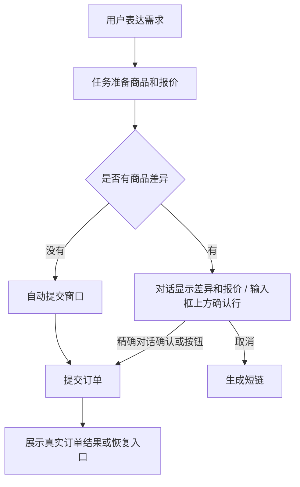

# 前端交互与技术文档

日期：2026-11-21。目标为桌面浏览器网页，复用 `/assistant` 页面和请求封装，任务状态按需查询。

## 页面结构

页面目的：表达购物需求，查看实际推荐、交易进度，并在商品有差异时一次性接受或取消。

顶栏保留在线标识和“重新开始”；删除模式单选项。左侧为对话记录和底部输入区，右侧仍展示流程及当前状态。新欢迎语说明条件符合自动下单，有差异先确认。

```text
┌── AI 助手 / 在线 ─────────────────────── 重新开始 ──┐
│ 对话、真实商品卡片、差异说明、费用摘要 │ 购物流程与进度 │
│                                      │              │
├──────────────────────────────────────┤              │
│ 描述购物需求 / 发送                   │              │
└──────────────────────────────────────┴──────────────┘
```

## 对话内差异与输入框上方确认行

`AssistantMessages` 直接展示当前商品、数量、原要求与实际差异，以及小计、优惠、运费和最终总额。`AssistantComposer` 在输入框上方显示一行提醒及“取消并生成短链”“确认下单”按钮。删除模态组件和独立回复框，正常对话输入始终可用，可直接回复“帮我下单”或“取消下单”。

```text
┌──────────────── 对话记录 ──────────────────┐
│ 当前商品名称 × 数量                         │
│ 要求：品牌 A      实际：品牌 B               │
│ 要求：续航10小时  实际：续航6小时            │
│ 商品小计 / 优惠 / 运费 / 最终总额            │
├────────────────────────────────────────────┤
│ 请核对上方差异与报价 [取消并生成短链] [确认下单]│
│ 正常对话输入，可回复“帮我下单”       [发送]  │
└────────────────────────────────────────────┘
```

确认按钮携带当前展示报价的 quoteId 和 cartVersion；后端校验后直接提交。差异接受记录随任务保存。确认后聊天记录继续保留差异事实，明确标为已接受，避免订单完成后仍要求用户判断。

## 状态与桌面窗口规则

- 内容布局沿用既有桌面左右分栏与宽度，不调整商品详情、普通购物车或首页助手入口。
- 长规格和差异在对话容器内换行，内容较多时滚动聊天记录；确认行随输入区固定在对话容器底部。按钮可随桌面窗口变窄换行，金额及输入框不得横向溢出。
- 页面无模态遮罩和背景锁定；输入框可持续回复，不需要关闭其他窗口才能表达确认或取消。
- 搜索/报价处理中显示已有加载状态；没有同类有货商品显示失败原因；目录/模型失败不使用本地默认商品或金额。
- 未登录和未授权沿用现有登录重试与授权提示。断连时禁用提交/取消，保留原任务并提供恢复查询。
- 下单中禁用再次提交；订单结果未知提供核对原任务入口。评论分析暂停自动提交及恢复流程继续保留。
- 删除固定 800ms 查询。推进/确认/取消请求等待服务端完成并返回最新任务，处理中显示统一加载状态；刷新页面或断线恢复时按需查询。恢复到外部仍在处理的任务时提供“刷新进度”，不会用无法推进的“继续执行”代替状态查询。
- 无差异任务仍由阶段推进请求和服务端截止时间完成自动下单；删除的是周期 GET 查询，不是自动推进动作。


