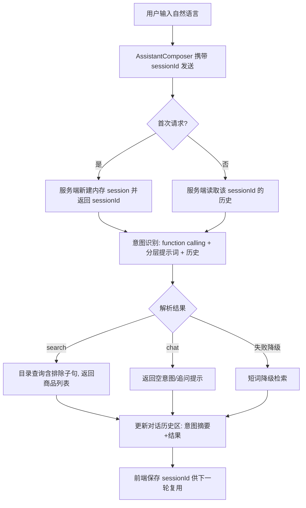

# 意图识别增强前端交互与技术文档

## 1. 版本、技术栈与职责

- 版本：`v0.2.0-assistant-intent-skill`，更新时间：2026-11-19（Asia/Shanghai）。
- 前置基线：`v0.1.0` 的 `AssistantDocker` 右侧停靠面板（F-17、F-18、AC-15～AC-17）。本次只改助手面板的**多轮对话与结果呈现**，不改全站导航、首页布局栅格或其它页面。
- 技术栈沿用 Next.js 15 + React 19 + TypeScript + TanStack Query + Zustand；助手面板当前以 React 本地 state 为主，本次引入最小化的会话状态，不把推荐分数/毛利/内部权重放进前端状态。
- 助手仍为桌面右侧固定宽度面板（建议 360px），首页 `/` 上占据页面位置（不浮动遮罩）且默认展开，收起为右下角小精灵；本次不改变这些布局规则。

## 2. 页面与组件变更

| 区域/组件 | 变更 |
| --------- | ---- |
| `AssistantDocker` | 结果区上方新增「对话历史区」，下方保留独立滚动的结果区与固定底部输入区 |
| `AssistantComposer` | 每次发送携带 `sessionId`；发送/重试/处理中状态原位反馈 |
| `SearchResultList` | 每轮结果与对应「意图摘要（含排除条件）」成组展示，支持下拉加载 |
| 新增 `AssistantHistory` | 渲染最近若干轮「用户问题 + 意图摘要」，不展示内部排序/评论原文 |
| 会话状态 | 新增 `sessionId` 本地状态；首次请求由服务端返回后缓存到组件内，页面刷新后重新开始（会话为服务端内存，刷新后不恢复历史，属已知限制） |

前端不计算意图、不拼接排除 SQL、不判断「继承/纠错」；只提交查询、展示服务端返回的 `intentSummary` 与商品结果。

## 3. 助手面板多轮对话布局线框

```text
首页（商品列表）：助手默认展开，新增对话历史区
┌─────────────────────────────┬──────────────────────┐
│ 页面导航/内容                │ 助手标题        [收起] │
│ （为助手预留宽度，不遮罩）    ├──────────────────────┤
│ 页面主内容                   │ 对话历史（最近 N 轮）  │
│                             │  Q：要蓝牙耳机         │
│                             │  A：已按“蓝牙耳机”筛选  │
│                             │  Q：不要白色的         │
│                             │  A：已按“蓝牙耳机，排除：白色”筛选 │
│                             ├──────────────────────┤
│                             │ 相关商品结果（独立滚动）│
│                             │ [商品卡] [商品卡]      │
│                             ├──────────────────────┤
│                             │ [输入商品需求]  [发送] │
└─────────────────────────────┴──────────────────────┘
                                                ◉ 卡通小精灵
```

- 对话历史区高度自适应且内部可滚动，不挤压商品结果区的最小可视高度；商品结果区仍独立 `overflow-y: auto`，滚动不带动底部输入区。
- 输入区固定底部；发送后禁用输入并在历史区追加「处理中」占位，服务端返回后替换为意图摘要 + 商品结果。
- 窄窗口（如 1024px 及以下）或 200% 缩放时，面板维持 360px 固定宽度，不横向溢出；历史区、结果区、输入区三段纵向排列，各自内部滚动。

## 4. 多轮交互流程



- 纠错/否定（「不要白色」「不是苹果的」）：服务端把否定写进 `exclude*`，`intentSummary` 展示「排除：…」，前端只回显，不自行解析。
- 指代/继承（「那个有没有黑色」「再加个蓝牙耳机」）：依赖服务端注入历史完成，前端只保证 `sessionId` 连续传递；刷新页面后历史丢失，助手提示「已开始新会话」。
- 处理中：历史区显示临时项并禁用发送；失败：历史区展示可重试的错误项，商品结果区保留上一次成功结果或空状态。

## 5. 状态与可访问性

| 状态 | 位置与反馈 |
| ---- | ---------- |
| 初次加载/空历史 | 历史区为空时只显示输入区与结果区，不显示占位文案干扰 |
| 处理中 | 发送按钮禁用、历史区显示「正在理解…」 |
| 失败 | 历史区显示失败原因与「重试」，保留已输入内容，不覆盖已有历史 |
| 空结果 | 结果区原位「未找到相关商品，可调整描述」，保留当前筛选意图 |
| 会话重置 | 面板关闭再打开、页面刷新后 `sessionId` 清空，历史区提示新会话 |

- 键盘可达：历史区可滚动、发送可聚焦；`prefers-reduced-motion` 下收起/展开动画降级。
- 商品结果仍只渲染服务端允许公开字段，缺失显示「暂无数据」，不推断质量/库存承诺/价格。

## 6. 契约摘要

```ts
type AssistantSearchRequest = {
  query: string;
  cursor?: string;
  pageSize?: number;   // 默认 20，最大 100
  sessionId?: string;  // 新增：用于多轮历史
};

type AssistantSearchResponse = {
  products: ProductCard[];
  nextCursor: string | null;
  intentSummary: string;   // 现在包含排除条件，如「已按“蓝牙耳机，排除：白色”筛选」
  searchMode: "model" | "fallback";
  sessionId: string;       // 新增：服务端会话标识
};
```

## 7. 验证计划

- 对应 AC-22～AC-27 的前端部分：助手能多轮连续发送并携带 `sessionId`；意图摘要正确展示排除条件；否定/纠错后结果区更新；指代与继承在连续轮次中生效；刷新后提示新会话；窄窗口与 200% 缩放无横向溢出；历史区、结果区、输入区三段滚动互不干扰。
- 尚未执行浏览器视觉回归；高保真与视觉资产（小精灵形象）沿用 v0.1.0 的待定项。
