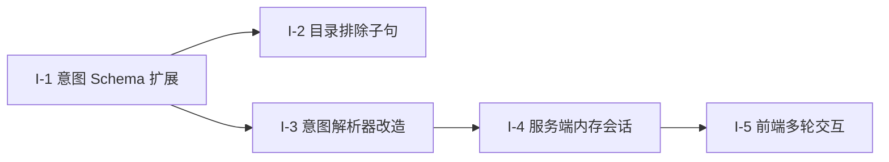

# 意图识别增强模块拆分与交付规范

## 1. 范围与拆分

本次是对 `v0.1.0` M4「AI 助手商品推荐 Agent」的**意图识别子模块增强**，不改变 M4 只读边界。按「契约 -> 数据 -> 后端 -> 前端 -> 联调」拆为 5 个可独立验证任务：

| 编号 | 任务 | 完整链路 |
| ---- | ---- | -------- |
| I-1 | 意图 Schema 扩展 | 扩展 `ProductSearchIntent`（`excludeTerms/excludeBrands/excludeCategories`）并补齐归一化 |
| I-2 | 目录排除子句 | `buildIntentWhere` 增加 `AND NOT (...)`，支持否定/纠错检索 |
| I-3 | 意图解析器改造 | `json_object` → function calling + 分层提示词 + 历史注入 |
| I-4 | 服务端内存会话 | `SessionStore` + 编排层/API 透传 `sessionId` 与历史 |
| I-5 | 前端多轮交互 | 助手面板对话历史区 + `sessionId` 传递 + 意图摘要展示排除条件 |

依赖：I-1 -> I-2 -> I-3 -> I-4 -> I-5；I-1 是 I-2/I-3 的前置，I-4 依赖 I-3 的历史入参，I-5 依赖 I-4 的 API 契约。

## 2. 任务书

### I-1 意图 Schema 扩展

- 需求映射：F-23、D-11；AC-27。
- 后端：`lib/catalog/types.ts` 增加三个可选字段；`lib/assistant-agent.ts` 的 `normalizeIntent` 增加排除字段归一化（去重、长度限制）与「排除优先」规则；`fallbackIntent` 返回空排除字段以保持类型一致。

### I-2 目录排除子句

- 需求映射：F-23、F-26；AC-23、AC-27。
- 后端：`lib/catalog/products.ts` 的 `buildIntentWhere` 追加 `AND NOT (...)`；`searchCatalogProducts` 保持 cursor 分页与稳定排序不变；`listCatalogProducts` 传空排除字段仍正常。

### I-3 意图解析器改造

- 需求映射：F-22、D-10、D-13；AC-22。
- 后端：`lib/assistant-agent.ts` 定义 `INTENT_TOOL`（JSON Schema）、`buildIntentSystemPrompt`（分层提示词）、解析 `tool_calls[0].function.arguments`；删除 `extractJson` 的自由文本抠 JSON 逻辑；保留 `normalizeIntent` 类型/长度/数值归一化与降级 `fallbackIntent`。

### I-4 服务端内存会话

- 需求映射：F-24、F-25、D-12、D-14；AC-24～AC-26。
- 后端：新增 `lib/agent/session-store.ts`；`lib/agent/orchestrator.ts` 增加 `sessionId` 入参与历史透传；`app/api/v1/assistant/search/route.ts` 接受并返回 `sessionId`；`makeIntentSummary` 展示排除条件。

### I-5 前端多轮交互

- 需求映射：F-24、F-25；AC-24～AC-26。
- 前端：`AssistantDocker` 增加 `AssistantHistory`；`AssistantComposer` 携带并缓存 `sessionId`；`SearchResultList` 成组展示「意图摘要 + 结果」；刷新/关闭重置会话提示。

## 3. 测试用例

| 编号 | 层级 | 前置数据 | 操作步骤 | 预期结果 | 关联 |
| ---- | ---- | -------- | -------- | -------- | ---- |
| I-T01 | 单元 | 意图解析器可用 | 输入「要蓝牙耳机但不要白色」 | 返回 `keywords=[蓝牙耳机]`、`excludeTerms` 含「白色」，不把「白色」当正向词 | AC-23 |
| I-T02 | 单元 | 同上 | 输入「找不是苹果的手机」 | `excludeBrands` 含「苹果」，`keywords` 含「手机」 | AC-23 |
| I-T03 | 单元 | 同上 | 输入「那个有没有黑色」（带历史：上一轮「蓝牙耳机」） | 正确把「那个」消解为「蓝牙耳机」，`specTerms`/关键词含「黑色」 | AC-24 |
| I-T04 | 单元 | 同上 | 输入「再加个蓝牙耳机」（带价格/品牌历史） | 输出合并后的意图，继承上一轮价格/品牌过滤 | AC-25 |
| I-T05 | API | 目录有可排除商品 | `POST /api/v1/assistant/search`，`query` 含否定 | 结果不含被排除项，`intentSummary` 含「排除：…」，返回 `sessionId` | AC-23、AC-26 |
| I-T06 | API | 同一 `sessionId` 连续请求 | 第一轮查询后携带 `sessionId` 再发指代/继承查询 | 第二轮正确消解/继承，不串到其他 `sessionId` | AC-24、AC-25 |
| I-T07 | 集成 | 无 `sessionId` | 首次请求 | 服务端新建会话并返回 `sessionId` | AC-26 |
| I-T08 | 页面 | 助手面板打开 | 连续发送多轮否定/纠错/继承 | 历史区逐轮展示意图摘要，结果区同步更新，输入区固定底部 | AC-24～AC-26 |
| I-T09 | 页面 | 窄窗口/200% 缩放 | 打开助手面板并多轮交互 | 无横向溢出，历史/结果/输入三段滚动互不干扰 | 布局验收 |

## 4. 可执行验证

- 修改后运行 `npm run typecheck`、`npm run lint`；按需 `npm run build` 验证 `.next` 与 `.next-dev` 输出隔离。
- 关键 API 验证：`POST /api/v1/assistant/search` 的否定/纠错/多轮与降级路径；`GET /api/v1/products` 等目录接口回归。
- 页面验证：优先 Playwright 覆盖 I-T08/I-T09；纯后端变更执行 API/集成测试并说明页面不适用原因。

## 5. Review 重点

- 工具调用解析不信任自由文本 JSON，仍对 `arguments` 做类型/长度/数值归一化；模型不可用时降级不阻塞搜索。
- 排除子句全部走参数绑定，不把模型返回文本拼进 SQL；`exclude*` 为可选，缺失不回归。
- 内存 session 只存结构化摘要，不存未脱敏评论/排序分数/账户信息；容量、TTL 与多实例限制在代码注释与文档明示。
- 前端不自行解析否定/纠错，只回显服务端 `intentSummary`；不把内部权重或订单状态放进前端状态。
