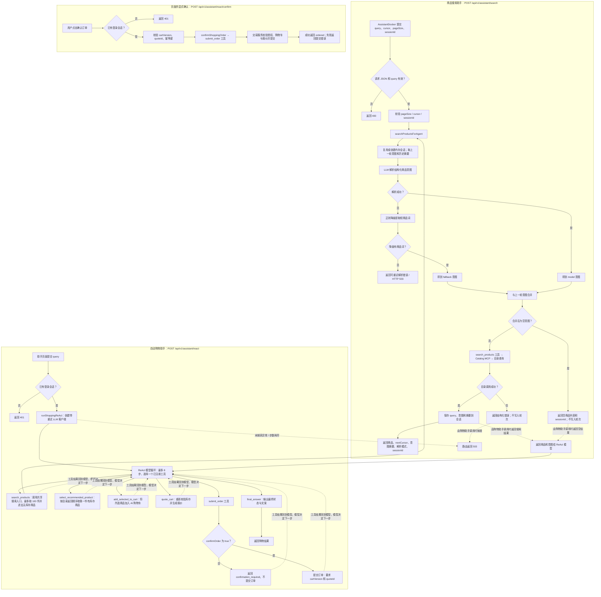

# 两个助手入口的当前逻辑

本文按当前实现梳理 `search-products-agent.ts` 与 `auto-shopping.ts` 的入口、共用逻辑及下单路径。

## 总览流程

## 两个入口的职责

- **商品搜索入口**是确定性编排：会话上下文 → 意图解析（模型优先、正则降级）→ 意图合并 → 空意图短路或调用目录工具 → 成功时记录会话。它不加购、不报价、不下单。
- **自动购物入口**是 ReAct 编排：模型在每一步观察工具结果，再决定调用哪个工具；商品搜索通过 `searchProductsForAgent` 复用上面的搜索链路，之后可选商品、加购、报价，最后调用 `final_answer` 结束。
- 两者最终都通过 `invokeAgentTool` 和 MCP 工具层访问目录或交易服务；模型不直接访问数据库。

## 读代码时需要注意的现状

1. 搜索助手的会话保存在服务端进程内存中，最多保留最近 5 轮，30 分钟过期，最多 1000 个会话；进程重启或多实例切换可能丢失上下文。只有成功的非空搜索会写入一轮。
2. 意图合并发生在空意图判断之前。本轮没有新商品、品类、品牌词时会继承上一轮检索主体；因此复用同一 `sessionId` 时，闲聊式空意图也可能被合并成上一轮搜索。当前助手页面则没有跨轮保留或回传购物 `sessionId`。
3. 购物助手只请求目录第一页的最多 100 件候选，再取其中“第一件有库存”的商品；目录返回顺序由服务端排序决定，并不按价格选最低价。页面初始问候语所说的“挑选低价商品”与当前选择实现不一致。
4. ReAct 系统提示要求加购 1 件，但工具参数 schema 允许数量 1–10，执行函数本身没有把数量固定为 1。
5. 页面调用 `/react` 时只发送 `query`，未发送 `confirmOrder`，所以该路径实际按 `false` 运行并展示报价确认。用户点击确认后，页面走独立 `/react/confirm` 接口下单。仅传 `confirmOrder: true` 才会让 ReAct 中的 `submit_order` 工具尝试直接提交。
6. `needs_login`、`needs_authorization` 等状态出现在最终结果类型中，但 ReAct 路由先拦截未登录；交易工具的授权或报价失败会抛出异常并由路由作为失败响应处理，当前实现没有把这些错误统一转换成对应的最终状态。
7. ReAct 每轮最多 8 步，包含结束用的 `final_answer` 调用；模型传输调用有重试，实际有副作用的工具默认不会因执行错误自动重跑。搜索工具显式标记为可重试。
8. 搜索、选择、加购、报价和下单不是代码强制执行的固定流水线；模型根据系统提示在每步选择工具，工具只对部分前置条件做校验。图中的工具是预期路径，实际调用顺序由 ReAct 模型决定。

## 代码入口

- `app/api/v1/assistant/search/route.ts` → `lib/agent/search-products-agent.ts`
- `app/api/v1/assistant/react/route.ts` → `lib/agent/auto-shopping.ts` → `lib/llm/react.ts`
- `app/api/v1/assistant/react/confirm/route.ts` → `lib/agent/auto-shopping.ts` 的 `confirmShoppingOrder`
- 共用目录入口：`lib/agent/tool-registry.ts` → `lib/mcp/tool-calls.ts` → MCP Server / 目录或交易服务
