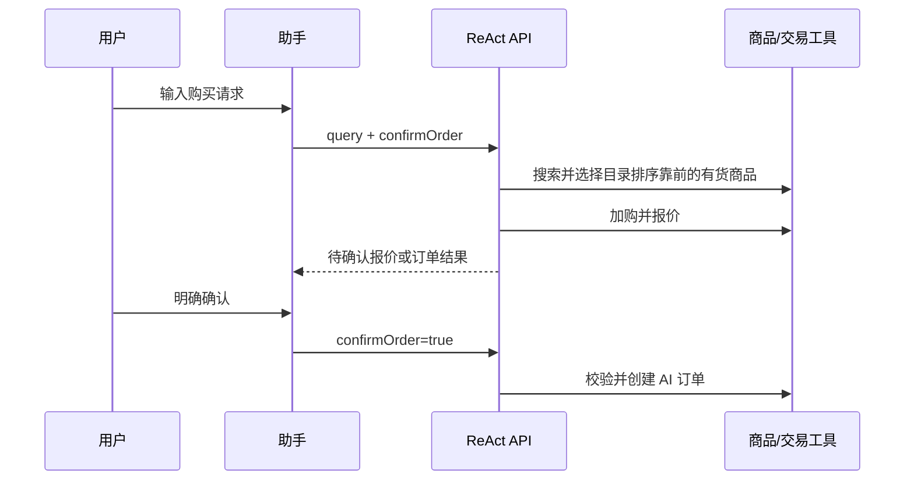

# 前端交互与技术文档

## 页面目的

在桌面浏览器的助手面板中展示 ReAct 执行过程、候选商品、目录推荐顺序下的选品、购物车报价和最终订单状态。

## 桌面布局与线框

```text
+------------------------------------------------------------------+
| 商品商城头部                                                     |
+----------------------+-------------------------------------------+
| 助手对话区           | 执行结果区                                |
| 用户输入             | 搜索候选商品                              |
| 工具调用状态         | 推荐优先商品与库存                        |
| 确认下单按钮         | 购物车报价 / 订单结果                     |
+----------------------+-------------------------------------------+
```

内容使用居中的桌面宽度容器，左右分栏在窗口缩放时保持最小宽度；文本、价格和状态允许换行，工具状态不得遮挡商品操作。顶部导航吸顶，结果区可独立滚动。

## 状态

提供加载、空结果、工具失败、未登录、未完成 AI 授权、报价过期、库存变化、处理中和下单成功状态。下单确认前显示商品、数量、运费、折扣、总价和报价有效期。

## 交互流程


