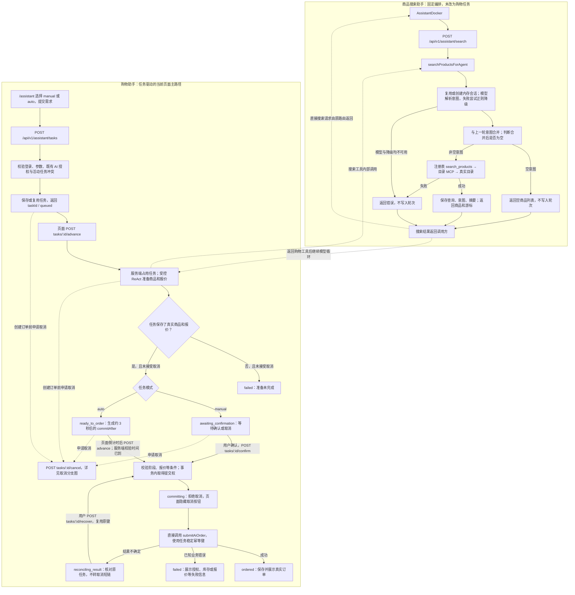
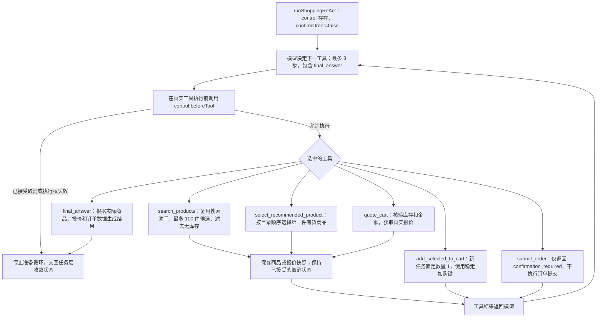
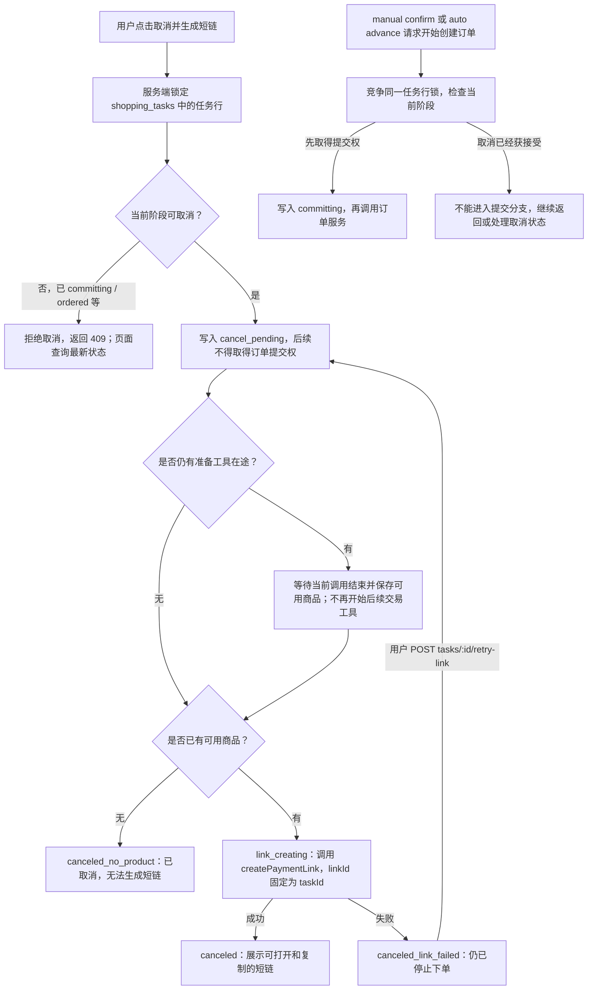

# 两个助手的当前流程图（v0.4）

核对日期：2026-11-20。本文依据当前代码，取代 v0.3 的“当前逻辑”说明；只描述已实现行为。

## 相比旧图需要更新的内容

| 位置 | 旧图 | 当前实现 |
| --- | --- | --- |
| 页面购物入口 | `/assistant` 调用 `/react`，等待最终响应 | 创建数据库任务，独立查询进度，使用动作接口推进/确认/取消 |
| 搜索助手 | 解析意图、合并上下文、查询目录 | 主逻辑不变，继续被购物助手的搜索工具复用 |
| ReAct 职责 | 模型可通过工具直接尝试下单 | 新任务传入 control；ReAct 只准备商品和报价，订单工具不执行下单 |
| 确认策略 | 页面调用旧 `/react/confirm` | manual 等待任务 confirm；auto 报价展示约 3 秒后由页面自动请求 advance |
| 取消 | 页面拿到结果后用商品生成短链 | 服务端按任务阶段接受取消，与创建订单互斥，再生成短链 |
| 实际下单 | 经工具注册表和交易 MCP 调用 | 新任务先原子迁移为 committing，再直接调用 `submitAiOrder` |
| 状态与恢复 | 搜索内存会话、单次购物响应 | 搜索会话仍在内存；购物任务持久化，支持恢复、短链重试及原订单结果核对 |

## 两个助手与当前页面的总览

图中省略登录/参数校验失败的返回节点：未登录返回 401、参数无效返回 400、创建任务时授权不足返回 403、已有其他活动任务返回 409。相同创建幂等键和相同需求重试会返回原任务。

搜索图中的历史记忆仅用于搜索意图；数据库购物任务的 taskId 不等同于搜索 sessionId。当前新任务准备调用未透传 sessionId，不据 taskId 自动建立多轮搜索上下文。

## 受控 ReAct 内部：模型决策与服务端检查

- 这些工具仍由模型逐步选择，并非服务端强制按图中文字顺序执行。工具有各自的前置校验；任务模式缓存已完成的加购和报价结果，避免模型重复调用导致重复修改。
- 搜索结束时就保存第一件有货候选，供提前取消时生成短链；选品工具仍负责确定实际购买商品。目录优先次序不等于最低价排序，页面欢迎语已与此一致。
- 搜索、加购、报价经 `invokeAgentTool → tool-calls → MCP Server` 调用。新任务的订单和取消短链由任务服务直接调用领域服务，因此不能再沿用旧图“两者所有业务都经 MCP”的概括。
- 准备请求设置 90 秒中止信号；每个工具前检查取消，不会仅凭取消浏览器请求假定已撤销在途业务操作。准备结束后任务层依据保存的真实商品/报价推进阶段，不仅依赖模型文案。

## 取消、创建订单的边界与短链分支

重复取消会返回当前取消状态；已经在途的搜索/加购/报价不会被当作瞬时回滚。当前取消不会额外清空 AI 购物车或释放库存，保留既有预留过期规则；生成短链不承诺继续使用原报价。

取消与提交通过同一行的事务锁互斥，不依赖前端按钮是否及时隐藏。页面收到 committing 后隐藏取消，手动点击确认或自动提交请求正在发出时也会先隐藏取消；取消请求在途时暂停本地自动提交计时。

## 进度、离页与异常恢复

- 页面所有接口继续使用封装的 `request`。每约 800ms GET 查询快照，不在 GET 中执行下单；`canCancel/canConfirm/canAdvance/canRecover` 均来自服务端。
- POST 创建任务只保存 queued 记录，随后 POST advance 等待准备实际完成；自动模式到时间后由页面再次 POST advance。当前实现没有独立后台定时下单执行器。
- 离页后不再发送后续推进请求；在途准备仍可完成并保存报价，在途订单仍可能完成。恢复的自动任务在前端暂停，点击“继续执行”后才恢复推进；manual 待确认状态继续等待确认。
- 轮询失败停止自动推进，显示重新连接入口；不会据此把订单认定为失败或已取消。不同来源的响应按 revision 丢弃旧快照。
- 已知订单业务错误进入 failed；未知结果进入 reconciling_result，并保留活动任务。核对/恢复使用 `shopping:taskId:order` 原幂等键，不新建购买请求。
- 执行占用超过 120 秒时：准备阶段不自动重放副作用操作；创建订单阶段仅允许按原幂等键恢复；中断的短链创建可按同一 taskId 查回已有链接或恢复生成。

## 旧接口仍存在，但不再是页面主路径

| 入口 | 当前保留行为 |
| --- | --- |
| POST `/api/v1/assistant/react` | 登录后检查是否有活动任务，有则 409；否则沿用无 control 的 ReAct 逻辑，只有 confirmOrder=true 才可尝试调用订单工具。 |
| POST `/api/v1/assistant/react/confirm` | 沿用旧报价确认参数，最终经过订单工具；交易 MCP 拒绝提交新任务绑定的报价。 |
| POST `/api/v1/assistant/order` | 通用 AI 下单接口也受任务报价检查约束，不能绕过任务取消/提交状态。 |

## 代码对照

- 页面与请求：`app/assistant/api.ts`、`app/assistant/use-assistant.ts`、`assistant-composer.tsx`。
- 任务路由：`app/api/v1/assistant/tasks/route.ts`、`tasks/[taskId]/route.ts`、`tasks/[taskId]/[action]/route.ts`。
- 任务状态与互斥：`lib/agent/shopping-task-types.ts`、`shopping-task-store.ts`、`shopping-task-service.ts`。
- 两个助手：`lib/agent/search-products-agent.ts`、`lib/agent/auto-shopping.ts`；ReAct 循环位于 `lib/llm/reAct.ts`。
- 实际下单与短链：`lib/order-service.ts`、`lib/payment-link/payment-link-service.ts`；旧接口任务报价检查位于 `lib/mcp/commerce-server.ts`。

相关说明：[后端技术文档](backend-technical.md)、[实现与验证记录](implementation-verification.md)。
