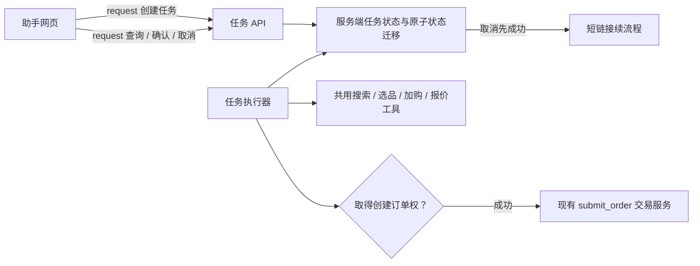

# 后端技术文档：购物助手双模式

状态：设计建议，尚未实施。不修改现有业务代码、数据库迁移或测试。

## 当前实现的约束

- `runShoppingReAct` 当前用单个 HTTP 请求完成多轮模型与工具调用，页面只能等最终响应，不能得知真实的下单起点。
- 当前 `confirmOrder` 可阻止订单工具提交，但仅把它设为 true 不能提供运行中取消、稳定进度或取消与提交互斥。
- 当前页面取消逻辑根据最新消息里的商品生成短链；运行中的任务可能还没回传商品。新流程需由服务端任务保留选品快照，按 taskId 取消。
- 现有 `runReAct` 的 `tool_call` 事件是在 `client.invoke` 返回后发出，而该调用内部已经执行工具。不能用这个事件作为“订单工具尚未执行”的取消屏障。
- 当前 `final_answer` 的订单字段来源是其参数，但 schema 没有订单参数，提交工具结果也没有被外部变量保存。新方案需把真实 order 写入任务快照，避免模型报告 ordered 却没有订单数据。

## 推荐架构

采用“同一任务编排器 + 两种提交策略 + 短轮询”。同步 HTTP 拆成创建任务与查询任务，不为两种模式复制工具和交易代码。

- 业务屏障在编排器和工具执行入口中强制检查，不交给模型决定授权、取消或状态迁移。
- ReAct 可继续用于搜索与选品等工具决策，但取消检查必须置于真实 `execute` 前；`submit_order` 统一经过确定性的提交屏障。模型提前结束不能把任务伪造为成功。
- 演示版可用单实例任务执行器配合数据库任务记录，无需先引入通用消息队列或 SSE。部署若会冻结/终止请求外任务，则必须采用可靠执行器，不能只启动未等待的 Promise 后返回响应。
- 单实例内存任务仅适合明确不要求刷新/进程恢复的临时原型，不作为下单互斥和可靠恢复的正式方案。

## 任务模型建议

任务保存：taskId、userid、mode（manual/auto）、phase、revision、选定商品和数量快照、cartVersion、quote/quoteId、commitAfter、order、短链结果、错误信息、稳定幂等键和时间戳。

进度阶段建议：`searching → selecting → reconciling → quoting → awaiting_confirmation(manual) / ready_to_order(auto) → committing → ordered`。

取消分支：任一可取消阶段 → `cancel_pending → link_creating → canceled / canceled_link_failed`；没有商品则 `canceled_no_product`。订单结果不确定时为 `reconciling_result`，不进入可取消状态。

`canCancel`、`canConfirm` 和最终业务状态由服务端从任务记录推导；客户端不可自行覆盖。

## 取消与提交的核心互斥

1. 自动模式报价后写入 `ready_to_order` 和 `commitAfter`；手动模式写入 `awaiting_confirmation`。等待时长建议约 3 秒，标记为 `needs_human_review`，由服务端执行器推进。
2. 自动提交须时间已到；手动提交须存在有效确认请求。两者都使用带 phase/revision/所有者条件的原子更新竞争迁移到 `committing`。
3. 取消接口使用同样的原子机制，只从可取消阶段迁移到 `cancel_pending`。提交和取消至多一个成功，禁止“先读状态再无条件更新”的竞态实现。
4. 订单工具只在成功取得 `committing` 状态后执行；从此拒绝取消。前端根据最新快照隐藏按钮，即使页面尚未刷新也由后端保证拒绝。
5. 取消已获接受的任务，执行器只能推进取消分支。进行中的搜索/加购/报价返回后不能用旧快照覆盖 `cancel_pending`，也不能再进入下单分支；使用 revision 或阶段条件写回工具结果。
6. 副作用工具执行前检查状态；已经在途的工具不能因取消或 AbortSignal 被假定回滚。等待其完成并记录结果，再执行需要的取消清理。
7. 提交超时或崩溃可能已创建订单，进入结果核对流程，沿用原订单幂等键查询/恢复；禁止再生成一套新键重新购买。`committing` 后即便提交最终失败，也不自动恢复自动提交或取消短链，需明确的新交互。

## 取消时如何生成短链

- 已选品：冻结取消成功时的商品/数量快照，确认不会进入订单分支，再通过现有支付短链服务生成链接。
- 搜索/选品中：先接受取消并阻止后续交易步骤；允许当前只读搜索完成并确定商品后生成短链。若搜索失败或没有可用商品，结束为取消但无短链，不虚构商品。
- 加购/报价中：等待在途调用完成，按已审定的库存/购物车清理规则收敛后生成短链；清理规则仍属 `needs_human_review`。
- 短链生成要按任务去重，失败可单独重试；重试不得恢复原自动购物任务。链接创建和取消落库之间的崩溃恢复需可查回已有结果。

## 接口建议（新增方案，非现有契约）

| 方法与路径 | 输入 | 行为 |
| --- | --- | --- |
| POST `/api/v1/assistant/tasks` | query、mode、idempotencyKey | 创建任务，返回 202 和 taskId/快照；同键重试返回同任务。 |
| GET `/api/v1/assistant/tasks/:id` | taskId | 返回 phase/revision、可用操作、商品/报价/订单/短链及 commitAfter。 |
| POST `/api/v1/assistant/tasks/:id/cancel` | idempotencyKey | 仅可取消阶段接受并返回 202；已取消重放当前结果，已 committing/ordered 返回 409 及最新阶段。 |
| POST `/api/v1/assistant/tasks/:id/confirm` | quoteId、cartVersion、idempotencyKey | 仅 manual 且待确认，校验绑定报价和版本后竞争提交权。 |
| POST `/api/v1/assistant/tasks/:id/payment-link/retry` | idempotencyKey | 只允许取消后短链失败的任务重试生成；复用任务级短链操作标识。 |

所有接口校验当前用户与任务归属；创建任务与副作用动作有稳定幂等键，GET 只读。任务模式创建后不可修改。原 `/react`、`/react/confirm` 如何保留兼容需实施时统一；新任务不得绕开任务屏障调用旧确认入口重复提交。

## 保留的业务边界与评审项

- 沿用现有登录与 AI 下单授权门禁、购物车来源与版本、报价有效期、库存和订单幂等校验；自动模式不跳过交易校验，不引入资金扣款。
- 自动授权语义、库存释放、短链费用有效性、任务保留和页面断开策略均见需求文档 `needs_human_review`，不在本方案中视为已批准。
- 演示时同一用户建议最多一个活动购物任务，避免现有按用户划分的 AI 购物车被并发任务互相改写；具体并发限制作为实施方案评审。
- 需验证：取消/提交竞争、重复请求、工具在途取消、报价过期、无商品、授权不足、短链失败、创建任务登录重试、刷新恢复，以及订单已提交但响应丢失。订单真实成功优先于模型文案，状态必须由实际工具和任务记录生成。
