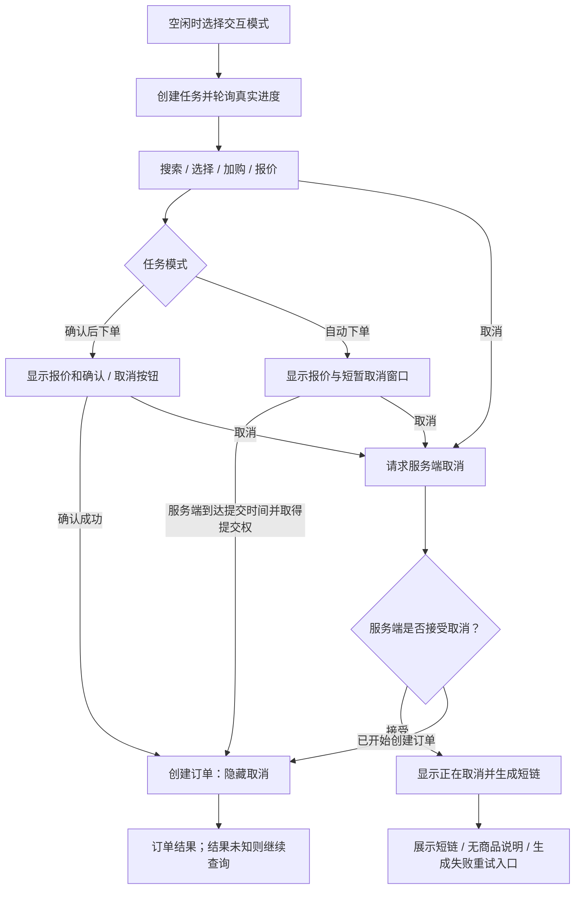

# 前端交互与技术文档：购物助手双模式

状态：核心交互已实施（2026-11-20）。页面保留原有样式，主容器沿用 1160px，流程栏沿用 270px；以下布局建议中的扩展尺寸不作为本次额外改版内容。

当前实现使用 `request` 创建任务、每 800ms 只读查询进度、单独 POST 推进任务；查询与取消可在准备请求尚未返回时执行。恢复自动任务默认暂停，用户点击“继续执行”才恢复推进；轮询失败停止自动推进并提供“重新连接”，避免反复弹出错误。报价展示 3 秒后自动推进，进入创建订单阶段隐藏取消按钮。

## 页面目的与信息顺序

沿用桌面 `/assistant` 页面：标题和模式选择 → 当前任务进度 → 商品/报价或最终结果 → 取消/确认操作 → 输入框。右栏继续展示流程，突出当前阶段。

## 布局线框

```text
+--------------------------------------------------------------------------+
| AI 助手       [确认后下单 ○ | 自动下单 ●]                 在线  重新开始   |
| 自动模式：将自动创建订单；进入创建阶段后不能取消                           |
+--------------------------------------------------+-----------------------+
| 对话与结果区                                     | 购物流程              |
| 用户：帮我买一款咖啡                             | 1 搜索商品      已完成 |
| 商品：名称、价格、品牌、分类、描述、规格、库存评价 | 2 选择商品      已完成 |
| 报价：币种、商品金额、折扣、运费、应付、数量       | 3 加购与报价    已完成 |
| 状态：即将自动创建订单，剩余 3 秒                 | 4 创建订单      待开始 |
|                                                  | 当前模式：自动下单    |
+--------------------------------------------------+                       |
| [取消并生成短链]  手动模式此处另有 [确认下单]      |                       |
| 创建订单阶段：按钮区改为“正在创建订单…”           |                       |
| [描述你想购买的商品…                         发送]|                       |
+--------------------------------------------------+-----------------------+
```

- 模式开关在标题区域；任务开始后禁用。重新开始不应暗中取消仍在执行的服务端任务；运行中禁用重置，允许查回当前任务。
- 当前阶段显示在最新消息/报价附近；取消按钮位于输入框上方的固定操作区域，避免消息增长后找不到。
- `committing` 时立即隐藏取消/确认按钮，显示“正在创建订单，请勿重复操作”。若取消响应表明已开始创建，即使轮询画面落后，也立即更新本地状态并拉取任务。
- 短链展示于对话结果中，保留打开和复制入口。订单结果显示真实订单编号；创建订单不应标注为支付成功。
- 商品卡片展示已有的品牌、分类、描述和全部非空规格，底部展示库存、评分、评价数量与“查看完整详情”入口；缺少的数据不编造，长内容换行。
- 应付总额及币种置于报价卡片显著位置，明细列出商品金额、折扣、运费和数量，不展示报价有效期。自动展示期金额仍可见，自动下单倒计时不受影响。

## 桌面窗口、滚动与遮挡

- 延续现有页面样式，建议主容器最大宽度 1280px；可用宽度足够时采用 `minmax(0, 1fr) 280px` 双栏，间距 24px。窗口收窄导致对话区不足约 560px 时，将说明栏折叠成顶部流程摘要；这属于桌面窗口调整，不新增移动端方案。
- 对话正文允许换行，长 URL 使用 `overflow-wrap:anywhere`；左右子项设置 `min-width:0`，防止长商品名、金额或错误文案撑出横向滚动。
- 输入和操作区固定在对话面板底部，消息容器独立滚动并预留操作区空间；沿用商城头部吸顶约束，不让新增区域覆盖头部、报价或最后一条消息。
- 模式栏和侧栏可在页面范围内 sticky，但其 top 偏移必须考虑既有商城头部；不添加全屏遮罩阻挡取消按钮。

## 交互与状态



| 状态 | 页面反馈和操作 |
| --- | --- |
| 初始/空数据 | 欢迎语和推荐问法；模式开关可用。 |
| searching / selecting | 显示真实阶段，可取消；取消后可能等待当前只读搜索结束以确定短链商品。 |
| reconciling / quoting | 显示处理中，可申请取消；已经在途的交易操作须由服务端收敛后再完成取消，不承诺瞬时回滚。 |
| awaiting_confirmation | 手动模式显示报价、确认和取消。 |
| ready_to_order | 自动模式根据服务端 `commitAfter` 显示剩余时间及取消；前端倒计时只负责展示，不负责定时触发下单。 |
| cancel_pending / link_creating | 禁用重复取消及新任务输入，显示取消处理或短链生成进度。 |
| committing | 隐藏取消，禁用模式切换、重新开始和新任务输入。 |
| ordered | 展示订单结果，恢复新任务入口。 |
| canceled / canceled_no_product | 展示短链或无商品提示，明确没有通过此任务创建订单。 |
| canceled_link_failed | 明确已停止下单，提供“重试生成短链”，不自动恢复购物任务。 |
| failed / no_results | 明确具体失败或无商品，允许重新发起；如结果尚未知，使用单独的核对状态。 |
| reconciling_result | 查询订单实际结果，隐藏取消，避免误导用户重复提交。 |
| 权限不足/未登录 | 401 沿用登录重试；授权不足展示现有授权入口，不将模式选择当作授权。 |
| 轮询失败 | 标注“进度暂不可用，正在重连”，保留 taskId；不得把网络失败当作已取消或下单失败。 |

## 与现有前端拆分的对应

- `api.ts`：继续使用 `@/lib/auth/auth-retry` 中的 `request`，增加创建任务、查询任务、取消任务、确认任务、重试短链方法。
- `use-assistant.ts`：保存 mode、taskId 和服务端快照，替代仅靠 `busy/pendingConfirmation` 推断流程；轮询建议 500–1000ms，卸载时停止轮询但不假定服务端任务已取消。
- 登录重试时必须复用创建任务/取消/确认的原幂等键；轮询同一任务只保留一个在途请求，以版本号忽略旧响应，并在终态停止轮询。
- `assistant-composer.tsx`：按服务端 `canCancel/canConfirm` 和阶段渲染操作区；取消不再因全局 `busy` 而不可点。取消请求本身另设 `canceling` 锁。
- `assistant-messages.tsx`：展示阶段、报价、短链和订单结果；`shopping-workflow.tsx` 展示当前步骤。
- 模式相关授权、自动展示期时长、离页行为及库存/费用规则见需求清单 `needs_human_review`，不在前端自行定案。
