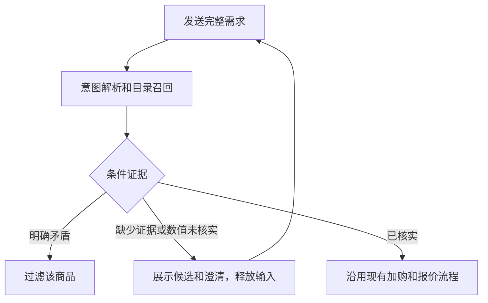

# 前端交互与技术文档：通用商品检索意图

日期：2026-11-20。仅桌面网页 `/assistant`，沿用现有组件与主题。

## 页面目的与区域

页面用于输入购物需求、查看真实候选及费用、澄清未核实条件，明确后进入现有购物流程。信息顺序：商城导航 → 助手标题/在线/模式/重置 → 用户需求 → 候选商品 → 未核实条件或报价 → 输入与任务操作。

```text
+------------------------------------------------------------------------+
| 商城导航                                                               |
+------------------------------------------------------------------------+
| AI 助手 / 在线                       [交互模式]              [重置]    |
+----------------------------------------------------+-------------------+
| 用户需求                                           | 购物流程          |
| 候选商品：名称、品牌、价格、描述、实际规格           | 当前阶段          |
| 尚未核实的必需条件/偏好；要求补充完整需求            |                   |
| 或：明确条件已满足，展示现有报价/费用和任务操作      |                   |
|                                                    |                   |
+----------------------------------------------------+                   |
| [完整购物需求输入]                         [发送]   |                   |
+----------------------------------------------------+-------------------+
```

主要操作仍为发送完整需求、确认/取消现有任务、重置。未知条件提示位于候选商品上方的助手消息中，规格位于商品卡片；应付金额、优惠、运费继续放在现有报价区域。澄清阶段无报价、确认下单或倒计时。

## 交互与状态



加载和处理中使用既有进度消息并禁用重复提交；空数据明确没有匹配的有货商品；失败保留已有错误区；权限不足沿用登录/授权入口。模型评估失败视为条件未知，展示澄清，不宣称匹配。

## 桌面窗口和防遮挡

保持当前导航吸顶、主区域占满剩余视口、标题单行居中和双栏结构，不新增移动端适配。主内容宽度随桌面窗口变化，对话栏使用可收缩网格，说明栏沿用现有宽度；窗口收窄沿用既有规则。本次不修改分栏、栅格或吸顶样式。

消息区独立滚动，输入区保持可见。长条件、商品名和规格遵守现有 min-width:0 与换行规则，不新增悬浮层，不以整页横向滚动展示条件；费用和任务操作不得被新增消息遮挡。
